# NXTSteps Product & Architecture Design

**Student-controlled transition planning, and a fair, safety-aware way to pair students with roles**

| Field | Value |
| --- | --- |
| Document title | NXTSteps Product & Architecture Design |
| Company | NXTSteps LLC · Westport, Connecticut |
| Contact | thomas@nxtsteps.dev |
| Author | Product & engineering design (draft for founder and implementation team; revised to make pairing, safety, snapshots, and employer IAM implementable) |
| Date | 2026-10-27 |
| Status | **Draft (revised after founder answers + HIPAA/JWT requirements, 2026-10-27)** |
| Audience | Founder / product owner, and the software team that will build production NXTSteps |
| Related live systems | Pilot/demo at [https://app.nxtsteps.dev/](https://app.nxtsteps.dev/); marketing at [https://nxtsteps.dev/](https://nxtsteps.dev/) |
| Repo state | Greenfield. The git workspace is empty. This document is the production plan, not a description of an already-shipped pairing engine. |

**How to read this document**

- **If you are the founder:** read Overview, Background, Goals, Key Decisions, Product Model, Pairing Hypothesis (the story and examples), Safety, Appendix K (what to say at Greenleaf), SaaS & Billing, Rollout. Skip the formulas.
- **If you are an engineer:** implement from Key Decisions, Architecture, Data Model, APIs, **Appendices A–L** (scoring, gates, field matrix, IAM, RLS), Security, Observability, and the PR Plan. Do not invent a scoring shortcut.
- This is **not** a claim that the live app already does rich pairing. Today's NXTMatch uses interests, location, transportation, and experience only. This document is how we productize a stronger, safer pairing model **on top of that public promise**, without breaking it.
- **Plain-language glossary:** *fail closed* = if we are missing a safety fact, we do not send the student; *WSP* = Workplace Success Profile, the only packet an employer can see; *Stage A* = the public NXTMatch board; *Stage B* = the private “should we actually apply?” check; *JWT* = a signed login ticket that expires in 15 minutes; *HIPAA* = the US health-privacy law whose security rules we implement (we are not a doctor’s office).

**Language choice.** The request described “special needs students.” In the body of this document we say **students with disabilities**, **transition-age students**, and **support needs**. “Special needs” is widely heard as othering; the product is about people, skills, environments, and supports. We still fully answer the pairing, safety, and evaluation request.

---

## Table of contents

1. [Overview](#overview)
2. [Background & motivation](#background--motivation)
3. [Goals & non-goals](#goals--non-goals)
4. [Key decisions](#key-decisions)
5. [Product model](#product-model)
6. [Pairing hypothesis](#pairing-hypothesis)
7. [Safety as a first-class subsystem](#safety-as-a-first-class-subsystem)
8. [Architecture](#architecture)
9. [Working with a development team](#working-with-a-development-team)
10. [Data model & domain class catalog](#data-model--domain-class-catalog)
11. [API / interface design](#api--interface-design)
12. [SaaS tenancy, billing, and environments](#saas-tenancy-billing-and-environments)
13. [Security, privacy, and threat model](#security-privacy-and-threat-model)
14. [Observability](#observability)
15. [Rollout plan](#rollout-plan)
16. [Alternatives considered](#alternatives-considered)
17. [Open questions](#open-questions)
18. [References](#references)
19. [Risks](#risks-explicit)
20. [PR Plan](#pr-plan)
21. [Appendices A–N](#appendix-a--stage-a-discovery-scoring-normative) (normative engine, IAM, RLS, JWT, HIPAA, founder one-pager)

---

## Overview

NXTSteps is a student-controlled platform for the years when school, family, counselors, nonprofits, and employers all need to pull in the same direction — and usually do not. A student (or an authorized parent/guardian, while the student is a minor) keeps **one shared profile and plan**. Teachers, mentors, vocational counselors, and providers join only by invitation. Employers and organizations **never browse or search student profiles**. Opportunities come to the student; the student is not a listing in a talent marketplace.

The live pilot already shows the product shape: a family dashboard, NXTNetwork, NXTPath/NXTPlan, NXTMe, NXTMatch, messages, a private document locker (uploads currently restricted), and NXTBridge for graduation handoff. What it does **not** yet do — and what this design defines — is a pairing model that can look a student and a real workplace in the eye and say, honestly, “this is a strong fit,” “this could work if these supports are in place,” or “this is not safe, and here is a better next step.”

The proposed production system is a **three-tier SaaS**: PostgreSQL as the system of record, a TypeScript API as the application layer, and a Node.js (Next.js) front end. Matching stays **strengths-first and environment-fit**. It never turns a diagnosis into a score. Safety is dual: the student must be safe in the workplace, and the employer’s staff and customers must be safe too. Restricted information (behavior-risk protocols, incident history, IEP content, diagnoses if ever stored) is **fail-closed** and **never shown to an employer** unless the student or authorized guardian explicitly shares a Workplace Success Profile for that application, and a human on the student’s team reviews the share.

That is the whole product in two sentences: **one student-owned plan, and a pairing process both sides can believe.**

---

## Background & motivation

### The problem families actually have

Support for transition-age students is real and also scattered. A parent in Westport might be emailing a transition coordinator, a vocational counselor, a nonprofit job-readiness program, and a grocery store that “is open to inclusive hiring,” while the student is trying to remember which form is due and whether they can ride the #10 bus. Official records live at the school. Job leads live in someone’s inbox. Safety information, if it exists, is whispered, overstated, or left out entirely — which helps no one.

NXTSteps exists because that fragmentation is the product problem. The company is **not** a school of record, **not** a vocational rehabilitation agency, **not** a job-placement firm, and **not** a diagnostic service. It is infrastructure that lets the people who already do the work share one student-controlled plan.

### What the live pilot already proves

The pilot at `app.nxtsteps.dev` (demo student **Alex Lee**, Westport, CT, Class of 2027) already encodes the product ethics:

- Access is invite-only. An invite is bound to one email. The invitee must sign in with that email and accept before seeing the plan.
- Student information is not searchable by employers or unrelated organizations.
- NXTMatch copy today: *“Matches use interests, location, transportation and experience only — never diagnoses or disability information.”*
- Documents: employers never see them; NXTSteps does not read, summarize, or send documents to AI tools. Medical records, SSN, and financial records are not to be uploaded.
- Age of majority: NXTSteps does not assume a parent keeps authority at 18.
- Legal documents are **drafts**, not effective policy. Sensitive uploads, document sharing, and school-record transfers remain disabled.

That ethics must survive a richer pairing engine. The temptation, once you have safety data, is to rank students by risk or disability. This design refuses that.

### Pain points the production system must remove

1. **The demo is not a durable architecture.** The repo is empty; the pilot cannot be the production system of record for real families, schools, or employers.
2. **Interest-only matching is fair but incomplete.** Alex matching Greenleaf Grocers because of “retail + Westport + bus” is a good start. It does not tell Greenleaf whether the floor is loud, whether a job coach is expected, or whether unsupervised back-room work is a bad idea. It also does not protect a café from a role that is a poor sensory or customer-intensity fit, or protect a student from a placement that will fail publicly.
3. **Safety is currently tribal knowledge.** If it is not in the product, it will be handled in side emails — which is how both discrimination and accidents happen.
4. **Trust will break if pairing feels like a black box.** A 90% badge without “why” will not convince a cautious employer or a proud student.
5. **Schools, families, nonprofits, and employers are different customers** sharing one student graph. Tenancy, billing, and permissions have to be designed for that, not bolted on.

### Current state (2026-10-27)

| Area | Live pilot | This design |
| --- | --- | --- |
| Product surfaces | Dashboard, NXTMe, NXTPath, NXTMatch, Messages, Documents, NXTBridge, Settings | Same surfaces, productionized, with pairing and safety as real subsystems |
| Matching | Interests, ZIP/distance, transportation, experience, org type, disability-friendly **listing** flag. **Note:** `/demo` recommended cards show 90% for Workshop/Greenleaf/Bean & Leaf; `/demo/match` shows 80/80/65 for the same three. Production copies `/demo/match` (Appendix A). | Keep Stage A as that public ranker; add Stage B placement pairing with environment-fit, dual safety, consent gates, human review |
| Documents | Demo only; uploads of medical/SSN/financial forbidden; sharing off | Same policy; encrypted object store when legally enabled |
| Legal | 12 drafts, not effective | Consent objects in the data model that map 1:1 to those instruments |
| Architecture | Pilot app | PostgreSQL + API + Next.js, multi-tenant, audited |

---

## Goals & non-goals

### Goals

**For students and families**

- One place for goals, tasks, meetings, the team, progress, and daily wins.
- The student can use the product (NXTMe): simplified view, larger text, high contrast, read-aloud, reduced motion, visual step numbers, keyboard and screen-reader support.
- Students can propose their own goals. The plan is built *with* them.
- Discovery of opportunities that respect published interests and logistics, without turning disability into a search facet.
- When a real application happens, a pairing explanation the student can read without shame: strengths, supports, hard parts, and a plan.
- Honest “this is not the right role” that offers a skill-building path instead of silence.

**For educators, counselors, mentors, nonprofits**

- Invite-only collaboration with clear roles and recorded permission changes.
- Shared timeline instead of email chains.
- A human review step before any employer sees a named student.
- Safety protocols stored as operational guidance (what happens, what helps, who to call), not as moral labels.

**For employers and community partners**

- Verified organization profiles and roles (jobs, internships, volunteering, training, programs).
- A candidate packet they can believe: strengths, supports the role must provide, residual risk, and why this pairing was recommended — **only** after consent.
- Protection for their staff: fail-closed on unmatched high-severity constraints (for example, unsupervised childcare vs. a documented elopement-without-1:1 constraint).
- No ability to fish for diagnoses or browse students.

**For the business**

- Multi-tenant SaaS that can start family-paid ($20/month or $200/year as published) and later add school and organization contracts.
- An architecture a small team can ship incrementally from an empty repo.
- Auditability sufficient for school data-privacy agreements, **HIPAA**, and for the founder to answer “who saw what, when.”
- **HIPAA-compliant** technical, administrative, and physical safeguards (Appendix N), including Business Associate Agreements when a customer is a covered entity.
- **JWT token authentication** (short-lived access JWT + rotating refresh tokens) for the API and web app.

### Non-goals (v1 and standing product limits)

NXTSteps will **not**:

- Be a medical device, diagnostic tool, or clinical decision system.
- Store diagnosis codes as matching features. Diagnoses are not ranker inputs. If a family pastes a diagnosis into a notes field, it is still not used to score.
- Become a **healthcare provider** or collect medical records, SSN, or payer data as a product feature. HIPAA compliance (Decision 10, Appendix N) is required **without** turning NXTSteps into a clinic. Medical-record, SSN, and financial uploads stay forbidden unless a future, legally reviewed program explicitly changes that.
- Replace the IEP team, VR counselor, or school of record. IEP-like fields in NXTSteps are **student-controlled planning data**, not official education records.
- Decide eligibility for VR, DDS, SSI, college disability services, or any public program (NXTBridge already says this).
- Let organizations search, browse, or reverse-index student profiles.
- Auto-send student documents to employers, LLMs, or “AI summarizers.”
- Promise a job. Pairing is a recommendation with a support plan, not a placement guarantee.
- Silently keep parental access after the age of majority.
- Use “disability score,” “risk score” as a public or employer-facing number, or any deficit ranking of students against each other.

### MVP vs later (product)

| MVP (pilot-grade production) | Later |
| --- | --- |
| Family-created student workspace, auth, consents | School roster ingest, district tenant |
| NXTNetwork invites with email binding | SSO for districts (SAML/OIDC) |
| NXTPath goals, milestones, tasks, meetings, notes, daily log | Richer portfolio / resume export |
| NXTMe + accessibility preferences | Native apps (not required) |
| Opportunity catalog + discovery matching (interests/location/transport/experience) | Paid employer listings, CRM for partners |
| Placement pairing v1 **staff-flagged**: rules + dimensions + safety gates + explanations; named employer share off until a reviewer-eligible teammate **or** (pilot) StaffUser exists | Named WSP to first verified employers; optional ML *re-ranker* that still cannot see restricted attributes |
| Messaging among team members, guardian visibility for minors | Employer↔student messaging only inside an accepted pairing |
| Documents locker UI; upload flag off until legal; sharing off | Purpose-limited document share to a named team member (**never employers**) |
| Audit log of permission and disclosure events | Customer-facing audit export for schools |
| Stripe subscriptions wired; `billing_enforced` off for 90-day founder pilot | School/district invoicing, nonprofit seats |
| Settings export/delete; notification intensity | NXTBridge graduation handoff (PR-20); adult-services directory with live referral status |
| Staging at staging.nxtsteps.dev + Alex seed + Little Sprouts canary | District SSO |

**MVP done (pilot-grade production)** means a Westport family can run Alex’s **daily** workflow on production data: sign-in, NXTMe, network invites, NXTPath, dashboard, team messages (guardian-visible if minor), NXTMatch Stage A, settings export/delete, staging parity. Documents remain share-off. Stage B is on for NXTSteps staff only. Employers see **nothing** from “I’m interested.” Named disclosure is a v1 flag (`employer_wsp`), not MVP. **NXTBridge is not MVP** (PR-20).

Calendar: **2 engineers × ~16 weeks** to MVP (**PR-01–PR-18** plus infra/worker/seed). Stage B library + staff UI is inside that if pairing PRs stay split. Employer WSP **code** is **PR-17** (`employer_wsp` default off). Turning the flag on for a reviewer-eligible partner **or** (pilot) staff review is a following 3–4 weeks after counsel and NXT-WSP-013. **PR-19 is Documents**, not WSP. `staff_may_review_wsp` defaults ON for the pilot.

---

## Key decisions

These are the decisions this document locks unless the founder explicitly reopens them.

1. **Student workspace is the privacy boundary, not the employer tenant.**  
   *Rationale:* Organizations never own the student graph. A school or nonprofit tenant can coordinate many students, but each student’s data is a separate workspace with its own membership and consents. Employers see only what a pairing disclosure grants.

2. **Two-stage matching, to keep the public promise.**  
   *Rationale:* **Discovery** (what Alex sees in NXTMatch) uses interests, location, transportation, experience, and listing filters only. **Placement pairing** (after “I’m interested,” before an employer sees a name) uses skills, environment fit, supports, and dual safety. Diagnoses never enter either stage.

3. **Strengths-first, environment-fit. No deficit score.**  
   *Rationale:* Ranking students by “how disabled” or “how risky” is both unethical and a discrimination magnet. We match observable skills and successful environments to role demands. Risk is handled as **constraints and protocols**, not as a personality grade.

4. **Dual safety, fail-closed, on *declared* data.**  
   *Rationale:* A pairing that is great for the résumé but unsafe for the student, coworkers, or the public is not a pairing. High-severity unmatched constraints block the match and trigger alternatives plus a skill-building path. Integrity of the employer side is attestation + ops review + revoke, not store inspection (Decision 28).

5. **Restricted data is invisible to employers by default; Workplace Success Profile is the only disclosure object.**  
   *Rationale:* Side-channel PDFs and “just tell them verbally” are how FERPA-ish data leaks. One versioned, consented, purpose-limited packet, per application, with an audit row.

6. **Human review before a named student is shown to an employer.** Expanded by Decision 17 (who may disclose in a family-only workspace).  
   *Rationale:* The live product already puts a transition coordinator and vocational counselor on the team. Software should not cold-email Greenleaf with Alex’s name because a score crossed 80.

7. **PostgreSQL is the system of record. The pairing engine is a pure function over snapshots.**  
   *Rationale:* Every pairing must be replayable: same inputs, same version, same explanations. We store the snapshot and the algorithm version on the Pairing Record.

8. **TypeScript on both sides of the API boundary (NestJS API + Next.js UI), PostgreSQL, Stripe.**  
   *Rationale:* One language for a small team; strong types for consent and pairing; NestJS module boundaries map cleanly onto domain modules; Next.js App Router supports accessible server-rendered NXTMe. A Python ranker is **not** in v1 and is not drawn in the architecture diagram. If we ever extract one, it may only consume Stage A public fields.

9. **REST API, not GraphQL, for v1.**  
   *Rationale:* Authorization is resource-and-purpose based. REST makes permission checks, audit hooks, and document uploads obvious. The Next.js BFF can aggregate.

10. **HIPAA compliance is required. NXTSteps is not a healthcare provider.**  
    *Rationale:* Founder lock 2026-10-27 (follow-up). The product must meet HIPAA Security Rule and Privacy Rule safeguards (Appendix N) because safety protocols and other health-related operational data can be PHI. NXTSteps still **does not** operate as a clinic, still **does not** collect medical records / SSN / payer data as a product feature, and still **does not** use diagnoses in pairing. When a customer is a HIPAA covered entity, NXTSteps executes a **Business Associate Agreement**. Subprocessors that can touch PHI (hosting, object storage, email if used for PHI — email must not carry PHI in v1) also need BAAs. School customers are often **FERPA** rather than HIPAA; we apply the same technical bar so we do not run two security programs. Counsel still reviews the legal classification; engineering implements the safeguards either way.

11. **COPPA: no self-serve accounts under 14 in MVP.** Listings with `ages_min < 14` are hidden (Adaptive Rec 13+ stays hidden until COPPA counsel reopens this).  
    *Rationale:* Founder lock 2026-10-27. Marketing stages 10–12 are a later, COPPA-compliant product. Engineering must not lower the age.

12. **Age of majority is a state-specific event, not a parent setting.**  
    *Rationale:* Matches NXTBridge copy. Guardianship or other legal arrangements can extend authority; the default is student control at 18 (Connecticut).

13. **Hybrid tenancy: family-paid first; organization tenants attach, they do not swallow. The family plan covers siblings.**  
    *Rationale:* Lets the founder run a Westport family pilot without a district contract. **Billing (founder lock 2026-10-27):** Subscription sits on the paying **Family**, not on each StudentWorkspace. One published price — **$20/month or $200/year per family** — covers N student workspaces in that household. This replaces the earlier one-student-per-subscription default. No per-seat family matrix in v1. Schools/nonprofits still invoice separately.

14. **No LLMs on student documents or restricted fields.**  
    *Rationale:* Live product already promises this. Pairing explanations are template-driven from structured attributes, not generated from IEP PDFs.

15. **“Disability-friendly” is a property of a listing/org, not of a student.**  
    *Rationale:* Filtering opportunities by employer capability does not require labeling the student.

16. **“I’m interested” is team-only until a Workplace Success Profile is shared.**  
    *Rationale:* An anonymous “local 17-year-old in Westport” who then vanishes is itself a stigma signal. The live demo’s “Organization reviewing” chip is **not** copied to production. Employers see zero inbound interest until `workflow_status=shared`. Stage B may run automatically for the team after interest; it is never employer-visible until disclose.

17. **Human review is split: (6a) no named disclosure without a checklist; (6b) who may disclose.**  
    *Rationale:* Software will not send a name because a score crossed 80. A parent may complete the checklist but **cannot disclose alone**. Reviewer-eligible disclosers: transition coordinator, vocational counselor, or verified nonprofit provider (e.g. Bridgeway) **or**, for the Westport pilot, an NXTSteps **StaffUser** on `staff.nxtsteps.dev` (founder/ops — never a family `User`). Flag `staff_may_review_wsp` defaults **ON** for the pilot and is intended **OFF** after, unless counsel approves. Employment-agency exposure from staff-as-reviewer is an **accepted pilot risk** with that sunset. Family-only workspaces can still be prompted to invite Bridgeway; staff review is the pilot path when no partner is on the team yet.

18. **Age-gated listings stay visible; apply/notify stays off until `eligible_on`.**  
    *Rationale:* Bean & Leaf is 18+. Alex at 17 sees the card with “Opens at 18.” No interest is sent. `fit_status=blocked` with `eligible_on` set.

19. **No first-class diagnosis field. No medication enum. No race/ethnicity/sex/work-authorization columns in v1.**  
    *Rationale:* Not needed for pairing; harmful if leaked. Emergency operational text may exist under NXT-DATA-004; medical records stay forbidden.

20. **Custom auth + JWT access tokens + rotating refresh tokens + CASL. Platform staff are a separate `StaffUser` on a separate host.**  
    *Rationale:* Founder lock 2026-10-27 (follow-up): JWT is the API authentication requirement. Clerk/Auth0 makes email-bound invites and 404-not-403 harder. Access JWTs are short-lived (15 minutes), RS256-signed, carry **no PHI** (only `sub`, `sid`, `jti`, `aud`, `mfa`). Refresh tokens are opaque, rotated, hashed at rest, and family-revoked on reuse. Tokens live in httpOnly Secure cookies (browser never reads them in JavaScript). Redis holds the refresh denylist / reuse detection; the `Session` table is the HIPAA-friendly audit of who was signed in. MFA is required for safety editors, pairing reviewers, org admins, and all StaffUsers. Automatic logoff: 15 minutes idle on safety / WSP / document routes; 30 minutes idle elsewhere.

21. **UUIDv7 everywhere. PostgreSQL RLS with `SET LOCAL` per transaction on role `nxtsteps_app`. NestJS current LTS (not a pinned “10”). Next.js current App Router LTS. WCAG 2.2 AA + axe in CI.**  
    *Rationale:* Issue-23 nits; no leftover uuidv4/uuidv7 fork.

22. **v1 vendors: Render (web/api/worker) + Postgres 16 with PITR + Redis + S3-compatible objects + Postmark + Stripe + Doppler + BullMQ + ZIP-centroid geocoding.**  
    *Rationale:* Stop re-deciding hosting in every PR. Move to AWS later if a district contract requires it.

23. **Placement pairing and WSP share map onto existing legal drafts plus new draft instruments.**  
    *Rationale:* Stage B on restricted support data requires NXT-DATA-004. Named share requires NXT-SHARE-008 **and** draft `NXT-WSP-013`. Until 013 exists, `employer_wsp` stays off. Mentor confidentiality NXT-MENTOR-010 is required before an org inbox can open a WSP. **Optional WSP photo** (founder lock 2026-10-27) requires a further draft `NXT-MEDIA-011`, is default off, is attached per application only after that instrument is signed for that use, and is **never** a Stage A or Stage B ranker input. A WSP with a photo still never includes documents or IEPs.

24. **FERPA model stays parent-invites-teacher. District roster ingest is v2.**  
    *Rationale:* Matches the live product. Schools may be billed sponsors without becoming data owners.

25. **Youth employment rules are CT-only in the pilot (Appendix C.3).**  
    *Rationale:* A 50-state matrix is a product of counsel, not of sprint 1. Non-CT paid jobs fail closed on `WORK_HOURS_MINOR` as insufficient_data. Appendix G is the listing wizard, not the hours/curfew table.

26. **User-facing name stays NXTMatch.** Stage B is a workflow inside it, not a new brand. Stage A may show a percent; Stage B leads with reasons, not a big number.

27. **Documents are never shared with employers, including after `documents_share` turns on for team members.**

28. **Dual safety claims “declared constraints × declared environment, fail closed” — not OSHA inspection, not violence prediction.** Demand profiles are attested; safety-sensitive listings need ops review; unattested profiles cannot enter Stage B.

29. **PairingRecord splits `fit_status` from `workflow_status`.** Incidents set workflow `paused_safety`. Age uses `eligible_on`, not a parallel enum soup.

30. **Snapshots are redaction-capable. Account deletion hashes-and-redacts pairing JSONB unless legal hold.** Replay keeps `algorithm_version`, `input_hash`, `fit_status`, `gate_ids`.

31. **v1 forbids pairing gate overrides.** There are no `override_*` columns on PairingRecord and no `pairing.override_gate` audit action in v1. Unsupervised childcare (`VULNERABLE_POPULATION` + unsupervised children) is never overridable in any version.

32. **`RoleDemandProfile.job_coach_policy` is one enum** (`unknown` | `welcome` | `required_by_role` | `not_permitted`), default `unknown`. Fail-closed workplace flags are tri-state `yes|no|unknown`, never `bool` defaulting to false.

33. **Family plan covers siblings at the published family price.** Subscription is on `Family`, not on `StudentWorkspace`. $20/mo or $200/year is the household price for the pilot. Free verified employer listings in MVP. Mentor background checks stay invite-only + NXT-MENTOR-010 (no Checkr in v1). Founder-comped pilot is **90 days** before `billing_enforced` can turn on.

34. **HIPAA program artifacts ship with the product, not as a later binder.**  
    *Rationale:* A BAA template, subprocessors list, annual risk analysis, breach runbook, workforce access procedure, and encryption verification are part of v1 (PR-05b / Appendix N). Marketing may say “HIPAA-ready safeguards” only after counsel signs the BAA template and the encryption/audit checklist is green in staging.

---

## Product model

This section is for the founder and for anyone writing copy, onboarding, or training.

### Who the product is for

NXTSteps sits in the middle of a support network. It does not replace those people.

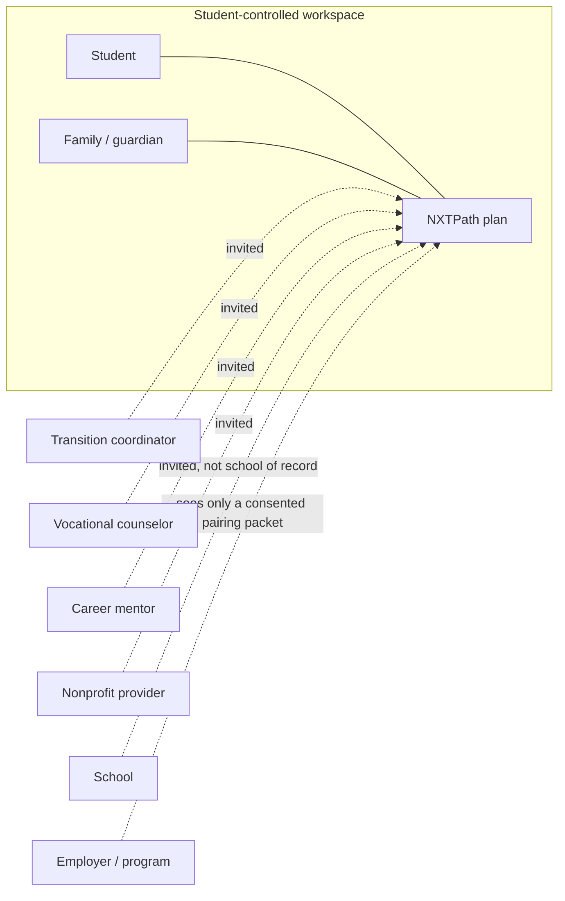

**Five partner types** (from the public site, kept):

| Partner | What they do in NXTSteps | What they must never do |
| --- | --- | --- |
| Student | Own the plan, log wins, propose goals, say “I’m interested,” control sharing at/after majority | Be listed in a searchable talent pool |
| Family | Coordinate while authorized; invite; safety review | Remain in control by default after 18 |
| School / educators | Collaborate on the plan they were invited to | Dump a roster into employer view; treat NXTSteps as the IEP system of record |
| Nonprofits / mentors / adult services | Deliver programs, workshops, job coaching; appear as verified orgs | Scrape student lists |
| Employers | Publish roles, review consented applications, commit to supports | Browse students, ask for diagnoses, see documents |

### Product surfaces (what we are productizing)

These names already exist in the pilot. Production keeps them.

**Student & family dashboard.** Goals, upcoming meetings, tasks, team, progress, daily log (win / school / independence / career / note). Example from the demo: Alex rode the #10 bus; Ms. Rivera logged a resume draft; Dana logged interview practice.

**NXTNetwork.** Invite by email; invitee must authenticate as that email and accept. Roles in the demo: Student, Parent/guardian, Transition coordinator, Vocational counselor, Career mentor, Nonprofit provider. Production adds: Job coach, Employer contact (only after pairing disclosure), School staff, Platform admin (NXTSteps employees — tightly audited).

**NXTPath / NXTPlan.** Four areas: Employment & career, Education & training, Independent living, Community & social. Goals have a lead person, milestones, tasks, meetings, team notes, progress history. Students can propose goals. Demo goals for Alex: part-time retail job by summer; culinary certificate; ride the bus independently; weekly budget; join a club.

**NXTMe.** Student-centered home. Accessibility is not a theme; it is the default path for many users: simplified view, bigger text, high contrast, read aloud, reduce motion, visual step numbers.

**NXTMatch (discovery + placement).** Verified opportunities. Filters: ZIP/distance, type (Employers / Volunteer / Nonprofits / Community programs / Education), disability-friendly **listings**, reachable by bus, remote OK, has some experience. Actions: **Save** / **I’m interested** (team-only). There is no “Organization reviewing” state until a WSP is actually shared. Placement pairing (Stage B) is a team workflow **inside NXTMatch**, not a separate product name.

**Messages.** Team-only. Messages with a minor are visible to an authorized parent/guardian. Anyone can report a message. Employers are not in the team chat until a pairing is active, and even then they get a dedicated, purpose-limited thread.

**Documents.** Private locker for IEP, vocational assessment, progress reports. Employers never see documents. Sharing remains off until legal instruments are effective. NXTSteps does not parse documents with AI.

**NXTBridge.** Graduation handoff. Student keeps the account. At 18, student decides who keeps access unless a legal arrangement says otherwise. Adult services are listed; NXTSteps does not decide eligibility.

**Settings.** Accessibility, notification intensity (everything / important only / daily digest), export, delete.

### The fairness story (what you can say in a sales conversation)

A parent will ask: “Will employers see that my child has a disability?”  
Default answer: **No. Employers do not see student profiles at all.** They do not even see that someone clicked “I’m interested.” If — and only if — the student wants that job and a reviewer (coordinator, VR counselor, Bridgeway-class nonprofit, or — in the Westport pilot — NXTSteps staff) plus the parent of a minor agree, the employer receives a **Workplace Success Profile**: skills the student chose to share, environment fits, requested accommodations, a support plan, and an optional photo only if the family attached one for that application. Not the IEP. Not a diagnosis. Not a stack of incidents. A parent cannot send the packet alone.

An employer will ask: “How do I know this is a good idea for my floor staff?”  
Answer: **We will not send you a name unless the role’s demands and the student’s support conditions fit, including safety.** If the role is unsupervised childcare and the student’s team has a current constraint that 1:1 support is required in that environment, the system blocks the pairing. You will not be asked to “give them a chance” against a hard safety gate. If the pairing is a caution, you will see the supports you must actually provide (job coach welcome, written task lists, quiet break). If you cannot provide them, it is not a match.

A student will ask: “Are you grading me?”  
Answer: **No. We are comparing this job’s environment to what already works for you.** If it is a bad idea, we say so and point to a better next step — a workshop, a different site, a skill to practice — so you are not left staring at a closed door.

### What “verified” means in product language

The demo shows a Verified badge on Greenleaf Grocers, Bridgeway Works, Bean & Leaf Café, and others. Production verification is a real workflow, not a CSS class:

- Organization identity (legal name, EIN or equivalent, address, primary contact).
- Role of the person claiming the org (cannot be a random Gmail).
- Inclusive-hiring or disability-employment attestation where claimed.
- For employers: acknowledgment of the mentor/partner confidentiality agreement (draft NXT-MENTOR-010) before any student packet can be received.
- Optional later: background-check status for people who will supervise minors on site (the platform records the *existence and date* of a check policy, and may integrate a vendor; NXTSteps is not a CRA).

Unverified orgs can draft listings. They cannot receive named student disclosures. They also **cannot enter Stage B** (Decision 28): no pairing run against an unattested demand profile.

Verification is a real SOP (Appendix H): EIN or state registration, proof of address, identity of a domain-email verification contact (personal Gmail cannot be the sole contact), 5-business-day SLA, revoke for diagnosis-fishing or false demand profiles.

---

## Pairing hypothesis

This is the heart of the product. It is written so a founder can defend it to a parent and an engineer can implement it.

### The tension we must resolve

The live product promises: matching never uses diagnoses or disability information.

A useful pairing **must** still account for:

- skills and preferred tasks,
- environments where the student already succeeds,
- supports that make success likely (job coach, visual schedules, consistent shifts),
- student safety (sensory load, supervision, transportation, hazards),
- employer/staff safety (duty of care, elopement, aggression, unsupervised work with vulnerable people).

If we put diagnosis into the ranker, we break the promise and invite discrimination. If we ignore safety, we put students and staff at risk. **The resolution is to match work and environment, and to treat safety as constraints and protocols with consent gates — never as a disability feature vector.**

### Hypothesis (one paragraph)

A student and a role are a **strong pairing** when the student’s published and team-confirmed **skills, preferred tasks, schedule, transportation, and successful environments** overlap the role’s **demands and workplace environment**, and when every **high-severity safety constraint** on either side is either matched by an employer capability (for example, job coach welcome, no unsupervised childcare, quiet break space) or the pairing is blocked. Employers see only a consented Workplace Success Profile. Students see a plain-language “why this job” that leads with strengths. Nobody sees a deficit score. A blocked pairing is an honest no plus a next step.

### Two stages

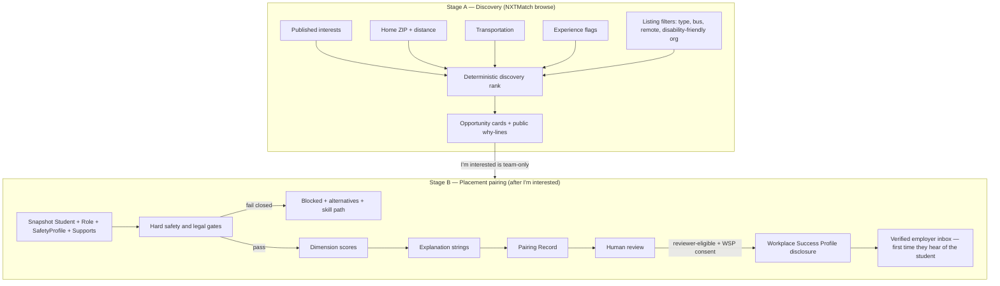

**Stage A is the public promise.** No safety flags, no diagnoses, no IEP fields, no behavior protocols. A “disability-friendly” chip is about the **listing**, not the student.

**Stage B is how we convince both sides.** It may use restricted attributes **inside the engine and the team UI** to gate and to write a support plan. Those attributes still do not flow to the employer unless they are explicitly copied into a Workplace Success Profile the student/guardian signed off on. “I’m interested” never notifies the employer (Decision 16).

### What both classes must carry

Pairing is only as good as the attributes on **Student** (and the related SafetyProfile, Transportation, Schedule, Skills) and **Role**. Those catalogs are in the Data Model section and are intentionally large so the team does not invent columns under pressure later. The engine never reads “diagnosis” or “disability type” columns because **those columns do not exist as ranker inputs**. If a future legal program stores a diagnosis in a restricted medical-note object, it is still excluded from `PairingInput`.

### Dual safety model

**Student safety (is this workplace safe for Alex?)**

- Supervision level actually provided vs. level needed.
- Transportation to/from site, including after dark and after-hours.
- Sensory load: noise, crowd, lights, smells, temperature, chaos at peak hours.
- Public-facing stress and customer intensity.
- Physical hazards: knives, hot oil, pallet jacks, chemicals, heights, vehicles.
- 1:1 vs group; isolated work areas; overnight.
- Staff trained on the support protocol the student would actually need.
- Known environmental triggers (the *environment*, not the identity): fire alarms, slamming doors, crowded registers at 5 p.m.

**Employer / staff / public safety (is this pairing safe for the floor?)**

- Predictable routines the student needs, framed as **what good supervision looks like**.
- Escalation patterns stored as **support protocols**: situation → likely response → what helps → what makes it worse → who to call — not as “dangerous kid.”
- Constraints: never unsupervised with young children or other vulnerable populations if that constraint is set; lifting/aggression/elopement/self-injury as **restricted** flags with consent, used as gates.
- Job-coach presence required vs. merely welcome.
- Incident protocol on both sides.

Behavior risk is **operational, not moral.** We do not store “bad attitude.” We store: *In crowded customer lines, Alex may raise his voice and leave the floor. What helps: a supervisor handing him a stocking cart and a 10-minute quiet break. What makes it worse: arguing at the register. Frequency: rare in the last 6 months. Severity: moderate. Last reviewed by Dana Lee and Mr. Patel on 2026-09-12. Relevant to high customer-intensity roles.*

### Consent gates (who sees what)

| Data | Student & authorized guardian | Invited school/nonprofit team (role-scoped) | Discovery ranker | Placement engine | Employer (default) | Employer after WSP share |
| --- | --- | --- | --- | --- | --- | --- |
| Preferred name, city/ZIP, interests, published skills, transportation, experience | Yes | Yes | Yes | Yes | **Nothing** (not even anonymous interest) | Yes, as in packet |
| Requested accommodations (student-chosen) | Yes | Yes | No | Yes | No | Only if included in WSP |
| Support protocols, safety constraints | Yes | Only Safety Reviewer roles | No | Yes (gates) | No | Only the **operational** lines explicitly included |
| Incident history | Yes | Safety Reviewer | No | Yes (recency/severity gates) | No | Never (v1) |
| IEP / documents / diagnoses | Yes | Only if document ACL says so | No | No | No | Never |
| Pairing explanations (student copy) | Yes | Yes | n/a | n/a | No | Employer copy only |

Default employer view of an “I’m interested”: **empty inbox.** The team sees the interest and may run Stage B. The employer learns of the student only at WSP share. This is Key Decision 16.

### Scoring / evaluation algorithm (implementable)

The engine is a **pure function**. It does not query the database. Callers assemble snapshots from the Appendix D allow-list.

```text
stageA(student_a_snapshot, listing_snapshot, algorithm_version="stage-a.2026.11.0") -> {score, why[], sortKey}
pair(student_snapshot, role_snapshot, safety_snapshot, algorithm_version="stage-b.2026.11.0") -> PairingRecord
```

**Normative details live in the appendices. Do not re-invent them in code comments.**

| Topic | Where |
| --- | --- |
| Stage A formula, why-lines, sort, `/demo/match` fixtures (80/65/40/30/15) | Appendix A |
| Per-dimension pseudocode, missing-data, caps, overall, residual-risk table, alternative picker | Appendix B |
| Hard gates with **exact Prisma paths**, CT youth table, SafetyConstraint derivation | Appendix C |
| Field matrix Stage A/B/WSP, denylist, hash, snapshot redaction | Appendix D |
| Reason-code enum and templates | Appendix E |

PR split: **PR-16a** engine library + fixtures (must go red on a one-line formula change) → **PR-16b** API → **PR-16c** team UI. Do not merge 16a without Greenleaf=93 strong and Little Sprouts blocked.

#### PairingRecord statuses (split)

Do not overload a single enum.

- `fit_status`: `strong | caution | possible | weak | blocked`
- `workflow_status`: `computed | needs_safety_data | needs_review | student_accepted | shared | employer_accepted | active | paused_safety | withdrawn | expired`
- `eligible_on`: date | null (age gates; UI “Opens at {date}”)
- `disclosure_status`: kept as a convenience projection of workflow (`none` until shared)

Incidents set `workflow_status = paused_safety`. They do not change `fit_status`.

#### Step 0 — Snapshots

Copy Appendix D allow-listed fields only. Unit tests fail if a `never-share-with-employer` field is in Stage A, if a `diagnosis*` column exists anywhere, or if `communication_supports` is in Stage B input.

#### Step 1 — Hard constraints

Appendix C. Fail closed. Unattested or unverified listings cannot enter Stage B (`EMPLOYER_UNVERIFIED`, `DEMAND_UNATTESTED`).

#### Steps 2–4 — Dimensions, residual risk, explanations

Appendix B and E. Weights sum to 1.00. No dimension named risk, disability, or behavior.

#### Step 5 — Human review

Required before `workflow_status=shared`. Who may disclose: Appendix F / Key Decision 17 (coordinator, VR, verified nonprofit, **or** StaffUser when `staff_may_review_wsp` is on). A parent cannot disclose alone. Checklist unchanged (strengths true; supports not an IEP dump; denylist clean; safety not stale; alternatives exist; photo omitted unless NXT-MEDIA-011 granted for this pairing).

#### Step 6 — Bad pairing without ghosting

Appendix B.13 picker. Employer is **not** notified of blocks or of “I’m interested.” **v1 forbids gate overrides** (no PairingRecord override columns, no `pairing.override_gate` audit action). Unsupervised childcare (`VULNERABLE_POPULATION` + unsupervised children) is never overridable in any later version either.

#### Trigger

`POST .../opportunities/:roleId/interest` saves team-only interest and **enqueues Stage B for the team** (worker job). It does not email the org. `POST /pairings` remains available for a coordinator to re-run. Two triggers, one visibility rule: employer sees nothing until disclose.

### Worked examples (Alex Lee’s world)

Assumptions for the examples (aligned with the demo, plus pairing attributes the demo does not yet collect):

**Alex Lee** — 17, Westport CT 06880, graduating 2027. Interests: retail, cooking, hospitality, animals, technology, customer service, recreation, college, volunteering. Travel-training in progress; rode the #10 bus to the library; reduced-fare card in hand; not yet independent on route 12. Strengths: stocking/organizing, following a written list, friendly one-to-one greetings, food prep at home, showing up when a parent or mentor is in the loop. Prefers weekday afternoons. Wants 8–15 hours/week. Job coach **welcome**, not always required for structured stocking; **required** for a fast café open and for any role with duty of care for children. Customer comfort: brief greetings and “where is the milk?” — not a busy espresso bar. Sensory: grocery floor OK with noise-cancelling breaks; commercial espresso peak and warehouse backup alarms are hard. Physical: can lift 20 lb repeatedly; not 50 lb all morning. Restricted safety (team only): **one** `SupportProtocol` row — `code=elopement`, `severity=high`, `frequency=rare`, `last_occurred_on` 8 months ago, `requires_1to1_in_open_community=true`, `requires_no_unsupervised_children=true`, `last_reviewed_at` within 6 months of the fixture clock, `relevant_role_types` empty. Situation: if overwhelmed in chaotic public lines, may leave the area without signing out. What helps: do not chase and yell; offer a quiet stock task; call Dana. **Not** to be left unsupervised with young children. No `overwhelm_exit` row, no aggression, no self-injury.

Team: Dana Lee (parent), Ms. Rivera (transition coordinator), Mr. Patel (vocational counselor), Jordan Hill (career mentor), Bridgeway Works (nonprofit).

---

#### Example 1 — Strong pairing: Alex × Greenleaf Grocers Inclusive Hiring Internship

**Role (from demo + pairing attributes we would store):** Paid 10-week internship, stocking shelves and helping customers, Westport, weekday afternoons, job coach welcome, written task lists, ages 17–24, no experience needed, verified inclusive hiring, step-free, bus reachable, typical lift 15–25 lb, customer intensity moderate (floor questions, not cashier peak), supervision: department lead on site, not 1:1 all day, no duty of care for children, no knives/hot oil, store closes before evening transit ends.

**Hard gates:** All pass. Age 17. Supervision floor met (periodic_checkins needed, on_site_assigned provided). `ELOPEMENT` does not fire: `open_community_unsupervised=no` and `near_traffic=no` (1:1 is required only in open community / near traffic). `JOB_COACH_REQUIRED` does not fire: grocery maps to `retail` and Alex’s map is `{retail: welcome}`; `job_coach_policy=welcome`. `WORK_HOURS_MINOR` passes: `hours_per_week_max=15`, shift 15:00–18:00, `overnight=no`, `hazardous_occupation_youth=no`, CT, working papers true. Residual **low** (high elopement is a gate, not unmatched-medium; unmatched medium count = 0).

**Dimensions (computed from Appendix B; CI fixture):**

| Dimension | Score | Why |
| --- | --- | --- |
| skills_overlap | 94 | required stocking + lists demonstrated; greeting learning; organizing demonstrated |
| preferred_tasks | 100 | stocking 60% / greeting 40%, both preferred |
| interests | 100 | retail + customer_service |
| schedule_fit | 100 | weekday 15:00–18:00 in availability; hours in band |
| transportation | 100 | 0.0 miles |
| sensory_environment | 80 | match minus known_hard grocery_peak |
| supervision_fit | 85 | periodic needed, on_site_assigned provided |
| customer_intensity | 50 | brief vs moderate (stretch; not a block) |
| physical_demands | 100 | typical lift 20 |
| support_availability | 100 | written_task_lists already offered |

**Overall: 93 → `fit_status=strong`**, residual risk **low**, `required_employer_capabilities` empty (gaps none). Operational plan may still mention a quiet break from `what_helps` without dropping to caution. Stage A card for the same listing is **80**, not 93 — different stage, different inputs. Dashboard 90% in the live demo is ignored.

**Student-facing**

> This internship uses your strengths in organizing shelves and helping people find things. Greenleaf already says job coaches are welcome and they use written task lists. The harder parts might be a busy aisle at 5 p.m. If that happens, the plan is a stocking cart and a short break — not staying stuck at a register. We recommend this because it is in Westport, on weekday afternoons, and it matches the retail goal you already set with Jordan.

**Employer-facing** (after WSP + Ms. Rivera review)

> This candidate is strong at stocking, organizing, and short friendly customer help. Success in this role typically needs written task lists and a named floor supervisor; a job coach for the first shifts is helpful and already welcome on your listing. Support plan: if the floor gets chaotic, reassign to stocking and allow a quiet break; contact the parent/guardian on file only if the student does not check in after 10 minutes. We recommend this because the task mix, hours, and supports you already offer line up with what this student does well. NXTSteps does not share diagnoses or school records.

**Shared why:** Westport afternoons; stocking + customer help; job coach welcome; no experience required; bus/parent commute.

This is the pairing both sides can believe.

---

#### Example 2 — Age-blocked at 17; after-18 seed needs safety data: Alex × Bean & Leaf Café, Part-time Team Member

**Role (demo + attributes):** Prepare drinks, restock, keep café tidy. Westport, weekday afternoons, ages **18+**, **some work or volunteer experience needed**, visual recipe cards, consistent shifts. Customer intensity **high** (counter). Sensory: espresso machine, peak lunch noise, smells, cramped behind bar. Category **kitchen**. Seed `job_coach_policy=unknown`. Kitchen hazards `hazard_hot_oil=unknown`, `hazard_knives=unknown`. Supervision: one shift lead, often two people behind the bar. Min age 18. `hours_per_week_max=20`; shift_windows weekday afternoons.

**Hard gates at 17 (locked seed):** `AGE_RANGE` fails (`RoleListing.ages_min=18`, Alex is 17). `fit_status=blocked`, `eligible_on=Alex.date_of_birth + 18 years`, `workflow_status=computed`. Discovery card **visible** with “Opens at 18.” “I’m interested” does not notify the café (Decision 16 and 18). Skill path: culinary certificate, food pantry volunteer, Greenleaf, food handler card. Other seed unknowns (`job_coach_policy`, kitchen hazards) are also `insufficient_data`; B.11 takes the **fail** branch first (`AGE_RANGE`), so the 17-year-old row is age-blocked with `eligible_on`, not `needs_safety_data`.

**After the 18th birthday (same seed, locked):** `AGE_RANGE` passes. Kitchen is `safety_sensitive_category=kitchen` with `job_coach_policy=unknown` and kitchen hazards `unknown`. High-severity `insufficient_data` on a safety-sensitive listing ⇒ `fit_status=blocked`, `workflow_status=needs_safety_data`, `overall_score=null`. Gate IDs: `JOB_COACH_REQUIRED` (Alex requires café coach; policy unknown) and `SELF_INJURY_HAZARD` (kitchen hazards unknown). The café is not notified. Next step is attestation, not a caution score.

Optional fixture `beanleaf-coach-welcome` (not the seed): `job_coach_policy=welcome`, `hazard_knives=no`, `hazard_hot_oil=no`. Then those gates pass and scores land **caution** (customer_intensity 20 brief→high, sensory from `cafe_peak` + noise high). PR-16a default after-18 Bean & Leaf is **blocked / needs_safety_data**.

**Student-facing**

> Bean & Leaf uses your interest in cooking, and it is close to home. The job is also fast, loud at lunch, and very customer-facing. That might be hard compared with stocking at a grocery store. Until you turn 18, the culinary certificate and the food pantry crew are better practice. After 18, the café still has to finish its workplace safety answers before we can recommend a plan — we will not send your name in the meantime.

**Employer-facing** (only if they later receive a packet)

> Strong interest in food prep and keeping a space tidy. Success typically needs a trainer for opening routines, visual recipe cards (you already offer), and no solo peak-bar coverage at the start. Residual: high customer intensity. We would not recommend this as a first independent job; we would recommend it as a second step after a structured internship.

Employer-facing copy above is for the optional `beanleaf-coach-welcome` fixture only. The default seed never reaches disclose.

---

#### Example 3 — Caution / likely weak: Alex × Warehouse Associate (Bridgeport Distribution Co.)

**Role:** Pick and pack, weekday **mornings**, Bridgeport (~9 miles), ages 18+, job coach welcome, quiet break room, supported employment partner, short interview, typical lift 40–50 lb, fast conveyor sensory load, backup alarms, forklifts in aisle, standing most of shift.

**Gates (computed):** `AGE_RANGE` fail (18+). Independently, `PHYSICAL_DEMANDS_HARD` fail (`RoleDemandProfile.typical_lift_lbs=50` > `Student.max_lift_lbs=20`). `fit_status=blocked`, `eligible_on` 18th birthday does **not** auto-clear the lift gate. Revisit only if the listing changes to light pack or Alex’s documented max lift changes. No auto-created “get stronger” goal.

**Student-facing:** Honest about early mornings, heavier lifting, and Bridgeport commute. Alternatives: Greenleaf stocking; food pantry pack (seated tasks available); travel training with Mr. Patel. Skill path: stamina and lift training only if *Alex* wants warehouse work — we do not “fix the student” to fit a 50 lb line.

---

#### Example 4 — Blocked pairing: Alex × Little Sprouts After-School Aide (invented)

**Role (invented, to test fail-closed):** Childcare aide, ages 16+, weekday afternoons, Westport, **unsupervised ratios** (one aide with a group of 8 children ages 4–6 in a playground adjacent to a parking lot), job coach **not** welcome (“kids find it confusing”), customer intensity with parents at pickup, duty of care for minors, open unfenced playground near traffic.

**Gates:** `VULNERABLE_POPULATION` fail (unsupervised with children). `ELOPEMENT` fail (open playground near traffic; `code=elopement` `severity=high` requires 1:1 in open community; `one_to_one_available=no`). `JOB_COACH_REQUIRED` fail (`job_coach_policy=not_permitted`; childcare required for Alex). **Status: blocked**, overall null. High elopement is a gate, not residual. We do not send this to the employer as a near-miss.

**Student-facing**

> This job is about being in charge of young children on a playground, mostly on your own. That is a different kind of responsibility than stocking shelves. We are not recommending it. That is about the job’s setup, not about whether you are good with kids in other ways. Better fits: Food Pantry Volunteer Crew, Westport Library Tech Day, Greenleaf internship.

**Team-facing:** Show gate IDs `VULNERABLE_POPULATION`, `ELOPEMENT`, `JOB_COACH_REQUIRED`. v1 has no override control.

**Employer-facing:** **Nothing.** Little Sprouts never learns Alex existed.

**Skill-building path (if Alex likes kids in structured settings):** Food Pantry or Tech Day with staff present; babysitting course later; never “try unsupervised and see.” Adaptive Rec Climbing Club is hidden in MVP (`ages_min=13`) and is not an alternative the picker may return.

---

### Why this convinces both sides

| Audience | What they need to believe | How the Pairing Record does it |
| --- | --- | --- |
| Student | “They see what I’m good at. They are not labeling me. A no comes with a next step.” | Strengths-first copy; no diagnosis language; alternatives + NXTPath tasks |
| Parent | “You will not put my child in an unsafe or humiliating placement.” | Fail-closed gates; human review; stale safety data blocks |
| Coordinator / VR | “I can stand behind this recommendation.” | Checklist, snapshot, algorithm version |
| Employer | “I know what success requires. You are not hiding a floor-safety issue.” | Capabilities they must accept; operational plan; no medical mystery |
| NXTSteps | “We can defend this in writing.” | Audit log, snapshots, no LLM on records, no employer browse |

### Algorithm versioning and fairness tests

Ship `pairing-engine` as a versioned package (`2026.11.0`). Every Pairing Record stores `algorithm_version`, weights, and input hashes.

Required automated tests:

- **Promise test:** Stage A fixtures never read safety, documents, or disability labels; static import check on the engine.
- **Denylist test:** Employer-facing strings cannot contain Appendix D.3 terms.
- **Fail-closed test:** Little Sprouts-style fixtures always `fit_status=blocked` on gate IDs `VULNERABLE_POPULATION`, `ELOPEMENT`, `JOB_COACH_REQUIRED` (canary on every deploy).
- **Greenleaf test:** Alex × Greenleaf `overall_score=93`, `sensory_environment=80`, `fit_status=strong`, `residual_risk=low`.
- **Bean & Leaf age test:** Alex at 17 → `fit_status=blocked` with `eligible_on`; `workflow_status=computed`; no org notification.
- **Bean & Leaf after-18 seed test:** Alex at 18 on the default seed → `fit_status=blocked`, `workflow_status=needs_safety_data` (`JOB_COACH_REQUIRED` and `SELF_INJURY_HAZARD` insufficient_data). Optional `beanleaf-coach-welcome` → `fit_status=caution`.
- **Fairness:** protocols that do not apply → identical scores; supervision-only differences may change only `supervision_fit` / `support_availability`.
- **Bind test:** every Appendix C identifier exists on Prisma.
- **Stale safety:** `last_reviewed_at` beyond threshold → disclose rejected.
- **Formula fragility:** a one-line change to `stageAScore` or Greenleaf weights fails CI.

---

## Safety as a first-class subsystem

Safety is not a checkbox on a listing. It is a module with its own entities, reviewers, SLAs, and things the platform **refuses** to do.

### Scope

1. **Student workplace safety** — environment, supervision, transport, hazards, sensory load, after-hours.
2. **Employer staff, coworker, customer, and client safety** — especially where the role includes duty of care.
3. **Minor online safety** — who can message whom, parent visibility, reporting, no stranger employers in DMs.
4. **Emergency contacts and incident reporting** — what happens Tuesday at 4 p.m. when something goes wrong.
5. **Job-coach / on-site support as a matching constraint** — not a nice-to-have blurb.
6. **Age of majority and guardianship** — who is allowed to attest to safety data.
7. **Employer verification and background-check policy** — verified badge with teeth.
8. **Explicit non-roles** for the company.

### SafetyProfile (product meaning)

A living, reviewed picture of **support conditions**, not a diagnosis chart. Owned by the student workspace. Editable by Safety Reviewer roles (parent/guardian, transition coordinator, vocational counselor, and the student at a developmentally appropriate level). Must be re-attested on a schedule.

High-severity protocols require dual attestation (student/guardian + coordinator or VR) before they can **unblock** a previously blocked role type. They can **block** with a single Safety Reviewer (fail closed).

### Incident reporting

If something happens on a placement (elopement, injury, aggression, medical emergency, harassment, student reports feeling unsafe):

- Any team member or the employer contact on that pairing can file a **SafetyEvent**.
- The event is **restricted**. It does not notify other employers. It does not change Stage A.
- It **can** pause an active pairing (`workflow_status = paused_safety`) and request a safety re-review.
- Emergency: the UI shows **call 911 first**, then notify emergency contacts. NXTSteps is not an emergency service and must not look like one.

### Employer / worksite safety (independent of the student)

Dual safety is not only “is this student a risk to the floor.” The floor must also be a declared-safe environment for a minor and for coworkers.

RoleDemandProfile carries worksite facts: `min_staff_on_shift`, hazards, duty-of-care, `one_to_one_available`. Employer carries `hosts_minors`, `staff_screening_policy`, `incident_contact_email`, `hours_of_operation` (Appendix H). `staff_trained_inclusive_hiring` is **not** the same as “staff trained on this student’s protocol.” The WSP operational plan is what the site agrees to follow; we do not certify training.

Integrity controls so gates are not theater:

1. Tri-state hazards (`yes|no|unknown`); default **unknown**.
2. `safety_sensitive_category` required; childcare/healthcare/driving/overnight/chemicals/warehouse/kitchen/open_community force the relevant questions (Appendix G).
3. Attestation (`attested_by_membership_id`, `attested_at`) before Stage B.
4. Ops review before publishing safety-sensitive listings (2 business days).
5. Unverified **or** unattested demand profiles cannot enter Stage B.
6. False attestation → listing unpublished and verification revoked.

**Sales sentence:** we match declared constraints to declared environments and fail closed. We do not inspect stores and we do not predict violence.

### Minor online safety rules (v1)

- Only accepted team members can message the student.
- Employer contacts are not team members until a pairing is `active` or `shared`, and then only in a **pairing thread**, not the whole-team chat.
- If the student is under 18, authorized parent/guardian can read messages with the student. Copy already in the demo.
- Report/block is available to everyone. Reports go to NXTSteps ops + the parent if a minor.
- No location sharing, no document attach in chat in v1 (prevents IEP-by-accident).
- Rate limits and profanity/grooming heuristics are **assistive** for ops; they do not replace human moderation.
- Adults on a minor’s team should be invite-only and email-bound, as the demo already does.

### Job coach as constraint

Three different facts, not one boolean:

- Student: coach **required** / **welcome** / **not wanted** for this role type.
- Role: coach **required by employer**, **welcome**, **not permitted**.
- Pairing: if student-required and employer-not-permitted → block.

Bridgeway Works and Greenleaf in the demo already advertise coach-friendly culture. Bean & Leaf does not. That difference must be data, not copy.

### Age of majority / guardianship

- `age_of_majority_on` computed from DOB and state (CT: 18).
- `legal_authority` on FamilyMember: `parent_minor`, `guardian`, `conservator`, `none`.
- At majority, scheduled NXTBridge job: freeze inherited permissions until the **student** re-grants, unless a reviewed legal arrangement document is on file (guardianship order). NXTSteps staff must not “just leave the parent on.”
- Safety protocols created by a parent before 18 remain, but **re-consent** is required for new employer disclosures after 18.

### Background checks

- **Employers / programs supervising minors:** verification workflow collects whether the org runs legally required checks on staff. NXTSteps records `org.staff_screening_policy`, date, and who attested. Optional vendor integration later.
- **Mentors:** career mentors in a minor’s network should be known to the family/school; v1 relies on invite-by-parent/coordinator, NXT-MENTOR-010 confidentiality, and report tools — **no Checkr or other background-check vendor in v1** (founder lock 2026-10-27).
- **Students:** the platform does not run background checks on students in v1. If a role requires one, the listing says so; the family handles it off-platform or via a future integration.

### What the platform will not do

- Not a medical device; not diagnostic; not therapy; **not a healthcare provider**. HIPAA compliance is the **safeguard program**, not a clinic.
- Not an eligibility determiner for VR, DDS, SSI, IDEA, or college DSS.
- Not a substitute for IEP team or VR professional judgment. Human review is required for named disclosure **because** of that.
- Not emergency dispatch.
- Not a guarantor of workplace OSHA compliance. We encode hazards the org **declares**; we do not inspect stores.
- Not a covert channel for employers to ask “what’s the diagnosis?” The employer UI must not even have a field for it. If they type it in a message, that is a reportable policy violation.
- Not an employment agency and not a placement guarantee. TOS still says recommendation, not placement. For the Westport **pilot**, founder/ops StaffUsers may complete WSP review (`staff_may_review_wsp` on) so a family without Bridgeway is not stuck. That employment-agency exposure is an **accepted pilot risk**; the flag is intended **off** after the pilot unless counsel approves. A parent still cannot disclose alone.
- Not an OSHA inspector and not a violence-prediction tool. Dual safety = declared constraints × declared environment, fail closed.

### Safety SLAs (engineering + ops)

| Event | Target |
| --- | --- |
| High-severity SafetyEvent filed | Page engineer + founder in ET business hours (15-minute ack). Off hours: email + next morning. UI always says call 911 first. This is not a 24/7 SOC. |
| Permission or disclosure change | Audit row synchronous, before the response returns |
| Safety protocol stale | Block new employer shares; notify reviewers 14 days before expiry |
| Message report involving a minor | Human ops review within 1 hour during business hours; 4 hours off-hours in MVP (founder may tighten) |

---

## Architecture

### Three tiers

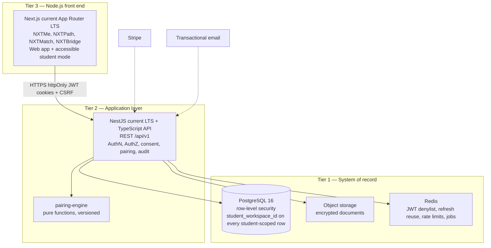

**Tier 1 — PostgreSQL.** Source of truth for people, consents, plans, roles, pairings, audit. If Redis or the UI cache disagrees, Postgres wins. Pairing snapshots are JSONB columns on `pairing_records`, redacted on delete (Appendix D.1).

**Tier 2 — API.** NestJS modules aligned to domains: Identity, Consent, Network, Plan, Opportunities, Pairing, Safety, Messaging, Documents, Billing, Audit. The pairing engine is a library with no I/O.

**Tier 3 — Front end.** Next.js on Node.js. Server components for dashboards; client components where accessibility widgets need state (read-aloud, simplified view). The browser never talks to Postgres. The Next.js server may use a BFF pattern (server actions or route handlers calling the API) so cookies stay httpOnly.

### Why this stack (for the founder)

You asked for PostgreSQL, an API, and a Node.js front end. We recommend **TypeScript on the API as well** so a small team is not splitting its brain across Python and JavaScript on day one. NestJS gives clear folders, guards for “is this user allowed to see this student,” and a place to hang audit interceptors. Next.js is the default professional React framework: good accessibility story, good deployment story, one Node.js runtime.

PostgreSQL is the right database: relational (teams, consents, roles), strong constraints, row-level security as a second lock on the door, JSONB for snapshots without abandoning a schema.

### Recommended repo layout (monorepo)

```text
nxtsteps/
  apps/
    web/                 # Next.js UI
    api/                 # NestJS API
    worker/              # email, stale-safety jobs, NXTBridge majority jobs
  packages/
    db/                  # Prisma schema, migrations, seeds (Alex demo)
    pairing-engine/      # pure pairing library + fixtures
    shared-types/        # DTOs, sensitivity enums, role enums
    eslint-config/
  infra/                 # Terraform or SST: RDS, S3, ECS/Fly, secrets
  docs/                  # this design, runbooks
  .github/workflows/     # ci.yml, migrate, preview apps
```

The empty git repo should start here. Do not put student data in the repo. Seed data is fictional (Alex Lee).

### Core runtime choices

| Choice | Pick | Notes |
| --- | --- | --- |
| Language | TypeScript 5.x, Node 22 LTS | Strict mode |
| API | NestJS + Fastify adapter | Fastify for speed; Nest for structure |
| ORM | Prisma | Migrations as PRs; matches incremental PR plan |
| AuthN | Email + password + confirmation; **JWT access (RS256, 15 min) + rotating refresh**; httpOnly Secure cookies; Redis denylist; Session audit row; TOTP MFA for safety/reviewer/org admin/staff | SSO when a district pays |
| AuthZ | **CASL** `principal × action × resource × purpose` from Appendix F | Not a second boolean matrix |
| RLS | See Appendix L: `nxtsteps_app` + `SET LOCAL` per transaction | API still 404s first |
| Files | S3-compatible (S3 or R2), KMS, ClamAV sidecar, PDF-only v1 | Sharing flag default off |
| Email | **Postmark** | Invites, confirms |
| Payments | Stripe Billing | **Family** $20 / $200 covers siblings |
| Feature flags | `FeatureFlag` table + env | Stage B `pairing_v1`; WSP `employer_wsp`; `staff_may_review_wsp` on for pilot |
| Hosting | **Render** for web, api, worker; Postgres 16 PITR; Redis | AWS later if a district requires it |
| Jobs | `apps/worker` + BullMQ | email, geocode, stale safety, majority, deletion |
| Geo | ZIP centroid table in-repo | No student street to a vendor in MVP |

### Request authorization flow

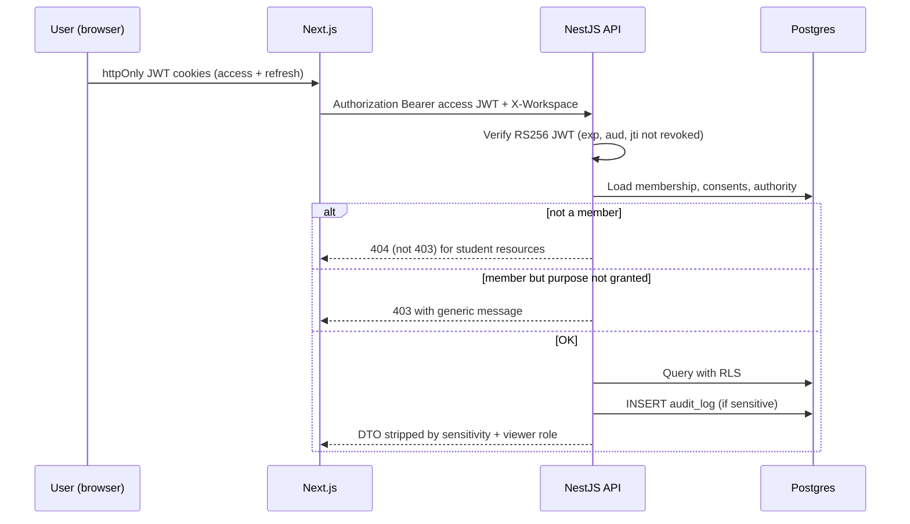

**404 not 403** on other families’ workspaces so we do not leak that a student exists.

DTOs are role- and purpose-shaped. An employer token cannot fetch `GET /students/:id`. They fetch `GET /pairings/:id/employer-view` which returns the WSP snapshot only.

### Pairing runtime

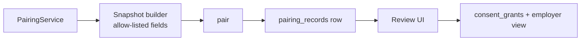

Worker jobs: recompute discovery ranks nightly; expire stale WSP grants; remind safety review; age-of-majority freeze.

### Accessibility architecture

Preferences persist on `accessibility_preferences` and apply to all surfaces. NXTMe is not a separate app; it is a route with a reduced information density layout using the same APIs. Read-aloud uses the **device** speech API (as the demo says), not a cloud voice that would send student text to a vendor.

WCAG 2.2 AA is a release gate for student-facing pages. **axe-core runs in PR-04 CI** on NXTMe, auth, and the app shell.

---

## Working with a development team

This section is for the founder who is not going to merge pull requests.

### Who does what

**You (founder / product) own:** the pairing fairness story, which fields are restricted, which legal drafts become real, who is in the Westport pilot, employer verification standards, and the words students see when a match is blocked. You sign off on explanation templates.

**Engineering owns:** schema, APIs, tests, security, uptime, the pairing function’s correctness against this spec.

**Counsel owns:** making the drafts effective (including NXT-WSP-013 and NXT-MEDIA-011); FERPA/school agreements; **HIPAA BAA template and covered-entity classification**; youth employment; COPPA if you later open under-14; sunset of staff-as-reviewer after the pilot.

**You do not need to** pick indexes, ORM syntax, or Kubernetes. Founder decisions of 2026-10-27 are locked in Key Decisions and the Resolved-by-founder list. They do **not** block engineering.

### How work should feel week to week

1. **A living staging site** that looks like the demo but runs on the new architecture (`staging.nxtsteps.dev`).
2. **Weekly demo** on staging, using Alex’s seed data plus one real (consented) pilot family when you have one.
3. **Feature flags** so pairing Stage B can be on for NXTSteps staff and off for families until you trust the copy.
4. **Definition of done** is not “page exists.” It is: migration, API, UI, tests, audit hook, accessibility pass, and rollback noted in the PR.

### Suggested hiring shape (MVP)

- 1 product-minded full-stack engineer (TypeScript) as tech lead.
- 1 engineer strong in accessibility and React.
- Part-time security/privacy review (contractor) before the first real student document or the first employer disclosure.
- You + counsel on legal instruments.

Avoid: a six-person team before the data model and pairing gates exist. Avoid: an “AI matching” vendor in v1.

### How to ship incrementally

Follow the [PR Plan](#pr-plan). Each PR is independently reviewable. Do not wait for a big-bang rewrite of the pilot. The pilot can keep running at `app.nxtsteps.dev` until cutover.

Cutover meaning: new signups on the new stack; demo remains fictional; existing pilot users migrated only with explicit export/import and consent refresh.

### What “done” looks like

**MVP done:** **PR-01–PR-18.** Stage A live, team messages live, Stage B staff-flagged, documents share-off, consent records exist, `staging.nxtsteps.dev` is the weekly demo host. **NXTBridge is PR-20 (later), not MVP.**

**v1 done:** Stage B on for pilot families, first verified employers receiving WSP packets, incident path tested in a tabletop exercise, school agreement still optional.

**v2:** district tenants, SSO, document share to named team members, optional smarter ranker that still cannot see restricted fields.

---

## Data model & domain class catalog

### Conventions

- UUIDs (**uuidv7** only) as primary keys.
- Every student-scoped table has `student_workspace_id` (RLS).
- Soft delete (`deleted_at`) plus legal hold; hard delete only via account-deletion workflow.
- `created_at`, `updated_at`, `created_by_user_id` on mutable entities.
- **Sensitivity:** `public` | `team-only` | `restricted` | `never-share-with-employer`.
- Required/optional is for v1 application logic, not merely DB nullability. Secrets (password hashes) never leave the identity module.

### Sensitivity and stripping

The API applies a field-level policy. Example: `Student.legal_last_name` is team-only; `Student.date_of_birth` is restricted (age band 17–24 may be derived for a WSP); `SafetyProtocol.severity` is restricted; `Document.storage_key` is never-share-with-employer.

### Tenancy sketch

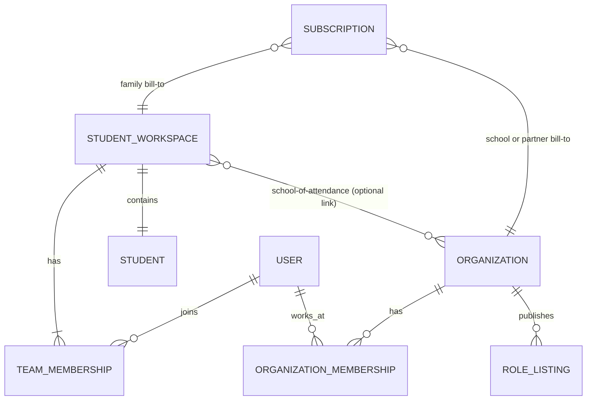

Organizations do **not** have `SELECT` on students. A school staff user sees a student only via `team_memberships`.

---

### Entity relationship (core people and network)

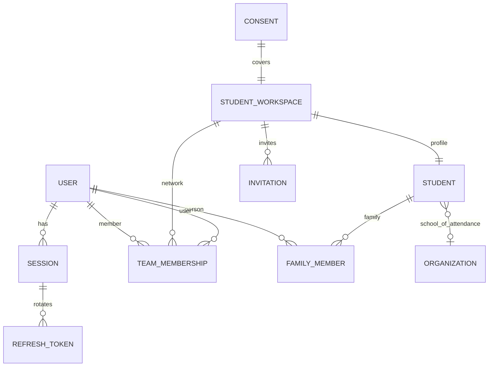

### Entity relationship (plan)

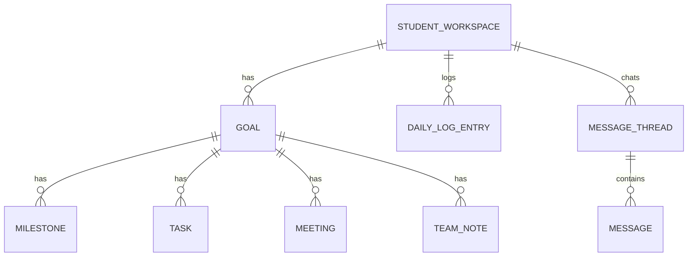

### Entity relationship (opportunities and pairing)

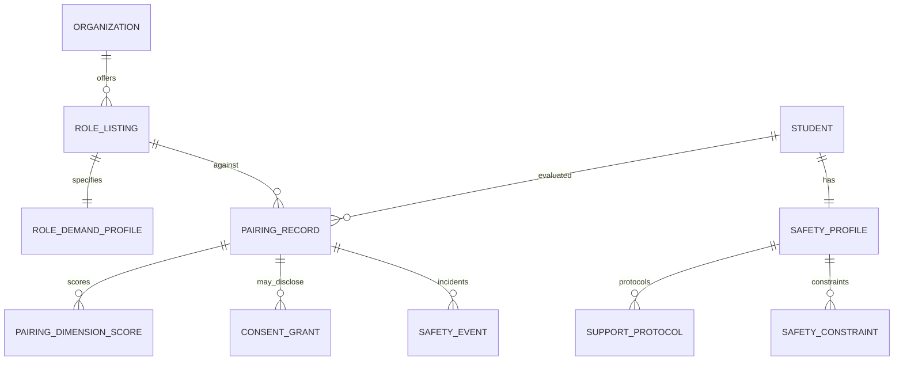

---

### Class catalog

For each class: product purpose, attributes, relationships, example. Types are application types. `req` = required for a complete record of that kind; `opt` = optional.

**v1 minimum vs full catalog:** Student and RoleDemandProfile list the full pairing catalog so we do not invent columns later. Ship order: identity + Stage A fields first; Stage B environment/safety fields before PR-16a; WSP fields before disclose. FamilyMember/Employer/OrganizationMembership v1 minima are called out on those classes. School is directory-only in v1 (see class 5).

---

### 1. User (Account)

**Purpose.** A human who can sign in. One login can be a parent on one workspace, a mentor on another, and an employer contact at Greenleaf. The login is not the student record.

| Attribute | Type | Req | Sensitivity | Notes |
| --- | --- | --- | --- | --- |
| id | UUID | req | public-to-self | |
| email | citext | req | team-only | Unique; invite binding |
| email_verified_at | timestamptz | opt | team-only | |
| password_hash | text | opt | never | Argon2id; null if SSO-only |
| mfa_enabled | bool | req | team-only | Required true before edit_safety, review_pairing, or org admin/owner |
| full_name | text | req | team-only | |
| preferred_name | text | opt | team-only | |
| phone | text | opt | restricted | E.164 |
| timezone | text | req | team-only | Default `America/New_York` |
| status | enum(`pending_confirm`,`active`,`suspended`,`deleted`) | req | team-only | |
| last_login_at | timestamptz | opt | restricted | |
| terms_accepted_version | text | opt | team-only | NXT-TOS-001 |
| privacy_accepted_version | text | opt | team-only | NXT-PRIV-002 |
| esign_accepted_at | timestamptz | opt | team-only | NXT-ESIGN-005 |
| ~~is_platform_admin~~ | — | — | — | **Removed.** Staff live in `StaffUser` on `staff.nxtsteps.dev` |
| created_at / updated_at | timestamptz | req | team-only | |

**Relationships.** Memberships, sessions / refresh tokens, sent invitations, message authors, audit actor.

**Example.** `jordan@mentor.example` — Career mentor on Alex’s team.

---

### 2. StudentWorkspace (tenant unit for student data)

**Purpose.** The lockbox. All student-scoped rows hang off this id. Billing does **not** live here — it lives on `Family` (or an organization sponsor).

| Attribute | Type | Req | Sensitivity | Notes |
| --- | --- | --- | --- | --- |
| id | UUID | req | team-only | RLS key |
| display_name | text | req | team-only | “Alex Lee’s plan” |
| status | enum(`active`,`frozen_majority`,`suspended`,`deleted`) | req | team-only | |
| family_id | UUID | opt | team-only | Required when sponsor_type is `family` or `pilot_comp` |
| sponsor_type | enum(`family`,`school`,`nonprofit`,`pilot_comp`) | req | team-only | |
| sponsor_organization_id | UUID | opt | team-only | If school-paid |
| home_timezone | text | req | team-only | |
| home_state | char(2) | req | team-only | Youth-employment + majority rules |
| majority_frozen_at | timestamptz | opt | restricted | |
| created_at | timestamptz | req | team-only | |

**Example.** Alex’s workspace, `family_id` = Lee household, sponsor_type `pilot_comp` during founder-run pilot. A sibling workspace would share the same `family_id` and the same subscription.

---

### 2b. Family (billing household)

**Purpose.** The paying family unit. One Stripe customer, one subscription, **N student workspaces** (siblings). Founder lock 2026-10-27: the published $20 / $200 price is the **family** price, not a per-student seat.

| Attribute | Type | Req | Sensitivity | Notes |
| --- | --- | --- | --- | --- |
| id | UUID | req | restricted | |
| paying_user_id | UUID | req | restricted | The adult who is the Stripe customer |
| display_name | text | req | team-only | “Lee family” |
| stripe_customer_id | text | opt | restricted | |
| created_at | timestamptz | req | restricted | |

**Relationships.** 1:N StudentWorkspaces; 1:1 current Subscription (`bill_to_type=family`). School/nonprofit sponsors use `bill_to_type=organization` instead and leave `family_id` for membership only.

**v1 rule:** attaching another child creates another StudentWorkspace on the same Family. It does **not** create another Stripe subscription. No per-seat family SKU. If the family subscription lapses, **all** attached workspaces go read-only together.

---

### 3. Student

**Purpose.** The person the plan is about. This is the richest record in the product. Pairing reads many of these fields; employers do not.

**Identity & life**

| Attribute | Type | Req | Sensitivity | Pairing? |
| --- | --- | --- | --- | --- |
| id | UUID | req | team-only | |
| student_workspace_id | UUID | req | team-only | |
| user_id | UUID | opt | team-only | Null if very young and parent-only login |
| preferred_name | text | req | team-only | Stage A/B as “Alex” |
| legal_first_name | text | req | restricted | WSP optional |
| legal_middle_name | text | opt | restricted | |
| legal_last_name | text | req | restricted | WSP optional |
| pronouns | text | opt | team-only | |
| date_of_birth | date | req | restricted | Age for gates; WSP gets age or band |
| age_of_majority_on | date | req | restricted | Computed |
| graduation_year | int | opt | team-only | Demo: 2027 |
| photo_url | text | opt | team-only | Team avatar only; **never** auto-copied to WSP |
| bio_self | text | opt | team-only | Student voice |
| bio_team | text | opt | team-only | |
| home_address_line1 | text | opt | restricted | |
| home_address_line2 | text | opt | restricted | |
| home_city | text | opt | team-only | WSP city |
| home_state | char(2) | req | team-only | |
| home_postal_code | text | req | team-only | Stage A ZIP |
| home_lat / home_lng | numeric | opt | restricted | Derived; used for distance |
| school_organization_id | UUID | opt | team-only | Organization.type=school |
| school_name_freeform | text | opt | team-only | If no org link |
| grade_level | text | opt | team-only | |
| expected_exit_date | date | opt | team-only | |
| primary_language | text | req | team-only | Default en |
| languages[] | text[] | opt | team-only | |
| interpreter_needed | bool | opt | team-only | |
| household_notes | text | opt | restricted | |

v1 **does not** collect `sex_gender_identity`, `race_ethnicity`, or `work_authorization_status`. If equity reporting is needed later, it is a dedicated consented instrument, not a column on Student.

**Schedule & working papers (pairing)**

| Attribute | Type | Req | Sensitivity | Pairing? |
| --- | --- | --- | --- | --- |
| has_working_papers | bool | opt | restricted | Minors; CT paid-work gate |
| desired_hours_min | int | opt | team-only | B |
| desired_hours_max | int | opt | team-only | B |
| desired_schedule_notes | text | opt | team-only | |
| weekly_availability | jsonb | opt | team-only | `{mon:[["15:00","18:00"]],...}` |
| cannot_work_after | time | opt | team-only | B gate |
| can_work_weekends | bool | opt | team-only | B |
| can_work_evenings | bool | opt | team-only | B |
| school_calendar_conflicts | jsonb | opt | team-only | |
| start_date_earliest | date | opt | team-only | |

**Transportation (pairing; Stage A uses a subset)**

| Attribute | Type | Req | Sensitivity | Pairing? |
| --- | --- | --- | --- | --- |
| zip_for_matching | text | req | team-only | A |
| max_commute_minutes | int | opt | team-only | A/B |
| remote_ok | bool | req | team-only | A |
| transit_uses_bus | bool | opt | team-only | A |
| transit_reduced_fare | bool | opt | team-only | |
| travel_training_level | enum(`none`,`in_progress`,`route_specific`,`independent`) | opt | team-only | B |
| known_routes[] | text[] | opt | team-only | Demo: #10, aiming for route 12 |
| has_ride_from_family | bool | opt | team-only | B |
| has_drivers_license | bool | opt | restricted | B |
| can_use_paratransit | bool | opt | restricted | B |
| evening_transport_available | bool | opt | team-only | B |
| mobility_notes | text | opt | restricted | Operational (step-free needed) |

**Interests, skills, tasks (pairing)**

| Attribute | Type | Req | Sensitivity | Pairing? |
| --- | --- | --- | --- | --- |
| published_interests[] | text[] | req | team-only | A — demo list |
| hidden_interests[] | text[] | opt | team-only | Team only, not A |
| skills[] | jsonb | opt | team-only | `{name, level: interest\|learning\|demonstrated, source}` B |
| preferred_tasks[] | text[] | opt | team-only | B — stocking, greeting, food prep, packing, animals, computers |
| avoided_tasks[] | jsonb | opt | team-only | `{task, hard_no: bool}` |
| tools_and_tech[] | text[] | opt | team-only | |
| certifications[] | jsonb | opt | team-only | Food handler, ServSafe, etc. |
| languages_spoken_at_work[] | text[] | opt | team-only | |
| portfolio_summary | text | opt | team-only | |

**Experience (Stage A “has some experience”)**

| Attribute | Type | Req | Sensitivity | Pairing? |
| --- | --- | --- | --- | --- |
| has_any_work_or_volunteer | bool | opt | team-only | A |
| experience_entries[] | jsonb | opt | team-only | Employer names may be team-only |
| interview_readiness | enum(`not_yet`,`practicing`,`ready_with_support`,`ready`) | opt | team-only | B modifier |
| resume_document_id | UUID | opt | never-share-with-employer | |

**Environment fit, sensory, physical, social (pairing B)**

| Attribute | Type | Req | Sensitivity | Pairing? |
| --- | --- | --- | --- | --- |
| customer_facing_comfort | enum(`none`,`brief`,`moderate`,`high`) | opt | team-only | B |
| phone_calling_comfort | enum(`none`,`low`,`moderate`,`high`) | opt | team-only | B |
| team_size_preference | enum(`solo`,`pair`,`small_team`,`large_floor`) | opt | team-only | B |
| noise_comfort | enum(`low`,`moderate`,`high`) | opt | team-only | B |
| crowd_comfort | enum(`low`,`moderate`,`high`) | opt | team-only | B |
| lighting_notes | text | opt | restricted | e.g. fluorescent headache |
| smell_heat_notes | text | opt | restricted | kitchens |
| known_good_environments[] | text[] | opt | team-only | “grocery floor”, “small office” |
| known_hard_environments[] | text[] | opt | team-only | |
| environment_hard_nos[] | text[] | opt | restricted | Gate |
| typical_lift_lbs | int | opt | team-only | B |
| max_lift_lbs | int | opt | team-only | Gate |
| standing_minutes_comfort | int | opt | team-only | B |
| cannot_stand_minutes | int | opt | team-only | Gate |
| no_ladder | bool | opt | team-only | Gate |
| outdoor_weather_ok | bool | opt | team-only | |
| stamina_notes | text | opt | restricted | |

**Supervision & supports (pairing B)**

| Attribute | Type | Req | Sensitivity | Pairing? |
| --- | --- | --- | --- | --- |
| min_supervision_level | enum(`independent`,`periodic_checkins`,`on_site_assigned`,`job_coach_1to1`) | opt | restricted | Gate |
| job_coach_preference_by_role_type | jsonb | opt | restricted | `{retail: welcome, cafe: required, childcare: required}` |
| requested_accommodations[] | text[] | opt | team-only | Student-chosen; WSP if they agree |
| benefits_from[] | text[] | opt | team-only | visual schedules, extra time, quiet room, written lists |
| communication_supports | text | opt | team-only | Operational; **excluded from Stage B input** (proxy risk). Reviewer may copy a denylist-clean phrase into WSP by hand. |
| reading_preference | enum(`standard`,`plain_language`,`visual_steps`) | opt | team-only | |
| instruction_mode | enum(`written`,`visual`,`spoken`,`demo`) | opt | team-only | B |

**IEP-like planning data (not school of record; never pairing ranker; never employer)**

| Attribute | Type | Req | Sensitivity | Pairing? |
| --- | --- | --- | --- | --- |
| transition_goal_employment | text | opt | restricted | Planning only |
| transition_goal_education | text | opt | restricted | |
| transition_goal_independent_living | text | opt | restricted | |
| course_of_study_notes | text | opt | restricted | |
| anticipated_services_post_school[] | text[] | opt | restricted | VR, DDS, CIL — NXTBridge |
| diploma_pathway | text | opt | restricted | |
| age_of_majority_iep_rights_reviewed | bool | opt | restricted | |
| section_504_or_iep_exists | bool | opt | never-share-with-employer | Do not infer diagnosis |

**Emergency**

| Attribute | Type | Req | Sensitivity | Pairing? |
| --- | --- | --- | --- | --- |
| emergency_medical_alert | — | — | — | **Not in v1.** Use SafetyProfile.emergency_instructions only |
| preferred_hospital | — | — | — | **Not in v1** |

**Meta**

| Attribute | Type | Req | Sensitivity |
| --- | --- | --- | --- |
| profile_completeness | jsonb | req | team-only |
| pairing_opt_in_stage_b | bool | req | team-only |
| created_at / updated_at | timestamptz | req | team-only |

**Relationships.** Workspace 1:1, School N:1, FamilyMembers, Goals, SafetyProfile 1:1, PairingRecords, Documents, Consents.

**Example.** Alex Lee, Westport 06880, graduation_year 2027, published_interests as in demo, travel_training_level `in_progress`, preferred_tasks `stocking, greeting, food_prep`, min_supervision `periodic_checkins`, job_coach retail `welcome`, `has_working_papers=true`, one SupportProtocol `elopement` high (Appendix J).

---

### 4. FamilyMember

**Purpose.** A parent, guardian, sibling supporter, or other household adult in the network — with **legal authority** spelled out so the product does not assume.

| Attribute | Type | Req | Sensitivity | Notes |
| --- | --- | --- | --- | --- |
| id | UUID | req | team-only | |
| student_workspace_id | UUID | req | team-only | |
| user_id | UUID | opt | team-only | |
| relationship | enum(`parent`,`guardian`,`grandparent`,`sibling`,`other`) | req | team-only | |
| legal_authority | enum(`none`,`parent_of_minor`,`legal_guardian`,`conservator`,`poa`) | req | restricted | |
| authority_document_id | UUID | opt | never-share-with-employer | |
| authority_expires_on | date | opt | restricted | |
| preferred_name | text | req | team-only | Dana Lee |
| legal_name | text | opt | restricted | |
| email | citext | opt | team-only | |
| phone | text | opt | restricted | |
| is_emergency_contact | bool | req | restricted | |
| is_primary_household | bool | req | team-only | |
| lives_with_student | bool | opt | team-only | |
| notification_level | enum | req | team-only | |
| nxt_parent_auth_accepted_at | timestamptz | opt | restricted | NXT-PARENT-003 |
| can_consent_to_wsp | bool | derived | restricted | Appendix I |
| consent_rank | int | derived | restricted | conservator 4 … none 0 |

**v1 vs full:** v1 ships identity, legal_authority, emergency contact, consent rank. Sibling-as-supporter is `relationship=sibling` + `legal_authority=none` (cannot consent). Two-parent WSP conflict: Appendix I (both must allow; either may block).

**Example.** Dana Lee, parent_of_minor, primary, emergency contact, can_consent_to_wsp true while Alex is a minor.

---

### 5. School

**Purpose.** Directory for the school the student attends. NXTSteps is not the SIS.

**v1:** there is **no separate School table**. School **is** `Organization.type='school'`. `Student.school_organization_id` is optional. Family types the school name if the org is not in the directory. No calendar, no bell times, no official student id, no roster. School-year exceptions live on `Student.school_calendar_conflicts`. IEP reminder dates live on `DocumentReminder`. `ferpa_school_official_mode` is always false in v1.

**Full catalog (v2):** nces_id, district, DPA status, roster ingest, bell times, assigned transition coordinator.

**Example.** Optional link to “Westport High School” organization, or a free-text school name on the student row (`school_name_freeform` optional text).

---

### 6. Organization (supertype)

**Purpose.** Any non-family institution: school district, nonprofit, VR office, CIL, college, mentor org, employer.

| Attribute | Type | Req | Sensitivity | Notes |
| --- | --- | --- | --- | --- |
| id | UUID | req | public | |
| type | enum(`school`,`district`,`nonprofit`,`vr`,`dds`,`cil`,`college`,`employer`,`community_program`,`mentor_org`,`government`,`other`) | req | public | |
| legal_name | text | req | public | |
| display_name | text | req | public | |
| ein | text | opt | restricted | Verification |
| website | text | opt | public | |
| description | text | opt | public | |
| phone / email | text | opt | public | |
| address, city, state, postal_code | text | opt | public | |
| lat / lng | numeric | opt | public | |
| verification_status | enum(`unverified`,`pending`,`verified`,`rejected`,`revoked`) | req | public | Badge |
| verified_at | timestamptz | opt | public | |
| verified_by_user_id | UUID | opt | restricted | |
| inclusive_hiring_program | bool | opt | public | Listing flag |
| disability_employment_focus | bool | opt | public | “Disability-friendly” in demo |
| job_coach_culture | enum(`unknown`,`welcome`,`required_for_some_roles`,`not_permitted`) | opt | public | |
| staff_screening_policy | text | opt | team-only-to-partners | |
| staff_screening_attested_at | timestamptz | opt | restricted | |
| confidentiality_accepted_version | text | opt | restricted | NXT-MENTOR-010 |
| stripe_customer_id | text | opt | restricted | |
| status | enum(`active`,`suspended`) | req | public | |

**Relationships.** RoleListings, OrganizationMemberships, optional sponsored workspaces.

---

### 6b. OrganizationMembership (employer / school / nonprofit IAM)

**Purpose.** Who can act for an organization. This is the enforcement point for Key Decision 1 on the employer side. **Not** TeamMembership.

Full attribute list: Appendix H (`org_role` owner|admin|recruiter|supervisor|billing|readonly; `verification_contact`; derived `can_publish_listings`, `can_receive_wsp`, `can_file_incidents`, `can_attest_demand`; email-bound invites).

**Example.** Greenleaf `careers@greenleaf.example` is owner + verification_contact. A floor supervisor can file incidents on an active pairing but cannot publish listings.

---

### 7. ExternalInstitution

**Purpose.** Product name for organizations that are **not employers and not the student’s school of attendance**: nonprofits, VR, DDS, CILs, community programs, postsecondary, mentor organizations. Stored as `Organization` with those types; this class is the product view and any extra attributes.

| Attribute | Type | Req | Sensitivity | Notes |
| --- | --- | --- | --- | --- |
| organization_id | UUID | req | public | PK/FK |
| services_offered[] | text[] | opt | public | travel training, job club, benefits counseling |
| populations_served_notes | text | opt | public | Do not encode student diagnoses; org self-description |
| referral_process | text | opt | public | |
| eligibility_determined_by_org | bool | req | public | Always true in copy: NXTSteps does not decide |
| ages_min / ages_max | int | opt | public | |
| accepts_job_coaches | bool | opt | public | |
| nxtbridge_category | enum(`vr`,`dds`,`cil`,`college_dss`,`other`) | opt | public | |

**Example.** Bridgeway Works — nonprofit, community employment workshop, verified. Norwalk Transit Wheels — travel training. NextGen Mentors — mentor_org.

---

### 8. Employer

**Purpose.** Organization that offers work, internships, job shadows, or paid training. Extra workplace attributes live here so Role can inherit defaults.

| Attribute | Type | Req | Sensitivity | Notes |
| --- | --- | --- | --- | --- |
| organization_id | UUID | req | public | |
| industry_naics | text | opt | public | |
| employee_count_band | text | opt | public | |
| workers_comp_attested | bool | opt | restricted | |
| youth_employment_aware | bool | opt | restricted | CT minor work rules |
| site_count | int | opt | public | |
| default_job_coach_policy | enum(`unknown`,`welcome`,`required_by_role`,`not_permitted`) | opt | public | Prefills `RoleDemandProfile.job_coach_policy` |
| default_supports_offered[] | text[] | opt | public | |
| incident_contact_email | text | opt | restricted | |
| w9_on_file | bool | opt | restricted | Paid internships later |
| hours_of_operation | jsonb | opt | public | |
| hosts_minors | bool | req | restricted | Attested |
| minor_hosting_attested_at | timestamptz | opt | restricted | Required if hosts_minors |
| default_safety_sensitive_category | enum | opt | team-only | Prefills listings |

**v1 minimum to ship pairing:** legal/display name, verification_status, memberships, hosts_minors, default_job_coach_policy, default_supports_offered, incident_contact_email, youth_employment_aware.

**Example.** Greenleaf Grocers — verified, inclusive hiring, job coaches welcome, hosts_minors true. Bean & Leaf Café — verified, small café. Bridgeport Distribution Co. — warehouse, supported employment partner.

---

### 9. Role (RoleListing + RoleDemandProfile)

**Purpose.** A **job, internship, volunteer seat, training seat, workshop, job shadow, or program offering** — the thing we pair a student **to**. Split into listing (what people see) and demand profile (what the engine uses) so marketing copy cannot silently change gates.

#### 9a. RoleListing (public / applicant-visible)

| Attribute | Type | Req | Sensitivity | Pairing? |
| --- | --- | --- | --- | --- |
| id | UUID | req | public | |
| organization_id | UUID | req | public | |
| title | text | req | public | “Inclusive Hiring Internship” |
| role_kind | enum(`employment`,`internship`,`volunteer`,`training`,`workshop`,`job_shadow`,`mentorship`,`community_program`,`education_program`) | req | public | A filter |
| description | text | req | public | |
| location_name | text | req | public | Westport, CT |
| site_address | text | opt | public | |
| postal_code | text | opt | public | A |
| lat / lng | numeric | opt | public | A distance |
| is_remote | bool | req | public | A |
| is_hybrid | bool | req | public | |
| transit_accessible | bool | opt | public | A |
| transit_notes | text | opt | public | |
| disability_friendly_listing | bool | opt | public | Org claim; A filter |
| ages_min / ages_max | int | opt | public | A display; B gate |
| needs_summary | text | opt | public | “No experience needed” |
| contact_email | text | req | public | |
| application_url | text | opt | public | |
| pay_type | enum(`unpaid`,`stipend`,`hourly`,`salary`,`credit_only`) | opt | public | |
| pay_min_cents / pay_max_cents | int | opt | public | |
| pay_period | text | opt | public | |
| hours_per_week_min / max | int | opt | public | |
| schedule_summary | text | req | public | “Weekday afternoons” |
| start_date / end_date | date | opt | public | |
| duration_weeks | int | opt | public | |
| openings | int | opt | public | |
| status | enum(`draft`,`published`,`paused`,`filled`,`archived`) | req | public | |
| published_at | timestamptz | opt | public | |
| accommodations_listed[] | text[] | opt | public | Demo: job coach welcome, visual schedules |
| interest_tags[] | text[] | opt | public | A |
| created_at / updated_at | timestamptz | req | team-only | |

#### 9b. RoleDemandProfile (engine)

All of these are **about the workplace**, not about students. The **full catalog** below is the schema so we do not add columns later. **v1 required subset depends on `role_kind` and `safety_sensitive_category`** (Appendix G). A café owner completes a 10-minute English wizard (“Will this person be left alone with children?”), not 50 raw booleans. Employer defaults pre-fill. **Every fail-closed workplace flag is tri-state `yes|no|unknown` (default `unknown`, never `no`).** `job_coach_policy` is a four-value enum (default `unknown`). There is no `bool` defaulting to false on a gate input.

Additional columns not in the original list:

| Attribute | Type | Req | Notes |
| --- | --- | --- | --- |
| safety_sensitive_category | enum(`none`,`childcare`,`healthcare`,`driving`,`overnight`,`chemicals_or_weapons`,`warehouse`,`kitchen`,`open_community`,`other_sensitive`) | req | Forces wizard questions |
| environment_tags[] | text[] | derived | Appendix B.6b |
| attested_at | timestamptz | req for Stage B | |
| attested_by_membership_id | UUID | req for Stage B | OrganizationMembership |
| ops_reviewed_at | timestamptz | req if category!=none before publish | |
| noise_level, crowd_level, serves_*, hazards, open_community_unsupervised, near_traffic, unsupervised_with_those_populations, one_to_one_available | enum yes/no/unknown or level | see Appendix G | `unknown` ⇒ insufficient_data on sensitive categories |

| Attribute | Type | Req | Sensitivity | Pairing use |
| --- | --- | --- | --- | --- |
| role_listing_id | UUID | req | public | |
| required_skills[] | text[] | opt | public | skills_overlap |
| preferred_skills[] | text[] | opt | public | skills_overlap |
| task_mix[] | jsonb | req | team-only | `{task, hours_share}` |
| entry_level_no_experience | bool | req | public | A + skills |
| experience_needed_summary | text | opt | public | |
| shift_windows[] | jsonb | opt | team-only | schedule_fit; empty on paid employment/internship ⇒ `WORK_HOURS_MINOR` / `AFTER_HOURS` insufficient_data |
| evening_hours | enum(`yes`,`no`,`unknown`) | req | public | default `unknown`; gate |
| weekend_hours | bool | req | public | |
| overnight | enum(`yes`,`no`,`unknown`) | req | public | default `unknown`; gate |
| hazardous_occupation_youth | enum(`yes`,`no`,`unknown`) | req | team-only | default `unknown`; CT/FLSA youth (Appendix C.3) |
| supervision_provided | enum(`independent`,`periodic`,`on_site_assigned`,`job_coach_1to1`) | req | team-only | gate + dimension |
| job_coach_policy | enum(`unknown`,`welcome`,`required_by_role`,`not_permitted`) | req | public | default `unknown`; **replaces** `job_coach_welcome` / `job_coach_required_by_role` / `job_coach_not_permitted` bools |
| customer_intensity | enum(`none`,`low`,`moderate`,`high`) | req | team-only | dimension |
| phone_use | enum(`none`,`occasional`,`frequent`) | opt | team-only | |
| cash_handling | bool | opt | team-only | |
| public_facing | bool | req | team-only | |
| typical_lift_lbs | int | opt | team-only | physical |
| max_lift_lbs | int | opt | team-only | gate |
| standing_minutes | int | opt | team-only | |
| walking_miles_per_shift | numeric | opt | team-only | |
| ladder_required | bool | opt | team-only | gate |
| outdoor_work | bool | opt | team-only | |
| temperature_extremes | bool | opt | team-only | |
| noise_level | enum(`low`,`moderate`,`high`) | req | team-only | sensory |
| crowd_level | enum(`low`,`moderate`,`high`) | req | team-only | |
| lighting | enum(`natural`,`standard`,`fluorescent_heavy`,`dim`) | opt | team-only | |
| smell_heat_intensity | enum(`low`,`moderate`,`high`) | opt | team-only | café/kitchen |
| pace | enum(`slow`,`steady`,`fast_peak`) | opt | team-only | |
| routine_predictability | enum(`high`,`medium`,`low`) | opt | team-only | |
| visual_schedules | bool | opt | public | support |
| written_task_lists | bool | opt | public | support |
| quiet_break_space | bool | opt | public | support |
| step_free_entrance | bool | opt | public | |
| sensory_friendly_hours | bool | opt | public | |
| captioned_training | bool | opt | public | |
| extra_time_training | bool | opt | public | |
| supports_offered[] | text[] | req | public | support_availability |
| hazard_knives | enum(`yes`,`no`,`unknown`) | req | team-only | default `unknown`; gate |
| hazard_hot_oil | enum(`yes`,`no`,`unknown`) | req | team-only | default `unknown` |
| hazard_chemicals | enum(`yes`,`no`,`unknown`) | req | team-only | default `unknown` |
| hazard_heights | enum(`yes`,`no`,`unknown`) | req | team-only | default `unknown` |
| hazard_vehicles_forklifts | enum(`yes`,`no`,`unknown`) | req | team-only | default `unknown`; warehouse |
| hazard_animals | enum(`yes`,`no`,`unknown`) | req | team-only | default `unknown` |
| open_community_unsupervised | enum(`yes`,`no`,`unknown`) | req | team-only | default `unknown`; elopement gate |
| near_traffic | enum(`yes`,`no`,`unknown`) | req | team-only | default `unknown` |
| isolated_work | enum(`yes`,`no`,`unknown`) | req | team-only | default `unknown` |
| serves_children | enum(`yes`,`no`,`unknown`) | req | team-only | default `unknown`; vulnerable pop |
| serves_vulnerable_adults | enum(`yes`,`no`,`unknown`) | req | team-only | default `unknown` |
| unsupervised_with_those_populations | enum(`yes`,`no`,`unknown`) | req | team-only | default `unknown`; **fail closed with constraints** |
| one_to_one_available | enum(`yes`,`no`,`unknown`) | req | team-only | default `unknown` |
| after_hours_transport_assumed | bool | opt | team-only | |
| driver_license_required | bool | req | public | |
| background_check_of_worker_required | bool | opt | public | |
| food_handler_required | bool | opt | public | |
| uniform_or_ppe | text | opt | public | |
| training_provided_hours | int | opt | public | |
| interview_with_coach_ok | bool | opt | public | Demo Greenleaf |
| staff_trained_inclusive_hiring | bool | opt | public | |
| min_staff_on_shift | int | opt | team-only | |
| residual_notes_for_reviewers | text | opt | team-only | Not shown to student unless copied |

Check constraint (Prisma + DB): before `RoleListing.status=published`, if `safety_sensitive_category=childcare` and `serves_children=yes`, then `unsupervised_with_those_populations` **must not** be `unknown`. Wizard copy: “Will this person be left alone with children?”

**Example — Greenleaf internship demand:** Appendix J seed. task_mix stocking 60% / greeting 40%; `job_coach_policy=welcome`; customer_intensity moderate; typical_lift 20; noise moderate; crowd moderate; serves_children no; unsupervised_with_those_populations no; open_community_unsupervised no; near_traffic no; one_to_one_available no; written_task_lists true; entry_level true; ages 17–24; hours_per_week_max 15; overnight no; hazardous_occupation_youth no; attested; category none.

**Example — Little Sprouts aide:** serves_children yes; unsupervised_with_those_populations yes; open_community_unsupervised yes; near_traffic yes; `job_coach_policy=not_permitted`; one_to_one_available no; customer_intensity moderate (parents); hours_per_week_max 15; overnight no; hazardous_occupation_youth no.

---

### 10. Role (product synonym)

In founder language, **Role** = RoleListing + RoleDemandProfile. Engineers should not create a third table named `jobs`. Volunteer and training seats are Roles too, so we do not only model W-2 employment.

---

### 11. Opportunity

**Purpose.** The student-facing card. Usually a 1:1 projection of a published RoleListing plus computed Stage A match for a given student (not stored as truth; can be cached).

| Attribute | Type | Req | Sensitivity |
| --- | --- | --- | --- |
| role_listing_id | UUID | req | public |
| student_workspace_id | UUID | req | team-only |
| discovery_score | int | req | team-only |
| discovery_reasons[] | text[] | req | team-only |
| saved | bool | req | team-only |
| interest_status | enum(`none`,`saved`,`interested`,`withdrawn`) | req | team-only | `org_reviewing` only after WSP shared (a projection of pairing workflow, not a default interest state) |

Demo reasons: “3.1 miles away · Matches interest: retail · Reachable by bus · No experience needed.”

---

### 12. TeamMembership

**Purpose.** The NXTNetwork edge. This is the access-control heart.

| Attribute | Type | Req | Sensitivity | Notes |
| --- | --- | --- | --- | --- |
| id | UUID | req | team-only | |
| student_workspace_id | UUID | req | team-only | |
| user_id | UUID | req | team-only | |
| network_role | enum(`student`,`parent_guardian`,`transition_coordinator`,`vocational_counselor`,`career_mentor`,`nonprofit_provider`,`job_coach`,`school_staff`,`employer_contact`,`other`) | req | team-only | Product label; permissions **derived** from Appendix F |
| title_override | text | opt | team-only | |
| organization_id | UUID | opt | team-only | Bridgeway, school |
| permission_overrides | jsonb | opt | restricted | Rare, audited; do not store can_* booleans |
| status | enum(`pending`,`active`,`declined`,`revoked`) | req | team-only | |
| accepted_at | timestamptz | opt | team-only | |
| confidentiality_accepted_at | timestamptz | opt | restricted | Mentors/partners |
| created_at | timestamptz | req | team-only | |

Every change writes AuditLog.

**Example.** Ms. Rivera — `network_role=transition_coordinator` (derives review_pairing, edit_safety, invite).

---

### 13. Invitation

**Purpose.** Email-bound invite, as the demo: “Invites go to one email. That person must sign in with it and accept.”

| Attribute | Type | Req | Sensitivity |
| --- | --- | --- | --- |
| id | UUID | req | team-only |
| student_workspace_id | UUID | req | team-only |
| email | citext | req | team-only |
| invited_by_user_id | UUID | req | team-only |
| network_role | enum | req | team-only |
| access_level | enum | req | team-only |
| token_hash | text | req | never |
| expires_at | timestamptz | req | team-only |
| accepted_at | timestamptz | opt | team-only |
| declined_at | timestamptz | opt | team-only |
| share_authorization_id | UUID | opt | restricted |

Live demo also shows a **second fictional family** pending invite: “Maya’s support team, invited by Dana Brooks as Mentor, view only.” That Dana Brooks is not Alex’s parent Dana Lee.

---

### 14. Consent and ConsentGrant

**Purpose.** Map the 12 legal instruments into data. A consent is a signed policy; a grant is a purpose-limited share (this pairing, this employer, these fields).

| Attribute | Type | Req | Sensitivity | Notes |
| --- | --- | --- | --- | --- |
| id | UUID | req | restricted | |
| student_workspace_id | UUID | req | restricted | |
| instrument | enum matching live NXT-TOS-001…NXT-SCHOOL-012 plus `wsp_share` (draft **NXT-WSP-013**) and `wsp_photo` (draft **NXT-MEDIA-011**) | req | restricted | Stage B restricted data uses existing `student_info_processing` (NXT-DATA-004), not a new placement_pairing key |
| version | text | req | restricted | `2026-10-25.draft-1` |
| granted_by_user_id | UUID | req | restricted | |
| granted_as_authority | enum | req | restricted | |
| granted_at | timestamptz | req | restricted | |
| expires_at | timestamptz | opt | restricted | |
| revoked_at | timestamptz | opt | restricted | |
| document_hash | text | req | restricted | What they saw |
| ip / user_agent | text | opt | restricted | |

**ConsentGrant** additional: `pairing_record_id`, `organization_id`, `field_allow_list[]`, `purpose`, `employer_viewed_at`.

Collaboration share (NXT-SHARE-008) is required on every invite. WSP share (NXT-WSP-013, plus NXT-SHARE-008 and NXT-MENTOR-010 on the org side) is required on every named employer disclosure. Until NXT-WSP-013 is drafted, `employer_wsp` stays off. Optional WSP photo requires NXT-MEDIA-011 for **that pairing**; until 011 is drafted, `photo_included` stays false and attach returns 403. Photo is never copied from `Student.photo_url` automatically.

---

### 15. Goal, Milestone, Task

**Goal purpose.** A student-owned outcome in one NXTPath area.

| Attribute | Type | Req | Sensitivity | Notes |
| --- | --- | --- | --- | --- |
| id | UUID | req | team-only | |
| student_workspace_id | UUID | req | team-only | |
| area | enum(`employment`,`education`,`independent_living`,`community_social`) | req | team-only | |
| title | text | req | team-only | “Part-time job in retail by summer” |
| description | text | opt | team-only | “Alex likes helping people and organizing shelves.” |
| status | enum(`proposed`,`active`,`paused`,`achieved`,`dropped`) | req | team-only | Students propose |
| proposed_by_user_id | UUID | req | team-only | |
| lead_user_id | UUID | opt | team-only | Jordan Hill |
| target_on | date | opt | team-only | Jun 1, 2027 |
| progress_pct | int | req | team-only | Computed |
| carry_forward_bridge | bool | req | team-only | NXTBridge |
| created_at | timestamptz | req | team-only | |

**Milestone:** id, goal_id, title, target_on, status, sort_order. Example: Explore career interests Sep 30, 2026 — achieved.

**Task:** id, goal_id, milestone_id?, title, due_on, assignee_user_id, status, completed_at. Example: Register for Bridgeway workshop, due Oct 26, 2026, Dana Lee.

---

### 16. Meeting and TeamNote

**Meeting:** id, workspace, goal_id?, title, starts_at, ends_at, location_or_url, attendee_user_ids[], notes. Example: Transition planning check-in Thu Oct 29 3:30pm.

**TeamNote:** id, goal_id, author_user_id, body, created_at. Example: “Alex was confident talking about stocking and customer help.” — Jordan, Oct 20.

---

### 17. DailyLogEntry

**Purpose.** The dashboard log: win / school / independence / career / note.

| Attribute | Type | Req | Sensitivity |
| --- | --- | --- | --- |
| id | UUID | req | team-only |
| student_workspace_id | UUID | req | team-only |
| kind | enum(`win`,`school`,`independence`,`career`,`note`) | req | team-only |
| body | text | req | team-only |
| author_user_id | UUID | req | team-only |
| logged_at | timestamptz | req | team-only |

Example: “Rode the #10 bus to the library by myself.” — independence, Alex.

---

### 18. AccessibilityPreferences

**Purpose.** Settings already in the demo, persisted per user (and overridable per student view).

| Attribute | Type | Req | Sensitivity |
| --- | --- | --- | --- |
| user_id | UUID | req | team-only |
| simplified_view | bool | req | team-only |
| larger_text | bool | req | team-only |
| high_contrast | bool | req | team-only |
| reduce_clutter | bool | req | team-only |
| reduce_motion | bool | req | team-only |
| read_aloud_buttons | bool | req | team-only |
| visual_step_numbers | bool | req | team-only |
| notification_intensity | enum(`everything`,`important`,`daily_digest`) | req | team-only |

---

### 19. SafetyProfile

**Purpose.** Dual-safety home. Restricted. Not a diagnosis file.

| Attribute | Type | Req | Sensitivity | Notes |
| --- | --- | --- | --- | --- |
| student_workspace_id | UUID | req | restricted | PK |
| last_reviewed_at | timestamptz | opt | restricted | Stale check |
| last_reviewed_by_user_id | UUID | opt | restricted | |
| student_acknowledged_at | timestamptz | opt | restricted | |
| emergency_instructions | text | opt | restricted | Operational |
| emergency_contact_order[] | UUID[] | opt | restricted | FamilyMember ids |
| preferred_quiet_space_notes | text | opt | restricted | |
| ~~medication_on_site~~ | — | — | — | **Removed from v1.** No medication enum. |
| version | int | req | restricted | |

---

### 20. SupportProtocol

**Purpose.** Situation → likely response → what helps → what makes it worse. The operational unit of “behavior risk.”

| Attribute | Type | Req | Sensitivity | Notes |
| --- | --- | --- | --- | --- |
| id | UUID | req | restricted | |
| student_workspace_id | UUID | req | restricted | |
| code | enum(`overwhelm_exit`,`elopement`,`escalated_voice`,`physical_aggression`,`self_injury`,`shutdown`,`other`) | req | restricted | No `medical_event_non_detail` in v1 |
| situation | text | req | restricted | |
| likely_response | text | req | restricted | |
| what_helps | text | req | restricted | |
| what_makes_worse | text | req | restricted | |
| severity | enum(`low`,`moderate`,`high`) | req | restricted | |
| frequency | enum(`rare`,`occasional`,`frequent`) | req | restricted | |
| last_occurred_on | date | opt | restricted | |
| relevant_role_types[] | text[] | opt | restricted | |
| requires_1to1_in_open_community | bool | req | restricted | |
| requires_no_unsupervised_children | bool | req | restricted | |
| last_reviewed_by_user_id | UUID | req | restricted | |
| last_reviewed_at | timestamptz | req | restricted | |
| student_visible | bool | req | restricted | Plain-language version |

**Never** include a diagnosis in `situation`. Reviewer UI warns if denylist terms are typed.

---

### 21. SafetyConstraint

**Purpose.** Boolean fail-closed flags derived from protocols plus explicit team-set constraints.

| Attribute | Type | Req | Sensitivity |
| --- | --- | --- | --- |
| student_workspace_id | UUID | req | restricted |
| no_unsupervised_with_children | bool | req | restricted |
| no_unsupervised_with_vulnerable_adults | bool | req | restricted |
| no_knives_or_heights | bool | req | restricted |
| no_isolated_work | bool | req | restricted |
| no_overnight | bool | req | restricted |
| requires_job_coach_for_customer_high | bool | req | restricted |
| custom_constraints[] | jsonb | opt | restricted |

---

### 22. SafetyEvent (Incident)

**Purpose.** Something happened. Restricted. Does not leak to other orgs.

| Attribute | Type | Req | Sensitivity | Notes |
| --- | --- | --- | --- | --- |
| id | UUID | req | restricted | |
| student_workspace_id | UUID | req | restricted | |
| pairing_record_id | UUID | opt | restricted | |
| reported_by_user_id | UUID | req | restricted | |
| kind | enum(`injury`,`elopement`,`aggression`,`harassment`,`student_unsafe_report`,`medical`,`other`) | req | restricted | |
| severity | enum(`low`,`moderate`,`high`,`emergency`) | req | restricted | |
| occurred_at | timestamptz | req | restricted | |
| narrative | text | req | never-share-with-employer | |
| emergency_services_called | bool | req | restricted | |
| paused_pairing | bool | req | restricted | |
| follow_up_status | enum | req | restricted | |

---

### 23. PairingRecord (Match)

**Purpose.** The object that convinces both sides. Immutable snapshot plus mutable workflow status.

| Attribute | Type | Req | Sensitivity | Notes |
| --- | --- | --- | --- | --- |
| id | UUID | req | team-only | |
| student_workspace_id | UUID | req | team-only | |
| role_listing_id | UUID | req | team-only | |
| algorithm_version | text | req | team-only | |
| input_hash | text | req | team-only | sha256 canonical JSON (Appendix D.2) |
| student_snapshot | jsonb | req | restricted | Appendix D; redacted on delete |
| role_snapshot | jsonb | req | team-only | |
| safety_snapshot | jsonb | req | restricted | codes + what_helps, not full narratives |
| fit_status | enum(`strong`,`caution`,`possible`,`weak`,`blocked`) | req | team-only | Score/gates only |
| workflow_status | enum(`computed`,`needs_safety_data`,`needs_review`,`student_accepted`,`shared`,`employer_accepted`,`active`,`paused_safety`,`withdrawn`,`expired`) | req | team-only | |
| eligible_on | date | opt | team-only | Age (and similar) future eligibility |
| overall_score | int | opt | team-only | Null if blocked |
| residual_risk | enum(`low`,`medium`,`high`) | req | restricted | Appendix B.12 |
| gate_results[] | jsonb | req | restricted | `{id, result}` |
| required_employer_capabilities[] | text[] | req | team-only | Gaps only |
| met_capabilities[] | text[] | req | team-only | Already on listing |
| student_commitments[] | text[] | req | team-only | |
| student_explanation | text | req | team-only | From reason codes |
| employer_explanation | text | req | restricted | Only after grant |
| shared_why[] | text[] | req | team-only | |
| alternatives[] | jsonb | opt | team-only | Appendix B.13 |
| skill_path_goal_id | UUID | opt | team-only | |
| reviewer_user_id | UUID | opt | team-only | Teammate reviewer |
| reviewer_staff_user_id | UUID | opt | team-only | StaffUser reviewer when `staff_may_review_wsp`; mutually exclusive with reviewer_user_id |
| reviewed_at | timestamptz | opt | team-only | |
| student_accepted_at | timestamptz | opt | team-only | |
| disclosure_status | enum(`none`,`approved_internal`,`shared_with_employer`,`revoked`,`expired`) | req | restricted | Projection of workflow |
| employer_accepted_capabilities_at | timestamptz | opt | team-only | |
| created_at | timestamptz | req | team-only | |

**v1 forbids gate overrides.** Do not add `override_rationale`, `override_by_user_ids`, or `override_at`. Blocked pairings offer B.13 alternatives only.

---

### 24. PairingDimensionScore

| Attribute | Type | Req | Sensitivity |
| --- | --- | --- | --- |
| pairing_record_id | UUID | req | team-only |
| dimension | text | req | team-only |
| weight | numeric | req | team-only |
| score | int | req | team-only |
| positive_reasons[] | text[] | req | team-only |
| watchouts[] | text[] | req | team-only |
| unknowns[] | text[] | req | team-only |

---

### 25. WorkplaceSuccessProfile

**Purpose.** The only packet an employer can see. Versioned. Subset of student + pairing, student-chosen.

| Attribute | Type | Req | Sensitivity | Notes |
| --- | --- | --- | --- | --- |
| id | UUID | req | restricted | |
| pairing_record_id | UUID | req | restricted | |
| preferred_name | text | req | shared-when-granted | |
| legal_name_included | bool | req | restricted | Default false until interview |
| city_state | text | req | shared-when-granted | |
| age_or_band | text | req | shared-when-granted | “17” or “17–18” |
| published_skills[] | text[] | req | shared-when-granted | |
| published_interests[] | text[] | req | shared-when-granted | |
| transportation_summary | text | req | shared-when-granted | |
| experience_summary | text | opt | shared-when-granted | |
| requested_accommodations[] | text[] | opt | shared-when-granted | Student-chosen |
| operational_support_plan | text | req | shared-when-granted | From pairing, denylist-checked |
| emergency_contact_on_file | bool | req | shared-when-granted | Not the phone number until active placement |
| no_documents | const true | req | | |
| no_diagnosis | const true | req | | |
| photo_storage_key | text | opt | restricted | Default **omitted**. Per-application attach only after NXT-MEDIA-011 for this pairing. Not a ranker input. |
| photo_consent_id | UUID | opt | restricted | ConsentGrant for `NXT-MEDIA-011` on this pairing |
| photo_included | bool | req | restricted | Default false. Employers who see a photo still never see documents/IEPs. |

---

### 26. Document

**Purpose.** Private locker. Sharing off in v1 production until legal says otherwise.

| Attribute | Type | Req | Sensitivity | Notes |
| --- | --- | --- | --- | --- |
| id | UUID | req | never-share-with-employer | |
| student_workspace_id | UUID | req | never-share-with-employer | |
| category | enum(`iep`,`transition_plan`,`school_to_work`,`vocational_assessment`,`employment_prep`,`progress_report`,`family_planning`,`other`) | req | never-share-with-employer | |
| title | text | req | never-share-with-employer | |
| storage_key | text | req | never-share-with-employer | |
| mime | text | req | never-share-with-employer | pdf only |
| bytes | int | req | never-share-with-employer | max 10MB |
| uploaded_by_user_id | UUID | req | never-share-with-employer | |
| iep_upload_consent_id | UUID | opt | never-share-with-employer | NXT-IEP-006 |
| sha256 | text | req | never-share-with-employer | |
| virus_scan_status | enum | req | never-share-with-employer | |
| deleted_at | timestamptz | opt | never-share-with-employer | |

NXTSteps **does not** OCR, embed, or send to AI.

**DocumentReminder:** annual IEP review, age of majority permission review, triennial — as in demo.

---

### 27. MessageThread and Message

| Attribute | Type | Req | Sensitivity | Notes |
| --- | --- | --- | --- | --- |
| id | UUID | req | team-only | |
| student_workspace_id | UUID | req | team-only | |
| kind | enum(`whole_team`,`group`,`direct`,`pairing_with_employer`) | req | team-only | |
| pairing_record_id | UUID | opt | team-only | Employer threads |
| participant_user_ids[] | UUID[] | req | team-only | |
| title | text | opt | team-only | |

**Message:** id, thread_id, author_user_id, body, created_at, reported_at, visible_to_guardian (always true if student is minor).

No attachments in v1.

---

### 28. AuditLog

**Purpose.** Every permission change and every employer disclosure. Append-only.

| Attribute | Type | Req | Sensitivity |
| --- | --- | --- | --- |
| id | bigserial | req | restricted |
| at | timestamptz | req | restricted |
| actor_user_id | UUID | opt | restricted | Family/org user |
| actor_staff_user_id | UUID | opt | restricted | Staff host actor (WSP staff review) |
| student_workspace_id | UUID | opt | restricted |
| action | text | req | restricted |
| entity_type / entity_id | text | req | restricted |
| purpose | text | opt | restricted |
| before / after | jsonb | opt | restricted |
| ip | inet | opt | restricted |

Actions include: `membership.accept`, `membership.revoke`, `consent.grant`, `wsp.share`, `wsp.staff_review`, `wsp.view_by_employer`, `safety.edit`, `document.upload`, `export.request`, `account.delete`. **v1 has no `pairing.override_gate`.** A later version may add that action together with PairingRecord override columns; unsupervised childcare remains non-overridable.

---

### 29. Subscription / billing objects

| Attribute | Type | Req | Sensitivity | Notes |
| --- | --- | --- | --- | --- |
| id | UUID | req | restricted | |
| bill_to_type | enum(`family`,`organization`) | req | restricted | Family household, not each student workspace |
| bill_to_id | UUID | req | restricted | `Family.id` or `Organization.id` |
| plan | enum(`family_monthly`,`family_annual`,`school_contract`,`nonprofit_partner`,`pilot_comp`) | req | restricted | |
| stripe_subscription_id | text | opt | restricted | |
| status | enum(`trialing`,`active`,`past_due`,`canceled`,`comp`) | req | restricted | |
| current_period_end | timestamptz | opt | restricted | |
| seats | int | opt | restricted | School/nonprofit only. Family plan does **not** use seats. |
| nxt_bill_auth_id | UUID | opt | restricted | NXT-BILL-009 |

Published price: **$20/month or $200/year per family** (covers siblings). This is a billing-model change from the earlier one-student-per-sub default. Schools and nonprofits: partnership / invoice. Employer listings: **free** when verified, in MVP.

---

### 30. GraduationHandoff (NXTBridge)

Mirrors the 7-step demo: review goals, future support needs, student next steps in their words, adult-service providers, new contacts, post-graduation goals, sharing & authority.

| Attribute | Type | Req | Sensitivity |
| --- | --- | --- | --- |
| student_workspace_id | UUID | req | team-only |
| cohort_year | int | req | team-only |
| steps_completed | jsonb | req | team-only |
| support_needs_selected[] | text[] | opt | restricted |
| student_words | text | opt | team-only |
| adult_providers[] | text[] | opt | team-only |
| authority_choices | jsonb | req | restricted |
| student_confirmed_as_adult_at | timestamptz | opt | restricted |

---

### 31. Other supporting classes (brief but real)

**StaffUser.** Separate table and host (`staff.nxtsteps.dev`). id, email, role (`ops`,`engineer`,`founder`), mfa_required=true. Not a flag on family User. When `staff_may_review_wsp` is on, `ops` and `founder` (not `engineer`) may complete WSP review/disclose from the staff host. That StaffUser is the audit actor (`actor_staff_user_id`). Staff never join the family as a `User` / TeamMember in order to disclose.

**Session.** id (also JWT `sid`), user_id or staff_user_id (exactly one), created_at, last_seen_at, idle_expires_at, absolute_expires_at, ip, user_agent, mfa_satisfied_at, revoked_at, revoke_reason. One login = one Session. Logout and “sign out everywhere” set `revoked_at` and denylist every `jti` issued for that `sid`.

**RefreshToken.** id, session_id, token_hash (SHA-256 of the opaque token), created_at, expires_at, rotated_at, replaced_by_id, revoked_at, reused_at. Stored hashed only. Rotation on every `/auth/refresh`. If a revoked or already-rotated token is presented, revoke the **entire session family** (reuse detection).

**JwtSigningKey.** kid, alg=`RS256`, public_pem, private_ref (KMS/Doppler — never in git), not_before, expires_at, status `active|retired`. JWKS at `GET /v1/.well-known/jwks.json` (public keys only). Rotate signing keys at least annually and on suspected compromise.

**BusinessAssociateAgreement.** id, counterparty_type `customer|subprocessor`, organization_id (nullable), vendor_name, version, signed_at, expires_at, storage_key (PDF), status `draft|active|expired`. Required before a covered-entity customer receives PHI (including safety-bearing WSP). Required for Render/Postgres/object-store/email vendors that can access PHI. Email in v1 must not contain PHI (invites are names + links only).

**BreachIncident.** id, detected_at, contained_at, notified_at, phi_involved bool, individual_count, narrative (restricted), hhs_reported_at, counsel_ticket. HIPAA breach clock: notify affected individuals without unreasonable delay and no later than 60 days; HHS for 500+ as required. Founder + counsel own notification; engineering owns containment.

**InterestTag / SkillTask taxonomy.** Seeded in the org/roles PR from demo tags: retail, cooking, hospitality, animals, technology, customer service, recreation, college, volunteering, plus task names in Appendix B.2.

**EmergencyContact.** If not using FamilyMember: name, phone, relationship, workspace_id. Prefer FamilyMember.

**VerificationCase.** org_id, documents, reviewer, decision, notes.

**FeatureFlag.** key, enabled_for (`staff`, `pilot`, `all`). Includes `pairing_v1`, `employer_wsp`, `staff_may_review_wsp` (default on for pilot), `documents_upload`, `documents_share`, `billing_enforced`, `hipaa_baa_enforced` (on in prod: covered-entity org cannot open WSP without an active BAA).

**LegalDocumentVersion.** instrument, version, markdown_hash, effective_at (null while draft).

**InterestTag / Skill taxonomy.** Controlled vocabularies so pairing is not free-text chaos. Seed from demo tags: retail, cooking, hospitality, animals, technology, customer service, recreation, college, volunteering.

**ProgressEvent.** generic timeline (goal created, milestone achieved) for dashboard “team activity.”

**Report (moderation).** message_id, reporter, reason, status.

**ExportJob / DeletionJob.** GDPR/CCPA-style; “Export my data” / “Delete account” already in Settings.

**Notification.** user_id, channel, body, read_at — encouragement, not pressure.

**Worksite** (optional split). If an employer has many stores, a RoleListing points at a Worksite with its own sensory/transit profile. Greenleaf Westport vs a hypothetical noisy flagship.

---

### Example instance graph (Alex)

- Family “Lee household” (billing customer; one $20/$200 sub covers siblings)
- StudentWorkspace “Alex Lee’s plan” (`family_id` = Lee household)
- Student Alex Lee
- FamilyMember Dana Lee
- Memberships: Rivera, Patel, Jordan, Bridgeway
- Goals: five as in demo
- SafetyProfile with **one** SupportProtocol `code=elopement` `severity=high`; constraints.no_unsupervised_with_children = true
- RoleListings: Greenleaf, Bean & Leaf, Bridgeway workshop, warehouse, Little Sprouts (seed for tests)
- PairingRecords as in the worked examples

---

### Migration strategy

Greenfield: Prisma migrations from PR-02 onward. No production student data to migrate from the empty repo. If the pilot database must be imported, treat it as **untrusted**: refresh consents, do not import documents, map users by verified email.

---

## API / interface design

Base: `https://api.nxtsteps.dev/v1` (browser uses same-origin `/api` proxy on the web app).

Auth: **JWT**. After `POST /v1/auth/login` the API sets two httpOnly Secure cookies: `nxt_at` (access JWT, 15 min, SameSite=Lax) and `nxt_rt` (opaque refresh, 14 days idle / 30 days absolute, SameSite=Strict, Path=`/v1/auth`). CSRF token for mutating calls from the web origin. The Next.js BFF sends `Authorization: Bearer <access_jwt>` to Nest. Tokens are never stored in `localStorage`. See Appendix L.

Idempotency-Key on pairing share and billing.

### Auth

| Method | Path | Purpose |
| --- | --- | --- |
| POST | `/auth/register` | Create user; send confirm email |
| POST | `/auth/confirm` | Email token |
| POST | `/auth/login` | Verify password; issue access JWT + refresh; create Session |
| POST | `/auth/refresh` | Rotate refresh; new access JWT; reuse detection |
| POST | `/auth/logout` | Revoke session + refresh family + denylist `jti` |
| POST | `/auth/logout-all` | Revoke every session for this user |
| POST | `/auth/password/forgot` | |
| POST | `/auth/mfa/verify` | Step-up; sets `mfa` claim on next access JWT |
| GET | `/.well-known/jwks.json` | RS256 public keys |
| GET | `/auth/me` | Current user + memberships (from Session, not from JWT claims) |

### Workspaces and students

| Method | Path | Notes |
| --- | --- | --- |
| POST | `/workspaces` | Creates a student workspace on the paying **Family** (new household or attach sibling); parent_auth if minor |
| GET | `/workspaces/:id` | 404 if not member |
| GET | `/workspaces/:id/student` | Field-stripped DTO |
| PATCH | `/workspaces/:id/student` | Audit; some fields safety-reviewer only |
| GET | `/workspaces/:id/audit` | Coordinator/parent |

### Network

| Method | Path | Notes |
| --- | --- | --- |
| POST | `/workspaces/:id/invitations` | Requires collaboration consent |
| POST | `/invitations/:token/accept` | Email must match |
| DELETE | `/workspaces/:id/memberships/:mid` | Revoke; audit |

### Plan

| Method | Path | Notes |
| --- | --- | --- |
| CRUD | `/workspaces/:id/goals` | Student can POST status=proposed |
| CRUD | `/goals/:id/milestones` | |
| CRUD | `/goals/:id/tasks` | |
| CRUD | `/goals/:id/meetings` | |
| POST | `/goals/:id/notes` | |
| POST | `/workspaces/:id/daily-log` | |

### Opportunities and pairing

| Method | Path | Notes |
| --- | --- | --- |
| GET | `/workspaces/:id/opportunities` | Stage A; query: radiusMiles, types, bus, remote, experience, disability_friendly_listing; cursor pagination |
| POST | `/workspaces/:id/opportunities/:roleId/interest` | Team-only; 204; enqueues Stage B; **never notifies org** |
| DELETE | `/workspaces/:id/opportunities/:roleId/interest` | withdraw |
| POST | `/workspaces/:id/pairings` | `{ roleListingId }` re-run Stage B; Idempotency-Key |
| GET | `/pairings/:id` | Team view (`fit_status`, `workflow_status`, `eligible_on`) |
| POST | `/pairings/:id/review` | Checklist; reviewer-eligible teammate **or** StaffUser when `staff_may_review_wsp` |
| POST | `/pairings/:id/disclose` | WSP + ConsentGrant; flags; same reviewer rule; NXT-WSP-013; photo only if NXT-MEDIA-011 |
| POST | `/staff/pairings/:id/review` | Staff host; `ops`/`founder` StaffUser; flag on |
| POST | `/staff/pairings/:id/disclose` | Staff host; never uses a family User session |
| GET | `/orgs/:id/listings` | Org IAM |
| GET | `/orgs/:id/inbox` | Empty until shared |
| GET | `/orgs/:id/inbox/:pairingId` | WSP only |
| POST | `/orgs/:id/inbox/:pairingId/accept-capabilities` | |

### Safety

| Method | Path | Notes |
| --- | --- | --- |
| GET/PUT | `/workspaces/:id/safety` | Reviewer only |
| POST | `/workspaces/:id/safety/events` | Any member or pairing employer |
| POST | `/workspaces/:id/safety/review` | Attest |

### Messages, documents, billing, bridge, org IAM

| Method | Path | Notes |
| --- | --- | --- |
| GET/POST | `/workspaces/:id/threads` | Team; guardian can GET minor threads |
| POST | `/threads/:id/messages` | No attachments v1 |
| POST | `/messages/:id/report` | |
| GET/POST | `/workspaces/:id/documents` | Flag gated; share routes **403** |
| GET | `/workspaces/:id/bridge` | |
| POST | `/billing/checkout` | Stripe; NXT-BILL-009 |
| POST | `/orgs` / `/orgs/:id/invitations` | Appendix H |
| GET | `/workspaces/:id/export` | JSON + owned PDFs |
| POST | `/workspaces/:id/deletion` | Redacts snapshots |

OpenAPI file: `docs/openapi.yaml` (Appendix L). Pagination cursor on all lists. Rate limits Appendix L.

### Error shape

```json
{ "error": { "code": "SAFETY_STALE", "message": "Safety profile needs review before sharing." } }
```

Never include other students’ identifiers.

### Representative DTOs

**Discovery card (Stage A)**

```json
{
  "roleListingId": "…",
  "title": "Inclusive Hiring Internship",
  "organization": "Greenleaf Grocers",
  "verified": true,
  "kind": "internship",
  "discoveryScore": 80,
  "why": ["0.0 miles away", "Matches interest: retail", "Reachable by bus", "No experience needed"],
  "accommodationsListed": ["Job coach welcome", "Written task lists"],
  "ages": "17–24"
}
```

**Pairing team view (truncated)**

```json
{
  "fitStatus": "strong",
  "workflowStatus": "computed",
  "overallScore": 93,
  "residualRisk": "low",
  "sharedWhy": ["Westport weekday afternoons", "Stocking and short customer help", "Job coach welcome"],
  "studentExplanation": "This internship uses your strengths in organizing shelves…",
  "requiredEmployerCapabilities": ["Written task lists", "Named floor supervisor", "Quiet break if overwhelmed"],
  "gates": [{ "id": "VULNERABLE_POPULATION", "result": "pass" }],
  "disclosureStatus": "none"
}
```

---

## SaaS tenancy, billing, and environments

### Tenancy model (hybrid)

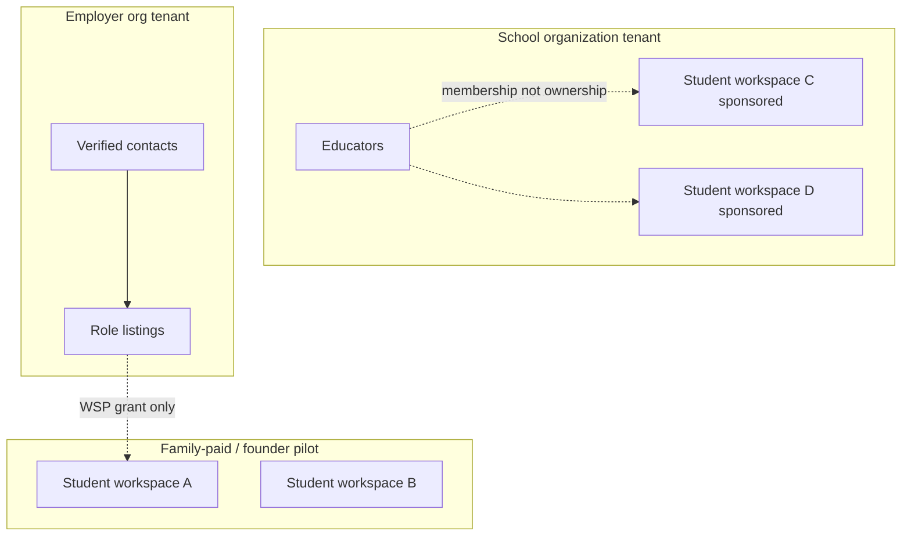

- **Student workspace** is the data island.
- **Organization tenant** is for directory, listings, roster of staff, invoices.
- A school can **sponsor** workspaces (pay, maybe pre-invite coordinators) but does not get a dump of all student fields to export to employers.
- An employer org cannot list students.

This is **not** a naive “one tenant_id on every table” SaaS where Greenleaf and Alex share a tenant.

### Billing sketch

| Customer | Plan | What they get | v1 |
| --- | --- | --- | --- |
| Family | **$20/mo or $200/yr per household** | N student workspaces (siblings), full network, discovery, pairing when flagged on | Yes (or 90-day founder-comped pilot) |
| School / district | Contract per school or FTE | Staff seats, sponsored workspaces, training | Sales-led |
| Nonprofit | Partner | Org profile, listings, referral, maybe sponsored families | Pilot options already on site |
| Employer | **Free verified listing in MVP**; paid boost later | Listings, WSP inbox | Free first to build inventory |

Need-based assistance: founder comps via Stripe coupons; do not build a complex scholarship engine in MVP.

**Lapse:** `past_due` → 14-day grace, **all** workspaces on that Family read-only (no invites, no disclose); then `suspended` (login + export remain). Siblings share fate with the household subscription.

Seat math: a family plan includes unlimited *invited* team members (they are unpaid collaborators) **and** unlimited sibling student workspaces at the published family price. We do not charge Ms. Rivera to help Alex. We do not charge a second $20 for a second child.

### Environments

| Env | URL (proposed) | Data | Who |
| --- | --- | --- | --- |
| local | localhost:3000 / :4000 | Seed Alex | Devs |
| ci | ephemeral | Seed | PRs |
| staging | staging.nxtsteps.dev | Synthetic + optional founder test | Weekly demo |
| prod | app.nxtsteps.dev (after cutover) | Real | Pilot then GA |

Secrets in a manager (Doppler/AWS SM). Prod credentials never on laptops in `.env` committed to git.

Backups: Postgres PITR 30 days; document bucket versioning; quarterly restore test.

---

## Security, privacy, and threat model

### Regulatory posture (product-accurate, not legal advice)

- **FERPA-adjacent:** NXTSteps is not a school. Official education records only move with NXT-FERPA-007 and a school DPA. Family-entered planning data is not automatically a FERPA record, but we treat IEP uploads as **highly sensitive** and currently disabled for sharing.
- **COPPA:** MVP accounts **14+**. No self-serve under 14. Listings with `ages_min < 14` hidden. Marketing’s 10–12 stage is a later, COPPA-compliant product only if counsel reopens this.
- **HIPAA (required):** Security Rule + Privacy Rule safeguards in Appendix N. Treat safety protocols and other health-related operational data as PHI. Execute BAAs with covered-entity customers and PHI-capable subprocessors. Still **not** a healthcare provider; still **no** medical-record / SSN / payer collection as a product feature. School records often remain FERPA; the technical bar is the same.
- **State student privacy:** CT and others; school DPA draft NXT-SCHOOL-012.
- **Youth employment:** pairing gates, not legal advice to employers.
- **E-SIGN** for consents.

All twelve drafts remain drafts until counsel says otherwise; the **data model still records** instrument version hashes so we can turn them on.

### Threat model (focused)

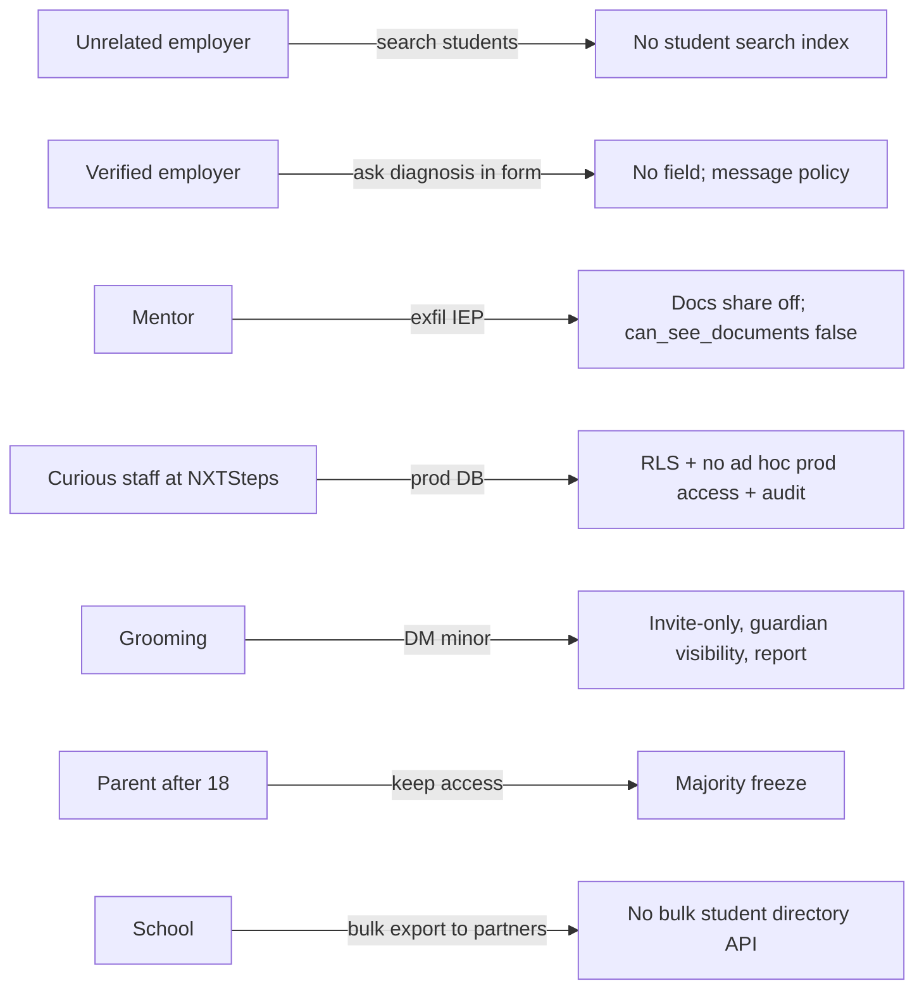

| Threat | Severity | Mitigation |
| --- | --- | --- |
| Employer fishing for diagnoses | High | No diagnosis fields; denylist on WSP; report path; confidentiality agreement |
| Discrimination using pairing % as a proxy | High | Employer never sees a ranked *list of students*; they see applicants to *their* role; no disability dimension |
| Stigma from a blocked match leaking | High | Employer not notified of blocks |
| Unauthorized team access | High | Email-bound invites; 404; RLS; revoke |
| Document leak | High | Share off; encryption; no AI; virus scan |
| Minor contact by strangers | High | No public profiles; employer not in DMs |
| Privilege creep after 18 | High | NXTBridge freeze |
| Insider (platform admin) | High | Admin actions audited; break-glass; no unconstrained SQL for support |
| Prompt injection / LLM leak | High | No LLM on student docs or restricted fields |
| Account takeover of parent email | Medium | Confirmation, rate limits, MFA required for safety/reviewer roles |
| Enumeration of student existence | Medium | 404, generic emails |
| XSS in team notes | Medium | Sanitize, CSP |
| IDOR on pairing IDs | Medium | Authorization on every fetch; unguessable UUIDs still not sufficient |

### Authn/z rules of thumb

- Student-scoped routes always take workspace id and check membership.
- Employer access JWTs are `aud=nxtsteps-api` with Session bound to `org_id`; they cannot pass a workspace id.
- Purpose: `can_review_pairings` does not imply `can_see_documents`.
- Platform admins use a separate console, step-up auth, and are not silently members of workspaces.
- Access JWTs are verified on every API call (`iss`, `aud`, `exp`, `nbf`, signature, `jti` not denylisted, Session not revoked, idle not expired).
- **No PHI in JWT claims.** Workspace membership is loaded from the database after authentication, never from a token the client could have edited.

### HIPAA (product meaning)

HIPAA is the Health Insurance Portability and Accountability Act. It is a **v1 requirement** (Decision 10). In founder language:

- We are **not** a doctor’s office. We do **not** keep medical charts to match students to jobs.
- We **do** protect health-related information the family already needs for a safe placement (for example: “if the floor gets loud, Alex needs a quiet break and a job coach”). That kind of note can be PHI, so we lock it with the same rules hospitals use for electronic records: unique logins, short-lived tokens, encryption, audit trails, BAAs, and a breach plan.
- Schools usually live under **FERPA**. Healthcare partners live under **HIPAA**. NXTSteps implements **one** high bar so a Westport family, a school, and a hospital volunteer program are not three different products.

Implementers follow Appendix N. Do not advertise “HIPAA compliant” in marketing until counsel has signed the BAA template and PR-05b’s checklist is green on staging.

### Data handling

- Encryption in transit (TLS 1.2+) and at rest (Postgres disk + S3 KMS). HTTPS only in staging and prod.
- Automatic logoff (HIPAA): idle 15 minutes on safety / WSP / document routes; 30 minutes elsewhere; access JWT expiry 15 minutes forces a silent refresh while the session is still idle-valid.
- Unique user identification: every request authenticated as a User or StaffUser UUID; shared logins forbidden.
- PII / PHI minimization in logs: no DOB, no safety narratives in app logs — IDs only. JWTs may be logged by `jti`/`sid`, never the raw token.
- Retention: messages 3 years after workspace close unless legal hold; audit **6 years minimum (HIPAA) / 7 years in this design** (ID-only bodies); documents 30-day grace then hard delete unless DPA/legal hold / HIPAA hold.
- Pairing snapshots: redacted on delete to `{algorithm_version, input_hash, fit_status, gate_ids}` unless legal hold (Appendix D.1).
- Employer export: WSP they were granted and viewed, plus their own listings — never the student graph.
- Export (family): JSON of team-visible fields + PDFs they uploaded.
- Deletion: worker job; Stripe customer retained as required by tax, not student notes.

---

## Observability

### Logging

- Structured JSON: `request_id`, `user_id`, `workspace_id` (if authorized context), `route`, `latency_ms`, `outcome`.
- **Do not log** request bodies for student PATCH, safety, or documents.
- Pairing runs log `algorithm_version`, `role_listing_id`, `status`, not snapshots.

### Metrics (RED + product)

| Metric | Use |
| --- | --- |
| `http_requests_total` | SLO |
| `pairing_runs_total{status,version}` | Engine health |
| `pairing_disclose_total` | Funnel |
| `pairing_blocked_total{gate}` | Are we fail-closed or over-blocking? |
| `invites_accepted_total` | Network |
| `safety_events_total{severity}` | Page if high |
| `auth_failures_total` | ATO |
| `document_uploads_total` | Should stay near 0 until legal enable |

Latency targets: API p95 `< 300ms` for reads excluding pairing; pairing `p95 < 1s` (pure CPU on one student × one role is cheap). Discovery list p95 `< 500ms`.

### Tracing

OpenTelemetry from Next.js and NestJS. Trace pairing as a span; do not attach snapshot payloads.

### Alerting

- 5xx > 2% for 5 minutes
- High-severity SafetyEvent
- Spike in `wsp.view_by_employer` from one org (scraping)
- RLS/policy denial spike
- Backup failure
- Certificate / email bounce storm on invites

### Product analytics

Privacy-preserving: funnel counts, not session replay on NXTMe. No third-party marketing pixels on student pages.

---

## Rollout plan

### Feature flags

| Flag | Default prod | Meaning |
| --- | --- | --- |
| `pairing_v1` | staff only | Stage B engine |
| `employer_wsp` | off | Named disclosure |
| `staff_may_review_wsp` | **on** (pilot) | StaffUser on `staff.nxtsteps.dev` (`ops`/`founder`) may review/disclose. Intended **off** after the Westport pilot unless counsel approves. |
| `documents_upload` | off until legal | Matches live policy |
| `documents_share` | off | |
| `billing_enforced` | off for **90 days** of founder-comped pilot | Coupons |
| `bridge_majority_freeze` | on when first 18th birthday in prod | |

### Stages

1. **Internal** — Alex seed on staging; pairing fixtures including Little Sprouts must pass CI.
2. **Founder + counsel** — explanation copy review; legal instruments still draft but UX is real.
3. **Closed family pilot** (Westport) — Stage A live; Stage B visible to team, employer_wsp off.
4. **First verified employers** — Greenleaf-like partners; WSP on for those orgs only after NXT-WSP-013. Reviewer is a teammate **or** (while `staff_may_review_wsp` is on) a StaffUser.
5. **GA families** — billing on; school contracts as ready.

Little Sprouts canary must stay blocked on every staging deploy (Appendix M).

### Rollback

- Flags off instantly (Stage B off returns product to live-pilot matching ethics).
- Schema migrations expand-then-contract; never drop pairing snapshots in a rush.
- If a gate bug **under**-blocks: disable `employer_wsp` first, add a reproducing fixture, patch engine, re-run gate tests, then re-enable for named orgs (Appendix M).

### Cutover from current pilot

Keep the current site as demo until the new app has feature parity for dashboard, path, me, match (Stage A), messages, settings. Then point `app.nxtsteps.dev` at the new stack. Do not silently import real users without password reset and consent refresh.

---

## Alternatives considered

### Backend language / framework

| Option | Pros | Cons | Decision |
| --- | --- | --- | --- |
| **TypeScript NestJS (chosen)** | One language with Next.js; guards/modules for consent; hiring pool | Heavier than a scripts folder | **Choose** |
| Python FastAPI | Nice for future ML; quick CRUD | Two languages, two CI worlds, weaker default UI sharing of types | Ranker could be extracted later; not v1 API |
| Ruby on Rails | Fast CRUD, mature | Team TS-centric; pairing as gem is fine but UI is Next by requirement | Reject for greenfield here |

### Matching approach

| Option | Pros | Cons | Decision |
| --- | --- | --- | --- |
| **Rules + weighted dimensions + hard gates (chosen)** | Explainable; testable; no diagnosis features; founder can defend | Tuning weights is work | **Choose v1** |
| Pure ML embedding match | Might catch fuzzy skill synonyms | Opaque; will overfit disability language in notes; cannot convince employer; legal risk | Reject until a re-ranker that **only** sees Stage A public fields |
| Human matching only | Safest ethically | Does not scale; becomes email again | Human **review**, not human **search** |

A future hybrid is allowed: ML may **reorder Stage A cards** using interests/location/transport/experience **only**. It may not ingest SafetyProfile.

### Tenancy

| Option | Pros | Cons | Decision |
| --- | --- | --- | --- |
| **Hybrid workspace + org (chosen)** | Student privacy; family-first revenue; school attach later | More authorization code | **Choose** |
| Single org tenant (school owns students) | Simple for SIS vendors | Makes families second-class; employer-in-same-tenant risk; wrong ethics | Reject |
| Fully isolated DB per family | Strong isolation | Ops nightmare at 50 families already | Reject; use RLS + workspace_id |

### Pairing science (beyond ML vs rules)

| Option | Pros | Cons | Decision |
| --- | --- | --- | --- |
| **Weighted dimensions + hard gates (chosen)** | Each number maps to a sentence the founder can read; tests are fixtures | Weights are political | **v1** |
| SAT / constraint-solver “find any feasible job” | Exact on gates | Opaque; no “92 because stocking”; hard to explain residual risk | Reject for ranking; gates already *are* boolean constraints |
| Two-sided matching (stable marriage on `openings`) | Respects finite seats | Needs employer ranking of students — creates a student marketplace | Reject. Exclude `openings==0`. No employer-side rank of people |
| Stage B only on explicit coordinator click | Fewer surprise scores | Families with no coordinator never see a caution | **Enqueue on interest** for the team; still employer-blind |
| Trust demand profiles vs inspect vs attest | Inspect is honest | We are not OSHA | **Attest + ops review + revoke** (Issue 3) |

### Auth and hosting vendors

| Option | Pros | Cons | Decision |
| --- | --- | --- | --- |
| Clerk / Auth0 | Faster passwords | Email-bound invites, 404 semantics, minor MFA, separate staff IdP get messy | **Reject MVP** |
| **Custom email+password + JWT (chosen)** | Fits consent graph; meets founder JWT requirement; short-lived access + rotation | ATO risk; we operate the signing keys | Confirmation, rate limits, MFA on privileged roles, RS256, reuse detection |
| Opaque Redis session cookie only (no JWT) | Simpler | Founder required JWT; harder for future mobile/API partners | Reject as sole mechanism; Redis remains the **denylist**, not the access token |
| JWT in `localStorage` / JS-readable cookie | Easy for SPAs | XSS steals PHI-capable sessions | **Reject.** httpOnly cookies only |
| Long-lived access JWT (hours/days) | Fewer refreshes | Stolen token stays valid; fails HIPAA automatic logoff | **Reject.** 15 minutes |
| Fly.io | Nice DX | Another vendor to learn | **Render** locked (Decision 22) |

### Other rejected ideas

- GraphQL v1: authorization too easy to get wrong on nested fields.
- Storing DSM/ICD codes “just in case”: becomes a ranker feature under deadline pressure.
- Public student talent board for inclusive employers: violates “organizations never browse students.”
- Auto-emailing employers on every “I’m interested” without review: humiliating if blocked later; also a spam vector. **Locked off** (Decision 16).

---

## Open questions

Pilot defaults and founder answers are **locked** so engineering is not blocked. Reopen only with an explicit founder + counsel decision.

### Resolved by founder (2026-10-27)

1. **Under-14 / COPPA.** Keep locked default. No self-serve accounts under 14 in MVP. Hide listings with `ages_min < 14`. Adaptive Rec (13+) stays hidden until COPPA counsel reopens this.
2. **Who may disclose a named student (WSP).** **Change.** NXTSteps **staff may review for the pilot.** Founder/ops StaffUser on `staff.nxtsteps.dev` can be the discloser in addition to coordinator / VR / verified nonprofit. A parent still cannot disclose alone. Employment-agency risk is **accepted for the Westport pilot**, with sunset: `staff_may_review_wsp` defaults ON and is intended OFF after the pilot unless counsel approves. Staff never review as a family `User`.
3. **Sibling pricing.** **Change.** Family plan covers siblings. Subscription is on the paying **Family**, not on StudentWorkspace. A family can attach N student workspaces. Published list price **$20/mo or $200/year is the family price** for the pilot (no per-seat matrix). This replaces the earlier one-student-per-sub default.
4. **Employer listings.** Keep locked default. Free verified listings in MVP.
5. **Mentor background checks.** Keep locked default. Invite-only + NXT-MENTOR-010 confidentiality in v1. No Checkr/vendor yet.
6. **Photo on WSP.** **Change.** Allow optional photo with **NXT-MEDIA-011**. Default still off; student/guardian can attach a photo per application only after that instrument is signed for that use. Photo is not used in ranking. Employers who receive a WSP with a photo still must not receive documents/IEPs.
7. **Founder-comped pilot length.** Keep **90 days** before `billing_enforced` can turn on.
8. **HIPAA compliance.** **Add.** Required for v1. NXTSteps is not a healthcare provider and still does not collect medical records. Safeguards + BAAs + risk analysis (Decision 10, Appendix N).
9. **JWT token authentication.** **Add.** Required for v1. Short-lived RS256 access JWT + rotating opaque refresh, httpOnly cookies, Session audit (Decision 20, Appendix L).

### Explicitly closed (do not re-litigate in a sprint)

- Diagnosis field: **no**.
- Medication enum: **no**.
- I’m interested notifies employer: **no**.
- Age 18+ UX: **show card, disable notify, set eligible_on**.
- FERPA roster: **v2**. Parent-invites-teacher in v1.
- Youth rules: **CT-only** table in Appendix C.3.
- User-facing name: **NXTMatch only**.
- Stage B big percentage: **no**; reasons first.
- Documents to employers: **never**.
- Parent-only WSP disclose: **no**.
- Per-student family seat price in v1: **no**.

---

## References

- Live app: [https://app.nxtsteps.dev/](https://app.nxtsteps.dev/)
- Demo: [https://app.nxtsteps.dev/demo](https://app.nxtsteps.dev/demo) and routes `/demo/me`, `/path`, `/match`, `/messages`, `/documents`, `/bridge`, `/settings`, `/plan/retail-job`
- Marketing: [https://nxtsteps.dev/](https://nxtsteps.dev/), [platform](https://nxtsteps.dev/platform), [about](https://nxtsteps.dev/about)
- Legal drafts index: [https://app.nxtsteps.dev/legal](https://app.nxtsteps.dev/legal) (NXT-TOS-001 through NXT-SCHOOL-012, draft 2026-10-25.draft-1)
- Company: NXTSteps LLC, Westport, Connecticut, thomas@nxtsteps.dev
- Published family pricing: $20/month or $200/year (platform page)
- This document does **not** cite the live app as already implementing the pairing algorithm

---

## Risks (explicit)

| Risk | Severity | Mitigation |
| --- | --- | --- |
| Pairing copy still sounds like a deficit score | High | Template review by founder; denylist tests; no “risk score” in UI |
| Over-blocking (every café blocked) | Medium | Caution vs block distinction; fixtures; metrics on `pairing_blocked_total` |
| Under-blocking (childcare slips through) | High | Fail-closed tests as CI gate; v1 forbids all gate overrides; unsupervised children never overridable |
| Legal drafts treated as policy by a school | High | UI continues to say draft; counsel track |
| Small team builds ML too early | Medium | PR plan forbids ML until Stage B tests are green in production |
| Pilot users upload medical PDFs anyway | Medium | Copy, blocked MIME, ops review |
| Discrimination claims because “disability-friendly” filter exists | Medium | Filter is on listings; document that in help center |
| Majority freeze bugs lock a student out | High | Staging tests with DOB; support runbook; student email always retains owner path |
| ADA Title I / state disability-employment claims because a wandering protocol blocked childcare | High | Counsel workstream **before** first WSP; gates are environment/duty-of-care not diagnosis; TOS says recommendation not placement; no student-vs-student ranking; a human still decides to disclose |
| NXTSteps treated as an employment agency | High | **Accepted for the Westport pilot** while `staff_may_review_wsp` is on (Decision 17). TOS still says recommendation not placement. Sunset: flag intended off after the pilot unless counsel approves. Prefer coordinator/VR/Bridgeway when they are on the team. |
| HIPAA-adjacent operational notes (elopement, aggression, self-injury) | High | Treat as PHI; Appendix N safeguards; NXT-DATA-004 before non-empty SafetyProfile; minimum snapshot (codes + what_helps); BAAs; still not a clinic and still no medical-record collection |
| Claiming “HIPAA compliant” before BAAs and encryption checklist | High | Marketing freeze until PR-05b green and counsel signs BAA template |
| Stolen JWT / session | High | 15-min access TTL; refresh rotation + reuse detection; httpOnly; MFA on privileged roles; logout-all |
| Employer lies on RoleDemandProfile | High | Attestation, ops review, revoke, unknown≠no |
| New instrument NXT-WSP-013 not drafted | High | `employer_wsp` remains off until counsel drafts it |
| NXT-MEDIA-011 not drafted | Medium | WSP photo attach stays 403; `photo_included` false |

---

---

## Appendix A — Stage A discovery scoring (normative)

`algorithm_version` for discovery: `stage-a.2026.11.0`.

Stage A may read **only** these student fields: `published_interests`, `zip_for_matching`, `home_lat`, `home_lng`, `transit_uses_bus`, `remote_ok`, `has_any_work_or_volunteer`, `date_of_birth` (age for display/filter only, not for disability). It may read listing fields listed below. It **must not** import SafetyProfile, documents, accommodations, supervision, or any `restricted` student field.

Live demo inconsistency: the dashboard at `/demo` shows **90%** for Community Employment Workshop, Greenleaf, and Bean & Leaf; `/demo/match` shows **80% / 80% / 65%** for the same three. Production **copies `/demo/match`**, not the dashboard. QA must not treat 90 as a fixture.

### Inputs

```text
interestHit     = |Student.published_interests ∩ RoleListing.interest_tags| > 0
experienceFit   = RoleDemandProfile.entry_level_no_experience
                  OR Student.has_any_work_or_volunteer == true
transitFit      = RoleListing.is_remote
                  OR (Student.transit_uses_bus == true AND RoleListing.transit_accessible == true)
remote          = RoleListing.is_remote == true
distanceMiles   = haversine(Student.home_lat/lng, RoleListing.lat/lng)
                  if either lat/lng is null: ZIP-centroid geocode of zip_for_matching vs listing.postal_code
                  if still null: distanceMiles = null (card still listed; reason "Distance not yet mapped")
```

Radius filter (UI, not score): drop listings with a known distance greater than the selected ZIP radius. Null distance is kept and sorted last inside its score band.

Product age rule (MVP): if `RoleListing.ages_min < 14`, **hide** the listing from NXTMatch in production (Adaptive Rec Climbing Club is 13+ on the live demo; it is not shown until COPPA/under-14 is a real product). Exception: staff staging seed may include it flagged `hidden_in_mvp: true`.

Filled listings: if `RoleListing.status != published` OR `openings == 0`, exclude from discovery. Do not over-recommend a filled internship.

### Display score (the integer on the card)

```text
function stageAScore(interestHit, experienceFit, transitFit, remote):
    if interestHit and experienceFit and transitFit: return 80
    if interestHit and (experienceFit != transitFit): return 65   # XOR
    if interestHit and not experienceFit and not transitFit: return 50
    if not interestHit and remote: return 40
    if not interestHit and transitFit: return 30
    return 15
```

This banding is what `/demo/match` actually shows (80 / 65 / 40 / 30 / 15). Distance is a **filter and tie-breaker**, not a component of the displayed percent.

### Why-lines (deterministic, max 4)

Emit in this order, skip if false:

1. `DISTANCE` — if miles != null: `"{miles:.1f} miles away"` else omit
2. `INTEREST` — if interestHit: `"Matches interest: {first matching tag}"` (first in student list order)
3. `TRANSIT` — if remote: `"Remote option"`; elif transitFit: `"Reachable by bus"`
4. `EXPERIENCE` — if `entry_level_no_experience`: `"No experience needed"`

### Sort

1. `stageAScore` desc
2. `interestHit` desc
3. `distanceMiles` asc (nulls last)
4. `RoleListing.published_at` desc
5. `RoleListing.id` asc

### Fixtures (must match `/demo/match`, not `/demo`)

Alex: interests as live demo; ZIP Westport; `transit_uses_bus=true`; `has_any_work_or_volunteer=false`; `remote_ok=true`.

| Listing | interest_tags (seed) | miles | transit_accessible | is_remote | entry_level | Live % | Formula % |
| --- | --- | --- | --- | --- | --- | --- | --- |
| Community Employment Workshop | retail, customer_service | 3.1 | true | false | true | 80 | 80 |
| Greenleaf Inclusive Hiring Internship | retail, customer_service | 0.0 | true | false | true | 80 | 80 |
| Culinary Skills Certificate | cooking | 9.0 | true | false | true | 80 | 80 |
| Food Pantry Volunteer Crew | cooking | 4.1 | true | false | true | 80 | 80 |
| Bean & Leaf Café | cooking, customer_service | 0.3 | true | false | **false** | 65 | 65 |
| Warehouse Associate | retail | 9.0 | **false** | false | true | 65 | 65 |
| Career Mentor Match | (none overlapping) | n/a | true | **true** | true | 40 | 40 |
| College Disability Services Info Night | (none overlapping; do not tag `college` unless copy matches) | n/a | true | true | true | 40 | 40 |
| Hotel Operations Job Shadow | (none overlapping) | 11.2 | true | false | true | 30 | 30 |
| Tech Careers Discovery Day | (none overlapping in live why-line) | 0.1 | true | false | true | 30 | 30 |
| Adaptive Rec Climbing Club | recreation | 1.7 | true | false | true | 30 | **hidden in MVP** (`ages_min=13`) |
| Youth Leadership & Job Club | (none overlapping) | 5.7 | true | false | true | 30 | 30 |
| Bus Travel Training | (none overlapping) | 1.6 | true | false | true | 30 | 30 |
| Shelter Volunteer Program | (none overlapping in live why-line) | 5.0 | false | false | true | 15 | 15 |

If a future seed tags Tech Day with `technology`, the formula will jump to 80. That is correct; update the fixture when tags change. Do not special-case percentages.

CI: `packages/pairing-engine/src/stageA.test.ts` loads this table. A one-line change to `stageAScore` must fail the Greenleaf=80 and Bean&Leaf=65 assertions.

---

## Appendix B — Stage B dimension formulas (normative)

`algorithm_version` for placement: `stage-b.2026.11.0`. Weights (sum 1.00) are constants in `packages/pairing-engine/src/weights.ts`. Changing a weight requires bumping the version.

Helpers:

```text
clamp(x) = min(100, max(0, round(x)))
ordinalComfort = { none:0, brief:1, low:1, moderate:2, high:3 }
ordinalSupervision = { independent:0, periodic_checkins:1, periodic:1,
                       on_site_assigned:2, job_coach_1to1:3 }
MISSING_NEUTRAL = 50   # used only for non-safety dimensions when an input is null
```

Each dimension returns `{ score: 0..100 | null, missing: bool, reasons: ReasonCode[], watchouts: ReasonCode[], unknowns: ReasonCode[] }`. `score=null` means “not applicable because a hard gate already failed on this axis”; it is omitted from the weighted average (weights re-normalized over remaining dimensions).

### B.1 `skills_overlap` (weight 0.18)

```text
level(name):
    s = Student.skills find normalized name
    if s.level == demonstrated: return 100
    if s.level == learning: return 60
    if s.level == interest: return 25
    return 0

required = RoleDemandProfile.required_skills
preferred = RoleDemandProfile.preferred_skills
if required empty and preferred empty:
    return { score: RoleDemandProfile.entry_level_no_experience ? 70 : 50, missing: true }

reqAvg = required empty ? 100 : mean(level(s) for s in required)
prefAvg = preferred empty ? reqAvg : mean(level(s) for s in preferred)
raw = 0.7 * reqAvg + 0.3 * prefAvg
if any required has level 0 and not RoleDemandProfile.entry_level_no_experience:
    raw = min(raw, 40)
    reasons += SKILL_REQUIRED_MISSING
if Student.has_any_work_or_volunteer: raw += 5
else: raw += 0          # no penalty for no experience
return { score: clamp(raw) }
```

Positive reasons: `SKILL_DEMONSTRATED:{name}` for each required/preferred at demonstrated. Watchout: `SKILL_REQUIRED_MISSING:{name}`.

### B.2 `preferred_tasks` (weight 0.12)

Task names are from the controlled taxonomy (`stocking`,`greeting`,`food_prep`,`drink_prep`,`packing`,`cleaning`,`childcare`,`animals`,`computers`,`customer_counter`). Map listing copy through the same taxonomy in seed.

```text
if RoleDemandProfile.task_mix empty:
    return { score: 50, missing: true, unknowns: [TASK_MIX_UNKNOWN] }
primary = tasks with hours_share >= 0.40
avoided = Student.avoided_tasks
hardNo = { t.task for t in avoided if t.hard_no }
if primary ∩ hardNo nonempty:
    # also GATE TASK_HARD_NO
    return { score: 0, watchouts: [TASK_HARD_NO] }
avoidPrimary = primary ∩ { t.task for t in avoided }
overlap = |primary ∩ Student.preferred_tasks| / max(|primary|, 1)
allOverlap = |task_mix.task ∩ Student.preferred_tasks| / max(|task_mix|, 1)
raw = 100 * (0.6 * overlap + 0.4 * allOverlap)
if avoidPrimary nonempty:
    raw = min(raw, 40)
    # cap overall fit_status at caution (see overall rules)
return { score: clamp(raw) }
```

### B.3 `interests` (weight 0.10)

```text
hits = |Student.published_interests ∩ RoleListing.interest_tags|
if hits == 0: score = 0
elif hits == 1: score = 85
else: score = 100
```

### B.4 `schedule_fit` (weight 0.12)

```text
if Student.weekly_availability null or RoleDemandProfile.shift_windows empty:
    return { score: 50, missing: true }
overlapHours = weekly hours of shift_windows ⊆ weekly_availability
               minus Student.school_calendar_conflicts dates
shiftHours = weekly hours of shift_windows
if shiftHours == 0: return { score: 50, missing: true }
frac = overlapHours / shiftHours
score = 100 * frac
roleHours = mean(RoleListing.hours_per_week_min, hours_per_week_max) if present
if Student.desired_hours_min/max set and roleHours outside that band:
    score *= 0.8
if overlapHours == 0: score = 0
```

### B.5 `transportation` (weight 0.10)

```text
if RoleListing.is_remote: return { score: 100 }
miles = distanceMiles as in Stage A
if miles is null:
    if Student.zip_for_matching == RoleListing.postal_code: score = 80
    else: return { score: 40, missing: true }
# Convert miles to minutes at 20 mph mixed (3 min/mile)
minutes = miles * 3
# Hard gate TRANSPORT_IMPOSSIBLE may already have failed; if so score=null
if miles <= 2: score = 100
elif miles <= 5: score = 90
elif miles <= 10: score = 75
elif miles <= 15: score = 60
elif miles <= 25: score = 40
else: score = 20
if Student.transit_uses_bus and RoleListing.transit_accessible: score = min(100, score + 10)
if Student.travel_training_level == in_progress and miles > 3: score -= 15
if Student.has_ride_from_family: score = max(score, 70)
return { score: clamp(score) }
```

### B.6 `sensory_environment` (weight 0.10)

There is **no** field named `environment_fit` or `sensory_profile`. Compare the ordinals that exist, plus tags.

```text
function sub(studentComfort, roleLevel):
    if studentComfort is null or roleLevel is null: return MISSING_NEUTRAL
    s = ordinalComfort[studentComfort]; r = ordinalComfort[roleLevel]
    if r <= s: return 100
    if r == s + 1: return 55
    return 20

noise = sub(Student.noise_comfort, RoleDemandProfile.noise_level)
crowd = sub(Student.crowd_comfort, RoleDemandProfile.crowd_level)
smell = sub(  # student has no ordinal; skip unless smell_heat_notes non-empty
    Student.smell_heat_notes ? 'low' : null,   # notes present ⇒ treat comfort as low for kitchens
    RoleDemandProfile.smell_heat_intensity)
base = mean of non-missing(noise, crowd, smell)  # if all missing: score 50 missing=true

tags = RoleDemandProfile.environment_tags[]   # ALWAYS recomputed on save from B.6b; never independently stored
if Student.known_good_environments ∩ tags: base = min(100, base + 10)
if Student.known_hard_environments ∩ tags:
    base = max(0, base - 20)
    watchouts += SENSORY_KNOWN_HARD
# hard-nos are a gate, not a score
return { score: clamp(base) }
```

**B.6b `environment_tags` derivation** (column is stored, **always recomputed on save** from this closed table; tests assert the stored array equals the derivation — no “derived or stored” fork):

| Condition | Tag emitted |
| --- | --- |
| role_kind internship/employment and org industry grocery (`Employer.industry_naics` starts with `445`, food & beverage stores) | `grocery_floor` |
| role_kind internship/employment AND org industry grocery (same NAICS rule) AND (`noise_level` OR `crowd_level` in {moderate, high}) | `grocery_peak` |
| noise_level=high and (drink_prep in task_mix or smell_heat=high) | `cafe_peak` |
| hazard_vehicles_forklifts=yes or (noise_level=high and packing in task_mix) | `warehouse_alarms` |
| smell_heat_intensity=high | `commercial_kitchen_peak_noise` |
| open_community_unsupervised=yes | `open_community` |
| always include noise/crowd as `noise_{level}`, `crowd_{level}` when those levels are set | |

Greenleaf seed (grocery internship, noise moderate, crowd moderate) therefore emits `[grocery_floor, grocery_peak, noise_moderate, crowd_moderate]` after every save. That is why Alex `known_hard` ∩ tags includes `grocery_peak` and `sensory_environment=80`.

### B.7 `supervision_fit` (weight 0.08)

```text
needed = ordinalSupervision[Student.min_supervision_level]
provided = ordinalSupervision[RoleDemandProfile.supervision_provided]
# job_coach_policy does NOT raise provided unless the student needs job_coach_1to1
if needed is null or provided is null: return { score: 50, missing: true }
if needed > provided:
    if Student job-coach required for this role_kind and RoleDemandProfile.job_coach_policy in {welcome, required_by_role}:
        provided = ordinalSupervision[job_coach_1to1]
    else:
        # SUPERVISION_FLOOR already failed; score=null
        return { score: null }
margin = provided - needed
if margin >= 2: score = 100
elif margin == 1: score = 85
else: score = 60
```

### B.8 `customer_intensity` (weight 0.06)

```text
s = ordinalComfort[Student.customer_facing_comfort]
r = ordinalComfort[RoleDemandProfile.customer_intensity]
# map role low→1, moderate→2, high→3; student none/brief/moderate/high
if s is null or r is null: return { score: 50, missing: true }
if r <= s: score = 100
elif r == s + 1: score = 50
else: score = 20
```

### B.9 `physical_demands` (weight 0.06)

```text
subs = []
if RoleDemandProfile.typical_lift_lbs != null and Student.typical_lift_lbs != null:
    if typical_lift <= Student.typical_lift_lbs: subs += 100
    elif Student.max_lift_lbs != null and typical_lift <= Student.max_lift_lbs: subs += 50
    else: # PHYSICAL_DEMANDS_HARD fail; score=null
if RoleDemandProfile.standing_minutes != null and Student.standing_minutes_comfort != null:
    if standing_minutes <= standing_minutes_comfort: subs += 100
    elif Student.cannot_stand_minutes != null and standing_minutes <= cannot_stand_minutes: subs += 40
    else: gate
if RoleDemandProfile.ladder_required and Student.no_ladder: gate
if subs empty: return { score: 60, missing: true }
return { score: clamp(mean(subs)) }
```

### B.10 `support_availability` (weight 0.08)

```text
requested = Student.requested_accommodations
if requested empty: requested = Student.benefits_from
offered = set(RoleDemandProfile.supports_offered)
         ∪ flags that are true: visual_schedules, written_task_lists,
           quiet_break_space, job_coach_policy in {welcome, required_by_role}→'job_coach', captioned_training
if requested empty: return { score: 80 }   # nothing extra asked
hits = |requested ∩ offered|
score = 100 * hits / |requested|
```

`required_employer_capabilities` = requested − offered (gaps only). Capabilities already on the listing are `met_capabilities` and do **not** force caution.

### B.11 Overall `fit_status` and score

```text
if any high-severity gate result == fail:
    overall_score = null
    fit_status = blocked
elif any high-severity gate result == insufficient_data and RoleDemandProfile.safety_sensitive_category != none:
    overall_score = null
    fit_status = blocked
    workflow_status = needs_safety_data
else:
    dims = dimensions with score != null
    overall_score = round(sum(weight_i * score_i) / sum(weight_i for dims))
    if any primary-task hard_no: fit_status = blocked
    elif eligible_on != null and eligible_on > today: fit_status = blocked  # UI uses eligible_on
    elif overall_score >= 75 and residual_risk == low and no dimension score < 40:
        fit_status = strong
        if required_employer_capabilities nonempty: fit_status = caution
    elif overall_score >= 50:
        if residual_risk in {medium, high} or any dimension < 50 or required_employer_capabilities nonempty:
            fit_status = caution
        else:
            fit_status = possible
    else:
        fit_status = weak
```

### B.12 Residual risk truth table

`unmatchedMedium` = SupportProtocol rows where `severity==moderate` AND (`relevant_role_types` empty OR intersects `RoleListing.role_kind`) AND the protocol is **not** fully covered by `met_capabilities` (e.g. quiet_break_space covers `overwhelm_exit` when `what_helps` contains quiet break). High-severity protocols are gates, not residual.

| unmatched medium count | max frequency | last_occurred_on | residual_risk |
| --- | --- | --- | --- |
| 0 | — | — | low |
| 1 | rare | null or > 6 months ago | low |
| 1 | rare | ≤ 6 months | medium |
| 1 | occasional | any | medium |
| 1 | frequent | any | high |
| ≥ 2 | any except any frequent | any | medium |
| ≥ 2 | any frequent | any | high |

`residual_risk==high` does **not** by itself block (high-severity already gated). It forces `fit_status` at best `caution`.

### B.13 Alternative picker

Called when `fit_status` in `{blocked, weak}` or when the team requests “show other options.”

```text
function pickAlternatives(student, failedListing, gateIds, limit=2):
    pool = Stage A list for student, exclude failedListing.id,
           exclude status!=published, exclude openings==0
    # Do not recommend the same fail: drop listings that would fail the
    # same high-severity gate IDs (recompute gates only, not full score)
    pool = [L for L in pool if not wouldFail(student, L, gateIds)]
    preferred = [L for L in pool if L.stageAScore >= 65
                 and (L.interest_tags ∩ student.published_interests)]
    if len(preferred) < 2:
        preferred += [L for L in pool
                      if L.role_kind in {workshop, training, community_program, volunteer}
                      and L.stageAScore >= 30]
    sort preferred by stageAScore desc, distanceMiles asc
    return preferred[:limit]
```

Always also emit one **skill-path** suggestion from the first failed gate (not a listing):

| Gate / gap | Skill-path title |
| --- | --- |
| AGE_RANGE | “Apply on your 18th birthday” calendar task |
| JOB_COACH_REQUIRED | “Ask Bridgeway about a job coach” |
| TRANSPORT_IMPOSSIBLE | “Ride route 12 with a trainer” (reuse existing goal if present) |
| SKILL_REQUIRED_MISSING / experience | “Finish workplace skills workshop” |
| PHYSICAL_DEMANDS_HARD | Do **not** auto-create lift training; only if student already has a warehouse goal |
| VULNERABLE_POPULATION | Structured program with trained staff (Food Pantry / Tech Day in MVP), never another unsupervised childcare |

### B.14 Worked example scores (computed, not illustrative)

**Alex × Greenleaf** (`stage-b.2026.11.0`) using Appendix J seed:

| Dimension | Score | Notes |
| --- | --- | --- |
| skills_overlap | 94 | required stocking+lists demonstrated; preferred greeting learning + organizing demonstrated; +0 exp |
| preferred_tasks | 100 | stocking 0.6, greeting 0.4, both preferred |
| interests | 100 | retail + customer_service |
| schedule_fit | 100 | weekday 15:00–18:00 ⊆ availability; 10–15 h in 8–15 wanted |
| transportation | 100 | 0.0 miles |
| sensory_environment | 80 | noise/crowd match (100) −20 known_hard `grocery_peak` |
| supervision_fit | 85 | needed periodic_checkins, provided on_site_assigned, margin 1 |
| customer_intensity | 50 | student `brief`, role `moderate` (stretch) |
| physical_demands | 100 | typical_lift 20 ≤ 20 |
| support_availability | 100 | requested `{written_task_lists}` already offered |

Weighted: `0.18*94 + 0.12*100 + 0.10*100 + 0.12*100 + 0.10*100 + 0.10*80 + 0.08*85 + 0.06*50 + 0.06*100 + 0.08*100` = **92.72 → 93** (`Math.round`). Residual **low**: the only protocol is `elopement` **high**, which is a **gate**, not unmatched-medium; unmatched medium count = 0. `required_employer_capabilities` empty (gaps none). `fit_status=strong`. CI fixture: overall 93 ± 0, sensory 80 ± 0, status strong, residual low. Tags after B.6b recompute: `[grocery_floor, grocery_peak, noise_moderate, crowd_moderate]`.

**Alex × Bean & Leaf at 17:** `AGE_RANGE` fail → `fit_status=blocked`, `eligible_on=18th birthday`, `workflow_status=computed`, no employer notify.

**Alex × Bean & Leaf after 18th birthday (default seed):** `AGE_RANGE` passes. `job_coach_policy=unknown` on kitchen + Alex requires café coach → `JOB_COACH_REQUIRED` insufficient_data. Kitchen `hazard_knives`/`hazard_hot_oil` unknown → `SELF_INJURY_HAZARD` insufficient_data. B.11: high-severity insufficient_data on `safety_sensitive_category != none` ⇒ `fit_status=blocked`, `workflow_status=needs_safety_data`, overall null. **This is the locked after-18 outcome.** Optional fixture `beanleaf-coach-welcome` (`job_coach_policy=welcome`, hazards `no`) is the only path to caution (customer_intensity 20, sensory from `cafe_peak` + noise high).

**Alex × Little Sprouts:** gates `VULNERABLE_POPULATION`, `ELOPEMENT`, `JOB_COACH_REQUIRED` **fail** (elopement high + open_community yes + near_traffic yes + one_to_one no; childcare required vs `job_coach_policy=not_permitted`; unsupervised with children). `fit_status=blocked`, overall null. Alternatives from B.13: Food Pantry, Tech Day, Greenleaf (climbing club hidden in MVP).

CI: `packages/pairing-engine` must go red if Greenleaf overall changes by 1 or Little Sprouts does not block.

---

## Appendix C — Hard-constraint catalog (exact attribute paths)

Every identifier here **must** exist on the Prisma schema. CI test `gate-catalog-binds.test.ts` parses this table.

Gate result: `pass` | `fail` | `insufficient_data`. High-severity `fail` ⇒ `fit_status=blocked`. High-severity `insufficient_data` on `safety_sensitive_category != none` ⇒ `fit_status=blocked` and `workflow_status=needs_safety_data`. **Insufficient data does not fail open.**

Fail-closed workplace flags use tri-state `yes|no|unknown` (not `false` as default). `unknown` is `insufficient_data`. `job_coach_policy` is `unknown|welcome|required_by_role|not_permitted`. In fail-when clauses, a tri-state field is true only when it equals `yes`.

### C.1 Derivation of SafetyConstraint (run on protocol save)

```text
SafetyConstraint.no_unsupervised_with_children =
    any(SupportProtocol.requires_no_unsupervised_children)
    OR any(code==elopement AND severity in {moderate,high})
    OR explicit team-set true

SafetyConstraint.no_unsupervised_with_vulnerable_adults =
    explicit team-set OR any(code==physical_aggression AND severity==high)

SafetyConstraint.no_knives_or_heights =
    any(code==self_injury AND severity in {moderate,high})
    OR explicit team-set

SafetyConstraint.requires_job_coach_for_customer_high =
    Student.job_coach_preference_by_role_type['cafe'|'childcare'] == required
    OR any(code in {overwhelm_exit,elopement} AND severity==high)
```

Student `job_coach_required_for_role(role_kind)` =

```text
map = Student.job_coach_preference_by_role_type  # jsonb
key = role_kind mapped: employment/internship + grocery → 'retail';
      drink_prep/cafe → 'cafe'; serves_children → 'childcare'; else role_kind
return map[key] == 'required'
```

### C.2 Gate table

| ID | Severity | Student path | Role path | Fail when | insufficient_data when |
| --- | --- | --- | --- | --- | --- |
| `AGE_RANGE` | High | `Student.date_of_birth` age at `RoleListing.start_date` or today | `RoleListing.ages_min`, `RoleListing.ages_max` | age < min or age > max | DOB null |
| `WORK_HOURS_MINOR` | High | `Student.date_of_birth`, `Student.has_working_papers`, `StudentWorkspace.home_state` | `RoleListing.hours_per_week_max`, `RoleDemandProfile.evening_hours`, `RoleDemandProfile.overnight`, `RoleDemandProfile.hazardous_occupation_youth`, `RoleDemandProfile.shift_windows` | Any **Appendix C.3** fail-if row is true | `has_working_papers` null **or** `hours_per_week_max` null **or** `shift_windows` empty/null on paid `employment`/`internship` for ages 16–17; `overnight` or `hazardous_occupation_youth` is `unknown` on paid 16–17; `home_state` not `CT` on paid employment/internship |
| `TRANSPORT_IMPOSSIBLE` | High if not remote | `Student.max_commute_minutes`, `Student.transit_uses_bus`, `Student.has_ride_from_family`, `Student.travel_training_level`, `Student.remote_ok`, `Student.has_drivers_license` | `RoleListing.lat/lng`, `RoleListing.is_remote`, `RoleListing.transit_accessible`, `RoleDemandProfile.driver_license_required` | not remote AND minutes > max_commute_minutes AND not (transit_uses_bus AND transit_accessible) AND not has_ride_from_family | lat/lng and ZIP both missing on an on-site role |
| `DRIVER_LICENSE` | High | `Student.has_drivers_license` | `RoleDemandProfile.driver_license_required` | required==true AND license==false | required==true AND license null |
| `SUPERVISION_FLOOR` | High | `Student.min_supervision_level` | `RoleDemandProfile.supervision_provided`, `RoleDemandProfile.job_coach_policy` | needed ordinal > provided ordinal AND NOT (needed==job_coach_1to1 AND job_coach_policy in {welcome, required_by_role}) | min_supervision_level null on safety-sensitive role; `job_coach_policy==unknown` when needed==job_coach_1to1 on safety-sensitive role |
| `JOB_COACH_REQUIRED` | High | `job_coach_required_for_role(role_kind)` as above | `RoleDemandProfile.job_coach_policy` | required AND policy==`not_permitted` | required AND policy==`unknown` on (`safety_sensitive_category != none` OR paid `employment`/`internship`); preference jsonb missing key on safety-sensitive role |
| `VULNERABLE_POPULATION` | High | `SafetyConstraint.no_unsupervised_with_children`, `no_unsupervised_with_vulnerable_adults` | `RoleDemandProfile.serves_children`, `serves_vulnerable_adults`, `unsupervised_with_those_populations` | (no_unsupervised_with_children AND serves_children==yes AND unsupervised_with_those_populations==yes) OR analog for adults | any of those role fields `unknown` on category `childcare`/`healthcare` |
| `ELOPEMENT` | High | `SupportProtocol` where `code==elopement` AND `severity==high` AND `requires_1to1_in_open_community==true` | `RoleDemandProfile.open_community_unsupervised`, `near_traffic`, `one_to_one_available` | such protocol exists AND (open_community_unsupervised==yes OR near_traffic==yes) AND one_to_one_available!=yes | those role fields `unknown` when an elopement protocol exists |
| `AGGRESSION_DUTY_OF_CARE` | High | `SupportProtocol` `code==physical_aggression` AND `severity==high` AND (`last_occurred_on` is null OR within **18 months**) | `serves_children` OR `serves_vulnerable_adults` OR `isolated_work` | protocol matches AND (serves_children==yes OR serves_vulnerable_adults==yes OR isolated_work==yes) | protocol high but `last_occurred_on` null still **fails** (fail closed); lookback constant `AGGRESSION_LOOKBACK_DAYS=547` |
| `SELF_INJURY_HAZARD` | High | `SafetyConstraint.no_knives_or_heights` | `hazard_knives`, `hazard_heights`, `hazard_hot_oil` | constraint true AND any of those hazards `yes` AND no listed mitigation in `supports_offered` containing `hazard_mitigation` | hazards `unknown` on kitchen/warehouse category |
| `SENSORY_HARD_NO` | Medium-high (blocks this role) | `Student.environment_hard_nos[]` | `RoleDemandProfile.environment_tags[]` | exact tag intersection nonempty | n/a (empty tags ⇒ pass, not unknown) |
| `PHYSICAL_DEMANDS_HARD` | High | `Student.max_lift_lbs`, `cannot_stand_minutes`, `no_ladder` | `typical_lift_lbs`, `standing_minutes`, `ladder_required` | demand exceeds documented max | typical_lift `unknown` on category `warehouse` |
| `AFTER_HOURS` | High | `Student.cannot_work_after`, `Student.evening_transport_available` | last end time in `shift_windows`, `evening_hours` | shift end > cannot_work_after AND evening_transport_available!=true | shift_windows empty on employment/internship |
| `TASK_HARD_NO` | High | `Student.avoided_tasks[].hard_no` | `task_mix[]` primary (≥0.40) | intersection | task_mix empty on employment/internship ⇒ insufficient_data |
| `EMPLOYER_UNVERIFIED` | High for Stage B **run** | n/a | `Organization.verification_status`, `RoleDemandProfile.attested_at` | status!=verified OR attested_at null | n/a |
| `DEMAND_UNATTESTED` | High for Stage B | n/a | `RoleDemandProfile.attested_at`, `attested_by_membership_id` | null | n/a |
| `CONSENT_MISSING` | High | `Student.pairing_opt_in_stage_b==true` AND Consent row `instrument==collaboration_share` mapped; Stage B restricted attrs also require Consent `instrument==student_info_processing` (NXT-DATA-004) when SafetyProfile is non-empty | n/a | opt-in false or required consent missing | n/a |
| `SAFETY_STALE` | High for **disclose**, not for compute | `SafetyProfile.last_reviewed_at` | n/a | last_reviewed_at null OR > 12 months OR (> 6 months if any protocol severity==high) | n/a |
| `OPENINGS` | Medium | n/a | `RoleListing.openings`, `status` | status filled or openings==0 | n/a |

`BACKGROUND_OR_CLEARANCE` is **informational** (`RoleDemandProfile.background_check_of_worker_required`) — never uses student disability; surfaces as a student_commitment, not a fail.

### C.3 Connecticut youth-employment table (pilot v1)

`StudentWorkspace.home_state` must be `CT` to evaluate `WORK_HOURS_MINOR`. Non-CT in MVP: gate returns `insufficient_data` for paid employment/internship (fail closed for paid work; workshops/remote info nights pass). Counsel must review before expanding states. This is **not legal advice**; it is a conservative encode of common CT + FLSA youth rules for software.

| Student age | Role | Fail if |
| --- | --- | --- |
| < 14 | any | always (also product min age) |
| 14–15 | `employment` or paid `internship` | always in v1 (volunteer/workshop/education_program/community_program may pass if ages_min allows) |
| 16–17 | any | `hazardous_occupation_youth==yes` |
| 16–17 | paid employment/internship | `has_working_papers!=true` |
| 16–17 | paid, school in session (weekday on `Student.school_calendar_conflicts` or default school year Sep–Jun excluding weekends) | `hours_per_week_max > 32` OR any `shift_windows` end > 22:00 OR start < 06:00 OR `overnight==yes` |
| 16–17 | paid, summer / not school | `hours_per_week_max > 48` OR `overnight==yes` |
| ≥ 18 | any | `WORK_HOURS_MINOR` passes (listing `ages_min` still applies via `AGE_RANGE`) |

**Missing hours are insufficient_data, not a pass.** On paid `employment`/`internship` for ages 16–17, if `hours_per_week_max` is null **or** `shift_windows` is empty/null, `WORK_HOURS_MINOR` returns `insufficient_data` (same fail-closed posture as `AFTER_HOURS`). `overnight==unknown` or `hazardous_occupation_youth==unknown` on paid 16–17 is also `insufficient_data`. Do not evaluate `null > 32` as false.

Employer policy `ages_min=18` still blocks a 17-year-old via `AGE_RANGE` even if CT law would allow the work.

---

## Appendix D — Snapshot / disclosure field matrix (normative)

Frozen in `packages/shared-types/src/fieldMatrix.ts`. Tests fail if a Prisma field is used in an engine input but missing here, or if a `never-share-with-employer` field is in Stage A or WSP.

Legend: **A** Stage A input · **B** Stage B input · **Team** team UI · **WSP** employer packet · **Expl** employer explanation text · **Log** may appear in application logs.

| Field | A | B | Team | WSP | Expl | Log | Notes |
| --- | --- | --- | --- | --- | --- | --- | --- |
| Student.id | n | n | y | n | n | id only | |
| preferred_name | n | y | y | y | y | n | WSP after grant |
| legal_*_name | n | n | y | opt-in | n | n | default off |
| date_of_birth | n | y | y | age or band | n | n | Stage A uses age only in-memory for 14+ filter, not stored in A snapshot |
| home_city / home_state | n | y | y | y | n | n | |
| home_postal_code | y | y | y | n | n | n | |
| home_lat/lng | y | y | y | n | n | n | |
| published_interests | y | y | y | y | y | n | |
| zip_for_matching | y | y | y | n | n | n | |
| transit_uses_bus | y | y | y | summary | n | n | |
| remote_ok | y | y | y | n | n | n | |
| has_any_work_or_volunteer | y | y | y | summary | n | n | |
| skills[] | n | y | y | chosen | y | n | |
| preferred_tasks / avoided_tasks | n | y | y | n | n | n | |
| weekly_availability, hours, cannot_work_after | n | y | y | n | n | n | |
| travel_training_level, has_ride_from_family, has_drivers_license | n | y | y | transport summary | n | n | |
| customer_facing_comfort, noise_comfort, crowd_comfort | n | y | y | n | n | n | |
| known_good/hard, environment_hard_nos | n | y | y | n | n | n | |
| typical/max_lift, standing, no_ladder | n | y | y | n | n | n | |
| min_supervision_level | n | y | y | n | n | n | restricted |
| job_coach_preference_by_role_type | n | y | y | n | n | n | |
| requested_accommodations, benefits_from | n | y | y | if student checks | if in WSP | n | |
| communication_supports | n | n | y | n | n | n | **not** in Stage B (proxy risk); reviewer may copy operational phrase into WSP manually |
| Student.photo_url | n | n | y | n | n | n | Team avatar only; never auto-copied |
| WSP.photo_storage_key | n | n | y if attached | y if NXT-MEDIA-011 granted for **this pairing** | n | n | Default omitted; **not** Stage A or Stage B ranker input |
| IEP-like fields, documents, section_504_or_iep_exists | n | n | scoped | n | n | n | |
| SupportProtocol.* | n | y | safety roles | **operational lines only if explicitly copied** | denylist lint | n | narratives not in WSP by default |
| SafetyConstraint.* | n | y | safety roles | n | n | n | |
| SafetyEvent.narrative | n | n | safety roles | n | n | n | recency/severity may inform stale/pause, not ranker features |
| race, sex, work_authorization | — | — | — | — | — | — | **removed from v1 schema** |
| diagnosis* | — | — | — | — | — | — | **must not exist** |

Stage A snapshot JSON keys: `{ published_interests, zip_for_matching, home_lat, home_lng, transit_uses_bus, remote_ok, has_any_work_or_volunteer, age_years }` plus listing public fields.

Stage B student snapshot: matrix B=y. Safety snapshot: protocol `{id,code,severity,frequency,last_occurred_on,requires_1to1_in_open_community,requires_no_unsupervised_children,relevant_role_types,what_helps}` — **not** `situation`/`likely_response`/`what_makes_worse` free text (those stay in the live SafetyProfile; replay uses codes + what_helps). This shrinks leak surface in JSONB.

### D.1 Snapshot retention vs deletion

On workspace delete without legal hold:

- Replace `student_snapshot` and `safety_snapshot` with `{ redacted: true, algorithm_version, input_hash, fit_status, gate_ids[] }`.
- Keep `PairingRecord` row for metrics.
- Delete WSP blobs; if `employer_viewed_at` set, retain a **WSP receipt** `{ pairing_id, org_id, viewed_at, field_allow_list }` without student text (employer may have an out-of-band copy; we do not pretend we can erase their inbox).
- AuditLog 7 years, bodies already ID-only.
- Documents: 30-day grace then hard delete.

Legal hold: freeze snapshots unredacted until hold lifts.

### D.2 `input_hash` canonicalization

In `packages/pairing-engine`:

```text
canonical = JSON.stringify(sortKeys({ student: student_snapshot, role: role_snapshot, safety: safety_snapshot, weights, algorithm_version }))
input_hash = sha256(utf8(canonical))
```

`sortKeys` is recursive key-sort; omit `undefined`; dates as ISO dates. Same inputs ⇒ same hash across Node versions (no insertion-order objects).

### D.3 Denylist (employer-facing + WSP lint)

Block save of WSP / employer_explanation if any token matches (case-insensitive, word-ish):

`autism, autistic, asd, asperger, asperger's, on the spectrum, adhd, add, diagnosis, diagnosed, iep, 504, disability, disabled, retarded, disorder, syndrome, bipolar, schizophrenia, down syndrome, intellectual disability, medication, adderall, risperdal, aac, nonverbal, non-speaking, special ed, special education, aba`

Reviewer UI blocks **Proceed** until the phrase is removed. False positives (e.g. “spectrum of tasks”) must be rephrased. This is a safety net, not a reason to store those words in pairing inputs.

### D.4 Fairness tests

1. Two students identical except a protocol that **does not apply** to the role → identical overall and every dimension.
2. Two students identical except `min_supervision_level` / job-coach required, **and the role already provides that supervision** → `skills_overlap`, `interests`, `preferred_tasks` identical; overall may differ **only** via `supervision_fit` and/or `support_availability`. No hidden column.
3. Stage A fixtures never read `Safety*` tables (static import check).

---

## Appendix E — Reason-code enum (closed)

```text
enum ReasonCode {
  INTEREST_MATCH
  DISTANCE_MILES
  TRANSIT_ACCESSIBLE
  REMOTE_OPTION
  ENTRY_LEVEL
  SKILL_DEMONSTRATED
  SKILL_LEARNING
  SKILL_REQUIRED_MISSING
  TASK_PREFERRED
  TASK_AVOIDED
  TASK_HARD_NO
  TASK_MIX_UNKNOWN
  SCHEDULE_OVERLAP
  SCHEDULE_NO_OVERLAP
  SCHEDULE_HOURS_BAND
  TRANSPORT_WALKABLE
  TRANSPORT_RIDE_BACKUP
  TRANSPORT_IN_PROGRESS
  SENSORY_MATCH
  SENSORY_STRETCH
  SENSORY_KNOWN_HARD
  SUPERVISION_MARGIN
  CUSTOMER_MATCH
  CUSTOMER_STRETCH
  PHYSICAL_WITHIN
  PHYSICAL_NEAR_MAX
  SUPPORT_MET
  SUPPORT_GAP
  JOB_COACH_WELCOME
  WRITTEN_TASK_LISTS
  QUIET_BREAK
  GATE_FAIL  // payload gate id
  AGE_BELOW_MIN
  OPENS_AT_ELIGIBLE_ON
  ALTERNATIVE_LISTING
  SKILL_PATH
}
```

Templates substitute `ReasonCode` + payload, never free-text from protocols except `what_helps` after denylist.

Student template:

> This job uses your strengths in {SKILL_DEMONSTRATED|TASK_PREFERRED}. The workplace has {SUPPORT_MET|JOB_COACH_WELCOME|WRITTEN_TASK_LISTS}. These parts might be hard: {CUSTOMER_STRETCH|SENSORY_STRETCH|WATCHOUTS}. Here is the plan: {SUPPORT_GAP mapped to a plan sentence}. {if blocked: We are not recommending you apply to this one. That is about the job’s setup, not about your worth. Next steps: {ALTERNATIVE_LISTING|SKILL_PATH}.}

Employer template: as in the pairing section, filled only from WSP-allowed codes.

---

## Appendix F — Permission matrix (network_role × purpose)

`network_role` is the product label. Permissions are **derived**. Store `permission_overrides jsonb` only for rare exceptions (audited). Do **not** store overlapping `access_level` or `can_*` booleans.

| Purpose | student | parent_guardian | transition_coordinator | vocational_counselor | career_mentor | nonprofit_provider | job_coach | school_staff | employer_contact |
| --- | --- | --- | --- | --- | --- | --- | --- | --- | --- |
| view_plan | y | y | y | y | y | y | y | y | pairing thread only |
| edit_plan | y | y | y | y | n | n | n | n | n |
| propose_goal | y | y | y | y | y | n | n | n | n |
| invite | n | y | y | n | n | n | n | n | n |
| review_pairing | y (own) | y | y | y | n | y if verified nonprofit | n | n | n |
| disclose_wsp | n | checklist only; **cannot disclose alone** | y | y | n | y if verified nonprofit | n | n | n |
| edit_safety | y (ack) | y | y | y | n | n | n | n | n |
| see_documents | y | y | n default | n default | n | n | n | n | n |
| message_team | y | y | y | y | y | y | y | y | n |
| message_pairing_thread | y | y | y | y | n | n | y | n | y if shared |
| file_safety_event | y | y | y | y | y | y | y | y | y if shared |

**Reviewer-eligible for named WSP (founder lock 2026-10-27):** a **TeamMembership** with `network_role` in `{transition_coordinator, vocational_counselor}` OR `nonprofit_provider` on a **verified** org, **or** a `StaffUser` with role `ops`/`founder` while `staff_may_review_wsp` is on. Parent/guardian may complete the reviewer **checklist** but `POST /pairings/:id/disclose` is **rejected** unless one of those reviewers acts. Staff disclose from `staff.nxtsteps.dev` (`POST /staff/pairings/:id/disclose`); they do not become a family User. **Staff review does not skip consents:** NXT-WSP-013 (and NXT-MEDIA-011 if a photo is attached) plus parent/student grants still required. Family-only workspaces are prompted to invite Bridgeway; staff review is the pilot path when no partner is on the team yet. After the pilot, turn `staff_may_review_wsp` off unless counsel approves.

`employer_contact` is created only when `workflow_status` reaches `shared`, scoped to that pairing thread, never the whole-team chat.

---

## Appendix G — Role demand v1 required subset and listing wizard

Tri-state fail-closed flags: `yes | no | unknown`. Default **unknown**, never `no`. `job_coach_policy`: `unknown | welcome | required_by_role | not_permitted`. Default **unknown**.

`safety_sensitive_category` enum on RoleDemandProfile (required): `none | childcare | healthcare | driving | overnight | chemicals_or_weapons | warehouse | kitchen | open_community | other_sensitive`.

If category != `none`, ops must review before `RoleListing.status=published` (SLA 2 business days). Unreviewed safety-sensitive listings stay `draft`.

### Required by `role_kind` (v1 wizard, ~10 minutes)

**All kinds:** `safety_sensitive_category`, `entry_level_no_experience`, `job_coach_policy`, `supervision_provided`, `is_remote`, `transit_accessible` (if not remote), `interest_tags` (≥1 or explicitly “none”).

**workshop / education_program / mentorship / job_shadow / community_program:** plus `ages_min/max`, `shift` summary. Hazards may remain unknown unless category != none.

**volunteer / internship / employment:** plus `task_mix` (≥1 task), `shift_windows` or `schedule_summary` parsed, `customer_intensity`, `noise_level`, `crowd_level`, `serves_children`, `serves_vulnerable_adults`, `unsupervised_with_those_populations` (if either serve=* yes), `open_community_unsupervised`, `typical_lift_lbs` or explicit “no lifting”.

**If category is childcare:** force questions: “Will this person be left alone with children?” → `unsupervised_with_those_populations` (must not remain `unknown` when `serves_children=yes` — publish check constraint); “Job coach allowed on site?” → `job_coach_policy`; “Playground near traffic?” → `near_traffic`; min_staff_on_shift.

**If kitchen:** `hazard_knives`, `hazard_hot_oil`.

**If warehouse:** `hazard_vehicles_forklifts`, `typical_lift_lbs`, `hazardous_occupation_youth`.

Employer.default_supports_offered and default_job_coach_policy **pre-fill** new listings.

Attestation block (required before Stage B): checkbox list, `attested_by_membership_id`, `attested_at`. Text: “I confirm these answers describe the actual worksite. Inaccurate answers can get this listing unpublished.”

**Founder-facing limit (sales must say this):** Dual safety means *declared student constraints × declared workplace environment, fail closed*. It is **not** an OSHA inspection, **not** a prediction of violence, and **not** a guarantee. If an employer lies on the demand profile, the gate cannot see the truth — verification + attestation + ops review + revoke are the integrity controls.

---

## Appendix H — Organization IAM, verification SOP, school

### OrganizationMembership

| Attribute | Type | Req | Notes |
| --- | --- | --- | --- |
| id | uuidv7 | req | |
| organization_id | UUID | req | |
| user_id | UUID | req | |
| org_role | enum(`owner`,`admin`,`recruiter`,`supervisor`,`billing`,`readonly`) | req | |
| verification_contact | bool | req | at least one per verified org |
| can_publish_listings | bool | derived | owner, admin, recruiter |
| can_receive_wsp | bool | derived | owner, admin, recruiter, supervisor |
| can_file_incidents | bool | derived | owner, admin, supervisor |
| can_attest_demand | bool | derived | owner, admin, supervisor |
| email_bound | true | | invite email must match user.email |
| status | pending/active/revoked | req | |
| invited_by_user_id | UUID | opt | |

Unique (organization_id, user_id). Random Gmail: `verification_contact` emails must be on the org domain **or** a filed exception (work phone + EIN match) reviewed by ops. Personal Gmail cannot be the sole verification contact.

### Employer APIs

| Method | Path | Auth |
| --- | --- | --- |
| POST | `/orgs` | authenticated user becomes owner |
| POST | `/orgs/:id/invitations` | admin/owner; email-bound |
| POST | `/orgs/invitations/:token/accept` | email match |
| GET | `/orgs/:id` | member |
| GET | `/orgs/:id/listings` | member |
| POST | `/orgs/:id/listings` | can_publish |
| PUT | `/orgs/:id/listings/:lid/demand` | can_publish |
| POST | `/orgs/:id/listings/:lid/attest` | can_attest |
| GET | `/orgs/:id/inbox` | can_receive_wsp — **empty until WSP shared** |
| GET | `/orgs/:id/inbox/:pairingId` | same as `/employer/pairings/:id` |
| POST | `/orgs/:id/inbox/:pairingId/accept-capabilities` | can_receive_wsp |
| POST | `/orgs/:id/inbox/:pairingId/incidents` | can_file_incidents |

There is **no** `GET /orgs/:id/students`.

### Verification SOP

Documents (VerificationCase.document_types[]): `ein_letter` or `state_registration`, `proof_of_address`, `identity_of_verification_contact` (photo ID last 4 not stored — ops checklist), optional `inclusive_hiring_policy`. SLA: 5 business days. Reject: cannot prove org, disposable email only, student-looking personal account. Revoke: incident of fishing for diagnoses, lying on demand profile, or confidentiality breach. Unverified orgs: draft listings only; **cannot run or receive Stage B**.

### School

MVP: School **is** `Organization.type=school`. Drop the separate School table. `Student.school_organization_id` is an optional directory link (name, city). No roster ingest. No bell-time table. School-year exceptions live on `Student.school_calendar_conflicts` (family-entered). IEP reminder dates live on `DocumentReminder` as today. `ferpa_school_official_mode` stays **false**. District billed customers in v1 are invoiced organizations that sponsor workspaces; they still access students only via TeamMembership.

### Employer extra v1 fields

`hours_of_operation`, `hosts_minors` (bool, attested), `minor_hosting_attested_at`, `worksite_count`, default supports, `incident_contact_email`, `youth_employment_aware`. Worksite optional: RoleListing.worksite_id for multi-store sensory/transit.

---

## Appendix I — FamilyMember consent precedence and Meeting v1

Legal authority rank (high wins): `conservator` > `legal_guardian` > `parent_of_minor` > `poa` > `none`.

`can_consent_to_wsp` = authority in `{conservator, legal_guardian, parent_of_minor}` AND (student is minor OR authority_expires_on > today) AND nxt_parent_auth accepted.

If two parents disagree on WSP share: **do not disclose**. Status `workflow_status=needs_review` with flag `consent_conflict`. Either parent with authority can **block**; both with authority must **allow** (or one allow and the other silent for 7 days with notification). Siblings with `legal_authority=none` cannot consent.

Adult student (≥ majority, no conservator): only the student consents to WSP.

**Meeting v1** (parity with `/plan/retail-job`): `id, student_workspace_id, goal_id?, title, starts_at, ends_at, location_or_url, attendee_user_ids uuid[], notes_text, created_by`. TeamNote: `id, goal_id, author_user_id, body, created_at`. Both team-only.

---

## Appendix J — Seed demand profiles (Alex world)

Used by pairing fixtures and staging.

**Greenleaf internship:** verified org; attested; category `none`; `role_kind=internship`; `pay_type=hourly`; org industry grocery (`Employer.industry_naics=445110`); ages 17–24; entry_level true; task_mix stocking 0.6 greeting 0.4; required_skills `[stocking, following_written_lists]`; preferred `[greeting, organizing]`; shift_windows weekdays 15:00–18:00; `hours_per_week_min=8`, `hours_per_week_max=15`; supervision `on_site_assigned`; `job_coach_policy=welcome`; customer `moderate`; noise `moderate`; crowd `moderate`; typical_lift 20; standing 120; serves_children **no**; unsupervised_with_those_populations **no**; open_community_unsupervised **no**; near_traffic **no**; one_to_one_available **no**; overnight **no**; hazardous_occupation_youth **no**; evening_hours **no**; written_task_lists true; supports_offered `[written_task_lists, job_coach, consistent_shifts]`; environment_tags **derived by B.6b on save** = `[grocery_floor, grocery_peak, noise_moderate, crowd_moderate]`; lat/lng Westport; transit true; openings 2.

**Bean & Leaf (default seed):** verified org; attested; `role_kind=employment`; `pay_type=hourly`; ages 18–99; entry_level **false**; task_mix drink_prep 0.5, greeting 0.3, cleaning 0.2; customer **high**; noise **high**; crowd **high**; smell_heat **high**; `job_coach_policy=unknown`; category `kitchen`; `hazard_hot_oil=unknown`; `hazard_knives=unknown`; `hours_per_week_max=20`; shift_windows weekday afternoons; overnight **no**; hazardous_occupation_youth **no**. After B.6b: tags include `cafe_peak`, `commercial_kitchen_peak_noise`, `noise_high`, `crowd_high`. **Locked outcomes:** Alex at 17 → `AGE_RANGE` blocked, `eligible_on` 18th birthday, `workflow_status=computed`. Alex at 18 on this seed → `fit_status=blocked`, `workflow_status=needs_safety_data`. Optional fixture `beanleaf-coach-welcome` (not this seed): `job_coach_policy=welcome`, `hazard_knives=no`, `hazard_hot_oil=no` → caution.

**Little Sprouts:** `role_kind=employment`; `pay_type=hourly`; category `childcare`; serves_children **yes**; unsupervised_with_those_populations **yes**; open_community_unsupervised **yes**; near_traffic **yes**; `job_coach_policy=not_permitted`; one_to_one_available **no**; ages 16+; `hours_per_week_max=15`; shift_windows weekday afternoons; overnight **no**; hazardous_occupation_youth **no** (so `WORK_HOURS_MINOR` passes and the canary gate IDs stay the three named ones).

**Alex safety:** **one** SupportProtocol: `code=elopement`, `severity=high`, `frequency=rare`, `last_occurred_on` 8 months before fixture clock, `requires_1to1_in_open_community=true`, `requires_no_unsupervised_children=true`, `last_reviewed_at` within 6 months of fixture clock (seed `2026-10-01`), `relevant_role_types=[]`, what_helps “do not chase and yell; offer a quiet stock task; call Dana”. No second protocol row. job_coach_preference `{retail:welcome, cafe:required, childcare:required}`; min_supervision `periodic_checkins`; customer_facing_comfort `brief`; noise_comfort `moderate`; crowd_comfort `moderate`; known_good `[grocery_floor]`; known_hard `[cafe_peak, warehouse_alarms, grocery_peak]`; typical_lift 20; max_lift 20; transit in_progress; has_ride true; `has_working_papers=true`; home_state `CT`; requested_accommodations `[written_task_lists]`; `pairing_opt_in_stage_b=true`; SafetyProfile.last_reviewed_at `2026-10-01`.

---

## Appendix K — Founder one-pager (Greenleaf conversation)

**What we will say**

- Employers never search students. Alex is not in a talent pool.
- Matching on the public board uses interests, town, bus, and experience only — never a diagnosis.
- If Alex is interested, a reviewer — his coordinator, Bridgeway, or (in the Westport pilot) NXTSteps staff — can build a Workplace Success Profile: what he is good at, what the store must provide, and a simple plan if the floor gets busy. An optional photo is only included if the family attached one for that application.
- We will not send you his name until that packet exists and he (and Dana, while he is a minor) agree. A parent cannot send it alone.
- If a job would leave him unsupervised with young children, or your site cannot offer the support he needs, we will not send him. You will not be asked to “just try.”
- This is not a medical opinion and not a job guarantee.

**What we will not say**

- “We screened his disability.” / “He’s low risk.” / “90% safe.”
- “We inspected your store.” / “OSHA is fine.”
- “We can share the IEP.”
- “Parents stay in control after 18.”

**If they ask “what’s his diagnosis?”** — “We don’t collect that for matching and we won’t share it. Tell us about the job’s environment; we’ll tell you the supports that make this candidate successful.”

---

## Appendix L — RLS, JWT authentication, vendors, geocoding, OpenAPI notes

### Database roles

| Role | Use |
| --- | --- |
| `nxtsteps_migrator` | migrations only; BYPASSRLS |
| `nxtsteps_app` | API/worker; NOBYPASSRLS; login |
| `nxtsteps_break_glass` | production support; MFA + ticket; audited |

Prisma `$transaction`: `SET LOCAL app.user_id`, `SET LOCAL app.workspace_ids` (comma uuid list the user may see), `SET LOCAL app.org_ids`. Connection pool **must not** reuse a client across requests without clearing (PgBouncer transaction mode + SET LOCAL is OK; SET SESSION is not). Superuser is never the API role.

Student-scoped tables: `USING (student_workspace_id::text = ANY (string_to_array(current_setting('app.workspace_ids', true), ',')))`.

Org-scoped tables: `org_id::text = ANY (string_to_array(current_setting('app.org_ids', true), ','))`.

API still 404s before the query if membership lookup fails.

AuthZ engine: **CASL**. Ability built from Appendix F. Nest guard `PoliciesGuard`.

### JWT (normative)

**Access token** — compact JWS, `alg=RS256`.

| Claim | Value |
| --- | --- |
| `iss` | `https://api.nxtsteps.dev` (staging: `https://api.staging.nxtsteps.dev`) |
| `aud` | `nxtsteps-web` when set as cookie for the BFF; `nxtsteps-api` when the BFF calls Nest; `nxtsteps-staff` on `staff.nxtsteps.dev` |
| `sub` | User or StaffUser UUID |
| `sid` | Session UUID |
| `jti` | unique UUID per access token |
| `typ` | `access` |
| `mfa` | boolean — true only after MFA for this session |
| `iat` / `nbf` / `exp` | `exp = iat + 15 minutes` |

**Forbidden in the JWT:** workspace ids, org ids, names, emails, safety flags, pairing ids, any PHI or student attribute. The resource server loads memberships from Postgres after signature verification.

**Refresh token** — 32+ bytes CSPRNG, sent only as httpOnly cookie `nxt_rt`. Database stores `SHA-256(token)` on `RefreshToken`. Each `/auth/refresh`: (1) hash and lookup, (2) reject if revoked/expired/already rotated, (3) on reuse of a rotated token, revoke the whole Session family and denylist all `jti`s, (4) otherwise insert new RefreshToken, mark old `rotated_at`, issue new access JWT.

**Cookies**

| Cookie | Contents | Flags |
| --- | --- | --- |
| `nxt_at` | access JWT | httpOnly, Secure, SameSite=Lax, Path=/, Max-Age=900 |
| `nxt_rt` | opaque refresh | httpOnly, Secure, SameSite=Strict, Path=/v1/auth, Max-Age=1209600 |
| `nxt_csrf` | double-submit CSRF | not httpOnly (readable for header), Secure, SameSite=Lax |

**Automatic logoff (HIPAA):** Session `last_seen_at` updated on authenticated requests. If now − last_seen > 15 min on routes under `/safety`, `/pairings/:id/disclose`, `/documents`, or staff console → 401 and revoke access `jti`. If now − last_seen > 30 min on any route → same. Absolute session lifetime 30 days. UI shows a 2-minute “still there?” warning on PHI routes.

**Revocation:** `POST /auth/logout` revokes Session + all refresh rows + Redis denylist of outstanding `jti` until their `exp`. Password change and MFA reset call logout-all.

**Staff:** separate signing `aud=nxtsteps-staff`, idle 15 minutes on every route, MFA required before first access JWT with `mfa=true`.

Password reset remains in PR-05 (time-limited emailed token, not a JWT with PHI).

CSRF: double-submit cookie `nxt_csrf` issued on login; mutating requests need header `x-csrf-token`. Cookie-authenticated browsers still need CSRF because JWTs are cookie-borne.

Rate limits: login 10/15min/IP; invite 20/hour/workspace; pairing disclose 30/hour/workspace; employer inbox 60/min/org.

Idempotency-Key required on `POST /pairings`, `/disclose`, Stripe webhook handlers.

Pagination: cursor `?cursor&limit=20` (max 50) on lists.

### Locked v1 vendors

| Concern | Vendor |
| --- | --- |
| Hosting (web, api, worker) | Render |
| Postgres 16 | Render Postgres or Amazon RDS Postgres (same provider as backup PITR) |
| Redis | Render Redis |
| Objects | Amazon S3 or Cloudflare R2 (S3 API), KMS, bucket versioning |
| Email | Postmark |
| Payments | Stripe Billing |
| Virus scan | AWS/Cloudflare: ClamAV sidecar on upload worker (PDF only) |
| Secrets | Doppler |
| Error/metrics | OpenTelemetry → Grafana Cloud (or Render metrics + Axiom) |
| Geocoding | ZIP centroid table (US Census ZCTA) shipped in-repo for Stage A; no student street sent to a vendor in MVP. Optional later: Mapbox for site addresses only |

Auth vendor (Clerk/Auth0) **rejected** for MVP: minor consent, email-bound invites, and workspace 404 semantics are easier to get wrong inside a black-box IdP. Custom email+password **with JWT** is accepted ATO risk; mitigate with confirmation, rate limits, 15-minute access tokens, refresh reuse detection, MFA required for `edit_safety` or `review_pairing` (and all org_role admin/owner). Platform staff use a **separate** `StaffUser` table and `staff.nxtsteps.dev` host, not `User.is_platform_admin`.

Worker: `apps/worker` + **BullMQ** on Redis. Queues: `email`, `geocode`, `pairing-recompute`, `safety-stale`, `majority-freeze`, `deletion`.

### Next.js BFF

Cookies stay on `app.nxtsteps.dev` (never readable by page JavaScript). The Next.js BFF verifies the access JWT (or refreshes using `nxt_rt`), then calls Nest with `Authorization: Bearer <access_jwt>` and `X-Workspace: <uuid>` only after membership is loaded from the API. The browser does not pick an arbitrary workspace id for employer routes. If the access JWT is expired, the BFF calls `/v1/auth/refresh` once; on 401 the user is sent to `/auth`.

### Geocoding

Stage A distance uses ZIP centroids. If `home_lat/lng` is null, worker fills from `zip_for_matching`. Listings geocode from `postal_code` (or site address internally). Until geocoded, `distanceMiles=null`, card remains, sorted last in band.

### Capacity (pilot)

50 families, ~500 listings: nightly Stage A recompute < 1 min. 10k students × 5k listings: batch job; not a request-path join. Pairing is one student × one role, p95 < 1s CPU.

### Thin OpenAPI (auth, workspaces, opportunities, pairings)

Publish `docs/openapi.yaml` in PR-03 and expand per PR. Representative:

```yaml
POST /v1/auth/login  {email, password, mfaCode?} → Set-Cookie nxt_at, nxt_rt, nxt_csrf
POST /v1/auth/refresh → Set-Cookie nxt_at, nxt_rt
POST /v1/auth/logout
POST /v1/auth/logout-all
GET  /v1/.well-known/jwks.json
GET  /v1/auth/me
POST /v1/workspaces  {preferred_name, date_of_birth, home_postal_code, parent_auth?, family_id?}  # extra child attaches to existing Family; no new Stripe sub
GET  /v1/workspaces/{id}/opportunities?radiusMiles&types&bus&remote&experience
POST /v1/workspaces/{id}/opportunities/{roleId}/interest   # team-only; 204
POST /v1/workspaces/{id}/pairings  {roleListingId} → PairingRecord team DTO
POST /v1/pairings/{id}/review  {checklist}
POST /v1/pairings/{id}/disclose {wspFieldAllowList, photoIncluded?}  # teammate reviewer + consents; photo needs NXT-MEDIA-011
POST /v1/staff/pairings/{id}/review
POST /v1/staff/pairings/{id}/disclose  # StaffUser; staff_may_review_wsp; never a family User session
GET  /v1/orgs/{id}/inbox
GET  /v1/orgs/{id}/inbox/{pairingId}  # WSP only
```

`POST interest` never notifies the org. `interest_status` on Opportunity is `saved|interested|withdrawn` for the **team**. Drop `org_reviewing` until WSP is shared, then it means the org opened the inbox item.

---

## Appendix M — On-call, canary, billing lapse, MFA

**MVP on-call:** engineer primary, founder backup. **Business hours (ET 9–6, Mon–Fri):** high-severity SafetyEvent pages both (SMS + email) with a 15-minute ack target. **Off hours:** email + next-morning; the product still shows “Call 911 first.” We do **not** claim a 5-minute 24/7 SOC. Founder may buy a pager vendor later.

**Canary:** staging listing `Little Sprouts After-School Aide` must remain `fit_status=blocked` for Alex on every deploy (CI + a staging smoke after render deploy). If it ever returns strong/caution, block the release and turn `employer_wsp` off.

**Under-block runbook:** (1) disable `employer_wsp`; (2) snapshot the pairing_id; (3) add a fixture that reproduces; (4) patch engine; (5) re-run all gate tests; (6) only then re-enable WSP for named orgs.

**Billing lapse:** family `past_due` → 14-day grace, read-only workspace (no new invites, no pairing disclose); Stage A still works; after 14 days `status=suspended` (login + export still allowed). Pilot comps use Stripe coupons so this does not surprise founder-funded families.

**MFA:** required before `edit_safety` or `review_pairing` or org admin/owner. TOTP v1. Access JWT `mfa` claim is false until verified; those routes 401 if `mfa!=true`.

**Family subscription:** v1 = **one $20 / $200 subscription per Family**. A second child is a second StudentWorkspace on the **same** Family and the **same** Stripe subscription. No per-seat family SKU. Lapse applies to every workspace on that Family.

---

## Appendix N — HIPAA compliance (normative)

This appendix is the implementable HIPAA program. It is **not** legal advice. Counsel owns covered-entity vs business-associate classification and the BAA text. Engineering owns the safeguards below. Spelling: **HIPAA** (Health Insurance Portability and Accountability Act).

### Scope of PHI in NXTSteps v1

Treat as PHI (or PHI-equivalent, same controls) when linked to a student:

- SafetyProfile, SupportProtocol, SafetyConstraint, SafetyEvent
- Emergency operational text, including “who to call”
- Any document that could contain health information (IEP/eval uploads stay share-off; still encrypted)
- WSP fields that describe supports, supervision, or protocols

**Not collected as product features:** medical records, diagnoses as fields, medication lists, SSN, insurance/payer IDs, lab results. If a user pastes a diagnosis into a free-text note, it is still PHI in that field: encrypt, audit, do not send to employers, do not send to LLMs, do not put in email.

Transactional email and Stripe metadata **must not** contain PHI. Invites: first name + magic link only.

### Roles

| Role | HIPAA meaning |
| --- | --- |
| NXTSteps LLC | Business Associate when a customer is a covered entity; applies Security Rule to all production student lockboxes |
| School / district | Often FERPA, not HIPAA; same technical bar; DPA (NXT-SCHOOL-012) |
| Healthcare employer / clinic volunteer program | Covered entity; BAA required before any PHI (including a support-bearing WSP) |
| Family user | Not a covered entity; still protected by the same encryption, access, and audit controls |
| Render / Postgres / object storage | Subprocessors; BAA or equivalent before production PHI |

### Security Rule — technical safeguards (must implement)

| HIPAA requirement | NXTSteps implementation |
| --- | --- |
| Unique user identification | User / StaffUser UUID; no shared passwords; Session `sid` on every access JWT |
| Emergency access | `nxtsteps_break_glass` DB role + StaffUser break-glass with ticket + MFA + audit (already in Appendix L) |
| Automatic logoff | Access JWT 15 min; idle 15 min on PHI routes; 30 min elsewhere; logout-all |
| Encryption / decryption | TLS 1.2+ in transit; Postgres disk encryption + S3 KMS at rest; JWT private keys in KMS/Doppler |
| Audit controls | `AuditLog` on auth, consent, safety, WSP view, break-glass, export, delete; 7-year retention (≥ 6-year HIPAA floor) |
| Integrity | RS256 signatures; Prisma constraints; RLS; object-store checksums on upload |
| Person or entity authentication | Argon2id password + optional TOTP; MFA required for PHI-edit and disclose; JWT signature check every request |
| Transmission security | HTTPS only staging/prod; HSTS; no PHI in query strings; no PHI in email |

### Security Rule — administrative / physical (v1 operating model)

- Named security official: founder until a hire; recorded in the staff console.
- Workforce: only StaffUser `ops`/`engineer`/`founder` with MFA may access staging/prod. Engineers do not get unconstrained SQL.
- Information access: CASL + RLS + purpose (Appendix F). Minimum necessary on WSP field allow-list.
- Security awareness: checklist before production credentials; annual refresh.
- Contingency: Postgres PITR 30 days; quarterly restore test (already in SaaS section).
- Evaluation: annual written risk analysis stored as a dated artifact (PR-05b).
- Facility / device: production only in the locked vendor set; no student PHI in local docker except fictional Alex seed; no production dumps on laptops.
- Business associate contracts: `BusinessAssociateAgreement` rows; cannot enable `employer_wsp` to a covered-entity org without an active BAA.

### Privacy Rule — how we use PHI

- **Purpose:** transition planning and dual-safety pairing — not marketing, not employer browsing.
- **Minimum necessary:** Stage A has no PHI; Stage B team-only; employer sees only WSP allow-listed fields.
- **Authorization:** NXT-DATA-004 before a non-empty SafetyProfile; NXT-WSP-013 before named disclose.
- **Individual rights:** Settings export (already planned) is the access path; amendment is in-product edit by authorized users; accounting of disclosures = AuditLog of `wsp.view_by_employer` and exports.
- **Notice:** Privacy Policy (NXT-PRIV-002) must describe HIPAA/FERPA posture before it is marked effective.

### Breach

`BreachIncident` workflow: contain (revoke sessions, rotate JWT keys if tokens leaked, disable `employer_wsp`) → counsel assesses → notify individuals without unreasonable delay, **no later than 60 days** → HHS if 500+ → document. Do not wait for a perfect narrative to contain.

### Verification checklist (PR-05b must go green)

1. TLS 1.2+ and HSTS on staging and prod.
2. Postgres and object storage encryption-at-rest verified in vendor console.
3. JWT RS256, 15-min access, refresh rotation, reuse detection, httpOnly cookies — tested.
4. Idle logoff 15/30 minutes — tested.
5. Audit rows for login, logout, failed auth, safety write, WSP view.
6. BAA template in `docs/legal/` (draft until counsel signs).
7. Subprocessor list published internally.
8. No PHI in email fixtures.
9. JWKS and key rotation runbook.
10. Marketing site does **not** say “HIPAA compliant” until this list is green **and** counsel says the BAA may be used.

## PR Plan

The repo is empty. Each PR is a mergeable slice. Definition of done for a product PR: migration (if any), API, UI, tests, audit hook when sensitive, accessibility pass, rollback note. **Do not start Stage B UI until PR-16a fixtures are green.** Calendar: 2 engineers × ~16 weeks to MVP (through PR-18).

Thin **Alex seed** ships with each domain PR (not a single dump at the end). Little Sprouts is a test-only listing from PR-13 onward.

---

### PR-01 — Monorepo scaffold, tooling, and CI

- **Files/components:** pnpm workspaces, `apps/web|api|worker` hello-world, `packages/shared-types` (including empty `fieldMatrix.ts`), ESLint, Prettier, TypeScript strict, `.github/workflows/ci.yml`, `.env.example`
- **Depends on:** none
- **Changes:** Node 22, lint + typecheck. uuidv7 helper.

---

### PR-02 — PostgreSQL + Prisma baseline + **real RLS**

- **Files/components:** `packages/db` Prisma: `User`, `StaffUser`, `Family`, `Session`, `RefreshToken`, `JwtSigningKey`, `StudentWorkspace` (`family_id`), `AuditLog` (`actor_staff_user_id`), `FeatureFlag`; docker-compose Postgres 16 with **encryption at rest**; SQL roles `nxtsteps_app` / `nxtsteps_migrator`; RLS policies + `SET LOCAL` helper; CI postgres
- **Depends on:** PR-01
- **Changes:** No stub-only RLS. Seed fictional emails only. Disk encryption documented.

---

### PR-03 — NestJS API skeleton + OpenAPI + baseline metrics + worker

- **Files/components:** NestJS + Fastify, `GET /v1/health`, Prisma module, config validation, request-id, error filter, `docs/openapi.yaml` stub, Prometheus/OTel counters for HTTP, `apps/worker` BullMQ ping, Redis
- **Depends on:** PR-02
- **Changes:** API boots; worker boots. Password-forgot route exists but 501 until PR-05.

---

### PR-03b — Staging deploy (Render)

- **Files/components:** `infra/` Render blueprints, `staging.nxtsteps.dev`, Doppler secrets, Postmark sandbox, S3/R2 bucket
- **Depends on:** PR-03
- **Changes:** Living staging from this point. Founder weekly demo target.

---

### PR-04 — Next.js app shell + accessibility + **axe CI**

- **Files/components:** App Router, design tokens, skip-to-content, nav, axe-core on shell/auth/NXTMe placeholders
- **Depends on:** PR-01 (parallel with PR-03)
- **Changes:** WCAG-oriented layout.

---

### PR-05 — Authentication (register, confirm, login, logout, **JWT**, password forgot)

- **Files/components:** API auth module; web `/auth`; Argon2id; RS256 JWT access (15 min) + rotating opaque refresh; httpOnly `nxt_at` / `nxt_rt`; Session + RefreshToken + JwtSigningKey; JWKS; Redis `jti` denylist; CSRF cookie; rate limits; idle logoff 15/30; MFA enrollment (required later by policy); logout-all
- **Depends on:** PR-03, PR-04
- **Changes:** Replaces the old opaque-session-only design. Browser never stores tokens in JS. Tests: expired access, refresh rotation, refresh reuse revokes family, PHI-free claims.

---

### PR-05b — HIPAA program artifacts + BAA gate

- **Files/components:** `BusinessAssociateAgreement`, `BreachIncident`; `docs/legal/baa-template.md` (draft); subprocessors list; encryption/TLS/audit checklist CI job; no-PHI-in-email lint on email templates; annual risk-analysis placeholder; HSTS on staging
- **Depends on:** PR-05, PR-03b
- **Changes:** Appendix N checklist must go green on staging. Marketing copy still must not say “HIPAA compliant” until counsel signs the BAA. Covered-entity orgs cannot receive a WSP without an active BAA row (enforced in PR-17 as well).

---

### PR-06 — Consent ledger + legal version table

- **Files/components:** `Consent`, `LegalDocumentVersion`; twelve live instrument keys + `wsp_share` (NXT-WSP-013) + `wsp_photo` (NXT-MEDIA-011) placeholders; intercept UX (still marked draft)
- **Depends on:** PR-05
- **Changes:** Later invite/upload/share must pass a consent check.

---

### PR-07 — Family workspace vertical slice (parent_auth + student identity + NXTMe)

- **Files/components:** `Family` (billing household), `FamilyMember`, parent_auth (NXT-PARENT-003), `Student` identity + Stage A fields + AccessibilityPreferences; `POST /workspaces` attaches to Family; NXTMe read view; age 14+ check (hide `ages_min<14`)
- **Depends on:** PR-06
- **Changes:** **Replaces old PR-07-then-08.** A minor cannot exist without a legal creator path. A second child is another workspace on the same Family, not a new subscription. Thin Alex identity seed.

---

### PR-08 — NXTNetwork invitations and memberships

- **Files/components:** `Invitation`, `TeamMembership` (permissions derived, Appendix F); email-bound accept; audit; confidentiality gate; 404 across workspaces
- **Depends on:** PR-07
- **Changes:** Dana can invite Rivera. Seed team.

---

### PR-09 — Team messaging (minor-safety)

- **Files/components:** MessageThread, Message, Report; whole-team + DM; guardian visibility; no attachments; no employer threads yet
- **Depends on:** PR-08
- **Changes:** Matches live Messages copy. **Does not depend on WSP.**

---

### PR-10 — NXTPath goals, milestones, tasks, meetings, notes

- **Files/components:** Goal/Milestone/Task/Meeting/TeamNote APIs and UI; proposed goals; progress_pct; Meeting attendees/location (retail-job parity)
- **Depends on:** PR-08
- **Changes:** Seed Alex’s five goals.

---

### PR-11 — Dashboard: daily log, what’s next, team activity

- **Files/components:** DailyLogEntry, ProgressEvent; dashboard page
- **Depends on:** PR-09, PR-10
- **Changes:** Alex-like home timeline.

---

### PR-12 — Organizations, **OrganizationMembership**, Employer, ExternalInstitution, School-as-org, verification SOP

- **Files/components:** Organization (+ type school/employer/nonprofit/…), OrganizationMembership, Employer extras, ExternalInstitution, VerificationCase document types, org invites, staff verify UI
- **Depends on:** PR-06
- **Changes:** IAM exists **before** listings. Seed Greenleaf, Bridgeway, Bean & Leaf as verified. Parallel after PR-06.

---

### PR-13 — Role listings + demand profiles + **taxonomy** + wizard

- **Files/components:** RoleListing, RoleDemandProfile (full schema, tri-state fail-closed flags, `job_coach_policy` enum, category, attestation columns, childcare publish check); InterestTag/Skill taxonomy seed; 10-minute wizard by role_kind (Appendix G); Little Sprouts `hidden_in_mvp` / test-only
- **Depends on:** PR-12
- **Changes:** Progressive disclosure, not a 50-boolean form. Employer defaults pre-fill.

---

### PR-14 — Stage A discovery (promise)

- **Files/components:** `packages/pairing-engine` `stageAScore`; ZIP centroid geocode worker; `GET /opportunities`; NXTMatch UI; Appendix A fixture table (80/65/40/30/15); hide `ages_min<14`
- **Depends on:** PR-07, PR-13
- **Changes:** **No safety inputs.** Promise tests. Seed opportunities for Alex.

---

### PR-15 — Safety subsystem

- **Files/components:** SafetyProfile, SupportProtocol, SafetyConstraint derivation, SafetyEvent; reviewer UI; MFA gate; stale job; denylist; NXT-DATA-004 before non-empty profile
- **Depends on:** PR-08, worker from PR-03
- **Changes:** Dual-safety data. Incident sets `paused_safety` when a pairing exists (nullable FK).

---

### PR-16a — Stage B **engine library + fixtures only**

- **Files/components:** `packages/pairing-engine` `pair()`, gates bound to Prisma paths, dimensions, residual table, alternative picker, reason codes, field matrix tests. Locked assertions: Greenleaf `overall_score=93`, `sensory_environment=80`, `fit_status=strong`, `residual_risk=low`; Little Sprouts `fit_status=blocked` on `VULNERABLE_POPULATION` + `ELOPEMENT` + `JOB_COACH_REQUIRED`; Bean & Leaf at 17 `AGE_RANGE` blocked with `eligible_on` and `workflow_status=computed`; Bean & Leaf after-18 **seed** `fit_status=blocked` / `workflow_status=needs_safety_data`; optional `beanleaf-coach-welcome` caution; fairness tests
- **Depends on:** PR-14, PR-15 (types/schema)
- **Changes:** **No HTTP, no UI.** Refuse merge if a one-line formula change does not fail tests.

---

### PR-16b — Stage B API (PairingRecord)

- **Files/components:** PairingRecord, PairingDimensionScore; `POST /pairings`; enqueue on interest; team DTO; feature flag `pairing_v1`
- **Depends on:** PR-16a
- **Changes:** Staff can compute a pairing via API.

---

### PR-16c — Stage B team UI (explanations, alternatives, skill path)

- **Files/components:** NXTMatch placement panel; student vs team copy; eligible_on banner
- **Depends on:** PR-16b, PR-14 UI
- **Changes:** Flag on for staff. No employer views.

---

### PR-17 — Human review + WSP + employer inbox (v1 disclose)

- **Files/components:** WorkplaceSuccessProfile (optional `photo_storage_key` after NXT-MEDIA-011), ConsentGrant wsp_share + wsp_photo, reviewer checklist, denylist lint, `GET /orgs/:id/inbox`, accept-capabilities, audit `wsp.view_by_employer`, reviewer-eligible guard, `staff_may_review_wsp` + `POST /staff/pairings/:id/disclose`
- **Depends on:** PR-16c, PR-12
- **Changes:** Flag `employer_wsp` default off. `staff_may_review_wsp` default **on** for pilot. Blocks if safety stale, org unverified, demand unattested, NXT-WSP-013 missing, or (`hipaa_baa_enforced` and covered-entity org has no active BAA). Photo attach 403 until NXT-MEDIA-011. Photo is not a ranker input.

---

### PR-18 — MVP wrap: export/delete, settings, canary, seed parity

- **Files/components:** Settings export/delete (redacts snapshots); notification intensity; staging smoke that Little Sprouts stays blocked; README for founder demo
- **Depends on:** PR-11, PR-14, PR-09
- **Changes:** **MVP done here** if pairing flag is staff-only. Documents still off. Billing not enforced.

---

### PR-19 — Documents locker (upload policy-gated)

- **Files/components:** Document, DocumentReminder, S3 presign, ClamAV, IEP consent; share **403**
- **Depends on:** PR-06, PR-07
- **Changes:** `documents_upload` default off.

---

### PR-20 — NXTBridge + majority freeze job

- **Files/components:** GraduationHandoff; 7-step UI; worker freeze; re-grant
- **Depends on:** PR-08, PR-10, worker
- **Changes:** Does not decide eligibility.

---

### PR-21 — Stripe family billing

- **Files/components:** `Family` Stripe customer, Subscription (`bill_to_type=family`), Checkout, portal, NXT-BILL-009, webhooks, coupons, lapse-all-workspaces
- **Depends on:** PR-06, PR-07
- **Changes:** **$20 / $200 is the family price** and covers N sibling workspaces. `billing_enforced` off during the **90-day** founder-comped pilot. No per-seat family SKU.

---

### PR-22 — Observability hardening + staff console

- **Files/components:** pairing_blocked_total, wsp view-rate limiter, break-glass StaffUser console, canary alert, backup restore drill notes
- **Depends on:** PR-03 (thin metrics already exist), PR-16b
- **Changes:** Not the first time we see metrics.

---

### PR-23 — Employer pairing threads (follow-on messaging)

- **Files/components:** `kind=pairing_with_employer` threads; only when `workflow_status=shared`
- **Depends on:** PR-09, PR-17
- **Changes:** Isolated from MVP team chat.

---

### PR-24 — Cutover runbooks

- **Files/components:** flag defaults, restore drill, link this design
- **Depends on:** PR-18, PR-22
- **Changes:** Production for invited Westport families.

---

**Parallelism:** PR-04 ∥ PR-02/03. PR-05b after PR-05 + staging. PR-12/13 after PR-06, parallel to path/dashboard. PR-19/20/21 parallel after MVP. **No ML PR.** School roster is v2, not a v1 PR.

**Do not merge PR-13–PR-17 until Appendices A–H are what the code implements.**

---

*End of draft (revised after founder answers). Status: Draft · 2026-10-27 · NXTSteps LLC. Not legal advice. Pairing examples use fictional demo people and invented listings (Little Sprouts) for fail-closed tests. Dual safety is declared constraints × declared environment, fail closed — not an inspection.*
